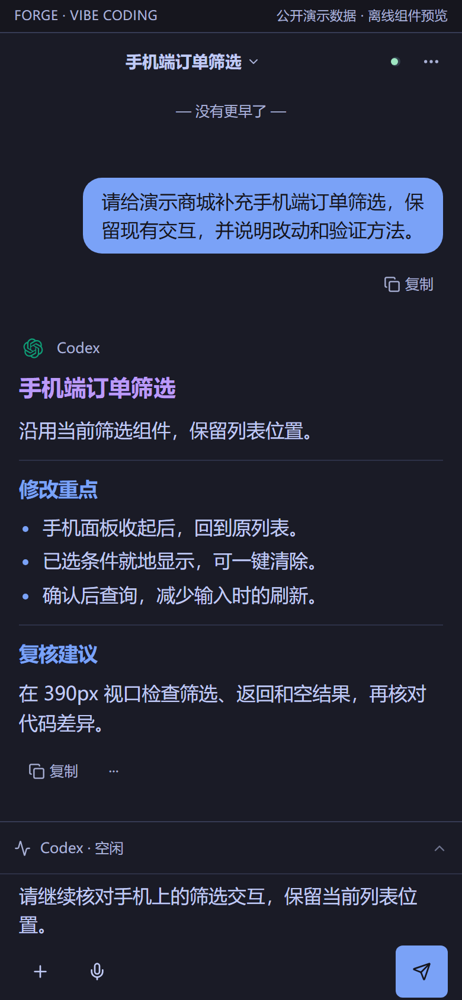
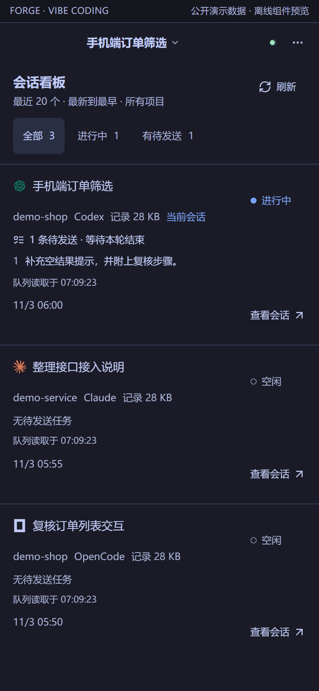
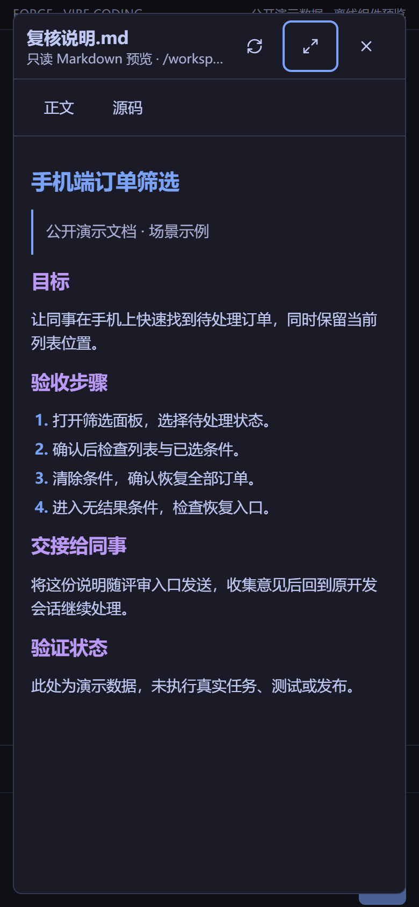
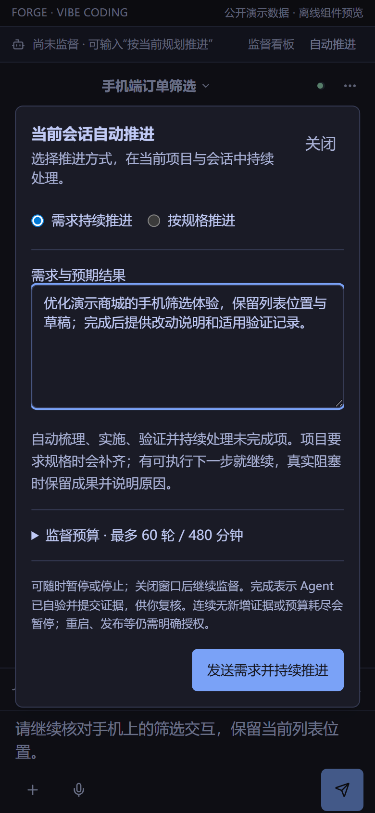
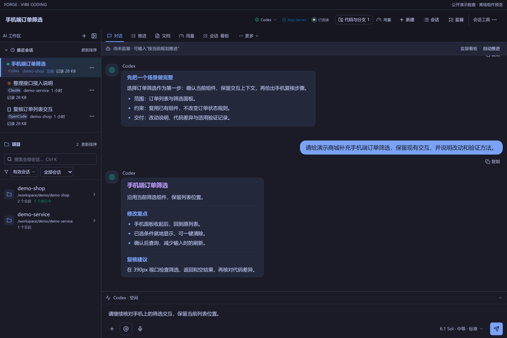
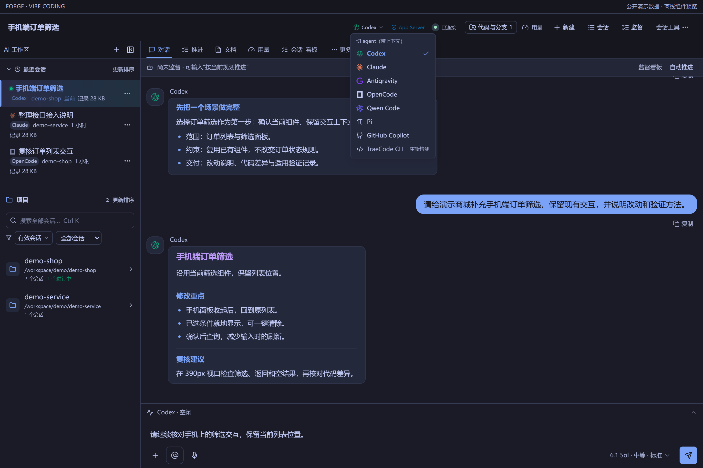
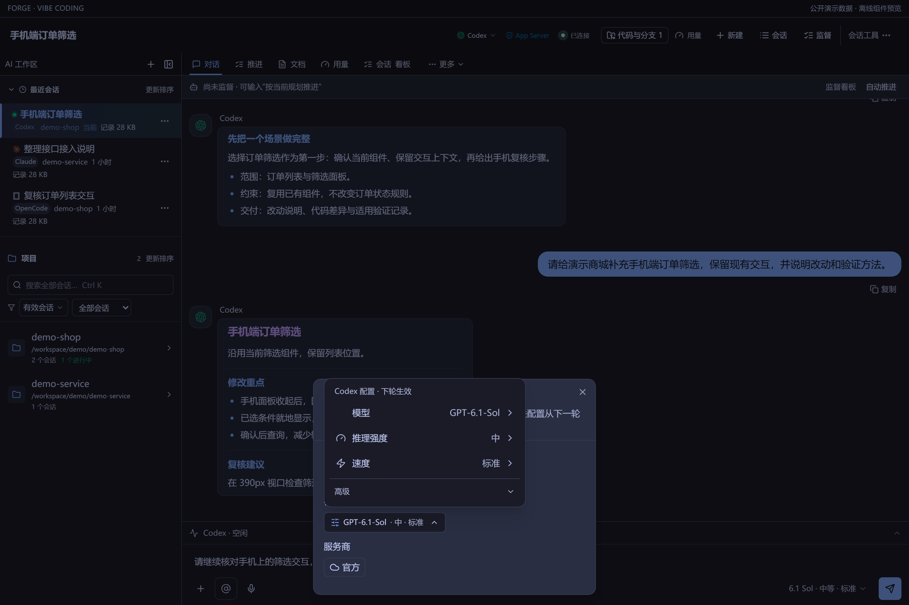
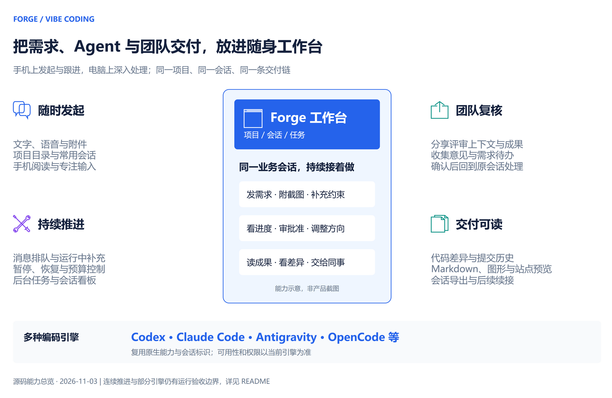
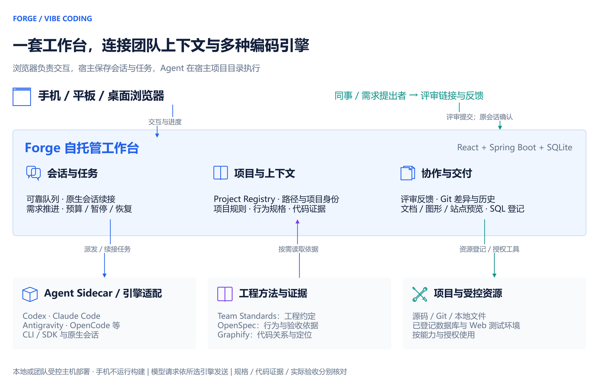

# Forge

**面向移动协作的 AI 开发工作台。**

在手机上提出需求、补充截图、跟进执行、查看成果；回到电脑上继续处理同一个项目和会话。Forge 将 Codex、Claude Code 等编码引擎，与项目上下文、任务推进、团队评审和开发工具整合到一个自托管的浏览器工作台中。

我们的核心是 **Vibe Coding**：让日常开发从“给 Agent 发一句话”，走向“围绕项目持续推进、随时接手、让同事参与复核”。功能来自团队实际开发中的反复使用与改进，重点投入移动端输入与阅读、长任务续接、跨引擎协作和成果交付。

[快速开始](#快速开始) · [移动端效果](#先看看手机上的开发体验) · [与直接使用 Codex 的区别](#与直接使用-codex-有什么区别) · [功能总览](#从日常开发中长出来的能力) · [协作架构](#forge-如何组织一次开发)

## 先看看手机上的开发体验

**离开电脑，也能把需求继续推进。** 打开浏览器，补充一句要求、查看排队任务，或直接读同事需要复核的交付说明。

| 发需求、读回复、继续追问 | 多项目、多引擎，一眼看进度 | 文档就地打开，不用先下载 |
|---|---|---|
|  |  |  |
| 文字和语音入口常驻输入区，回复按内容分层，方便边读边补充。 | 把“正在做什么、下一条要做什么”放在一起，进入原会话接着处理。 | 需求说明和验收步骤可以在当前界面阅读，关闭后回到对话。 |

以上及下方截图由 **真实前端组件＋公开演示数据** 在隔离浏览器中渲染，使用 Tokyo Night 主题；不含私人会话，未连接编码引擎或执行真实任务。移动图为 390×844 视口模拟，不作为手机真机或线上运行验收。点击图片可看原图。[截图来源与更新方式](docs/screenshots/README.md)

### 给出目标，让下一步有据可循



把需求、约束和预期结果写清楚，再选择持续推进或按规格推进。运行有轮次和时间预算，可以暂停、停止与人工接手，减少反复输入“继续”。上图仅展示提交前的配置，不代表已启动或完成任务。

### 电脑上展开处理，手机上随时接续



**项目、最近会话和当前任务放在同一工作区。** 在电脑上查看较长内容、整理项目与会话；切到手机时，继续围绕同一项目和业务会话跟进。

<details>
<summary>展开核心功能截图：会话内切换 Agent、配置模型与权限</summary>

**换一个引擎复核，保留任务背景。** Codex、Claude Code、Antigravity、OpenCode 等入口集中在会话中，可用性以实际安装和授权为准。



**根据任务调整模型、推理强度和速度。** 权限模式与模型参数分别设置；模型相关配置从下一轮开始使用，具体选项以当前引擎为准。



</details>

想体验完整路径，可以先从[快速开始](#快速开始)运行 Forge，在自己的项目里试一条带截图的小需求：**发起 → 跟进 → 看成果 → 让同事复核 → 回原会话继续处理**。

## 与直接使用 Codex 有什么区别？

**Forge 的额外价值，是把编码引擎接入团队日常工作的完整上下文，并持续打磨这条工作流。** 你可以继续使用熟悉的 Codex，同时在同一工作台选择其他引擎，让项目、需求、会话和评审结果保持关联。

Codex 本身已经提供丰富的开发能力，官方也支持手机远程开发、任务排队、代码评审和 worktree；这些不应被写成 Forge 独有功能。Forge 更适合希望自行部署、接入多种编码引擎，并把团队规则、已有系统资源和交付方式统一起来的使用者。[Codex 官方移动开发说明](https://developers.openai.com/blog/mastering-codex-remote-for-engineering) · [官方环境说明](https://learn.chatgpt.com/docs/environments/modes)（2026-11-03 核对）。

| 你关心的问题 | Forge 提供的集成与扩展 |
|---|---|
| 团队使用不同 Agent，如何接着做同一个任务？ | 在业务会话内切换支持的引擎，保留各自原生会话标识并交接增量上下文；不必重建一套项目与需求记录。 |
| 在手机上如何持续跟进开发？ | 围绕触屏输入、语音草稿、附件、长回复阅读、会话切换和待处理任务设计工作台，直接在浏览器访问受控主机上的项目。 |
| 怎么让 AI 理解我们的项目和约束？ | 集成 Project Registry、Team Standards、OpenSpec 与 Graphify，分别提供项目身份、工程约定、行为规格和代码关系；按任务需要读取。 |
| 能否减少反复输入“继续”？ | 提供持久消息队列和有预算的连续推进，保存进度与证据，支持暂停、恢复和人工接手；真实阻塞时停下来。 |
| 同事和需求提出者怎么参与？ | 分享评审上下文、查看成果并收集意见；评审待办由开发者在原会话确认后入队处理，保留意见到执行的联系。 |
| 写完代码后怎么复核和交付？ | 集成 Git 差异与提交历史、文档和图形预览、站点预览、待执行 SQL 登记及会话导出，减少在聊天、文件与工具间来回寻找。 |

如果你只需要单个引擎的原生开发体验，直接使用 Codex 就很合适。如果你需要把多种引擎和团队既有工作方式连接起来，欢迎试用 Forge。

## 从日常开发中长出来的能力



[可编辑 draw.io 功能图](docs/diagrams/Forge移动协作功能总览.drawio)概括下列能力；图中是功能示意，实际界面见上方截图。

### 手机也能成为开发工作台

- **输入不局限于键盘**：文字、截图、文件附件与语音输入；支持的 Codex 听写会先回填草稿，确认后再发送。
- **长回复读得下去**：专注阅读、快速定位最新消息、按需展开工具过程，以及直接预览回复中关联的本地文档和图形。
- **页面预览就在回复里**：完整的 Forge 预览链接进入阅读区后显示真实页面画面，可切换手机/桌面并原位全屏；普通网页链接保留原行为，账号与生产环境确认仍沿用原流程。[验收范围](openspec/changes/embed-chat-page-previews/tasks.md)
- **外观可先试再保存**：会话工具 → 阅读与显示 → 工作台主题，保留经典配色并提供黄油纸、报纸编辑室、荧光终端、极光玻璃；先看聊天场景，再临时试用或保存，可调材质强度。偏好按账号保存在当前浏览器，不跨设备同步；[实际验收范围](openspec/changes/vibecoding-workbench-themes/tasks.md)。
- **任务多了也找得到**：常用工作目录、项目与需求分组、最近会话、会话看板，以及贴边悬浮入口。
- **离开页面后可以续接**：服务端保存会话、队列和任务状态，重新打开后继续跟进；宿主和所选引擎仍需可用。

手机负责指挥、确认和复核，代码读取、命令与构建在运行 Forge 的主机执行。移动访问需要可达的 HTTPS 地址及适当访问控制；可使用已有局域网、受控网络或配置好的 Cloudflare 隧道。语音、证书及浏览器兼容性依设备与配置而定。

### 同一工作台使用多种编码引擎

以 Codex、Claude Code、Antigravity、OpenCode 等引擎为入口，按任务选择模型、服务商档案和可用权限模式。会话内切换时保留原生身份与增量交接，便于先分析、再实现、再换一个视角复核。

仓库还提供 Qwen Code、TraeCode CLI、Pi、GitHub Copilot 的适配；实际可用项以本机安装、授权和运行时引擎目录为准。各引擎对附件、模型目录、权限、流式事件及恢复的支持并不相同。DeepSeek Harness 已有适配与隔离验证，Forge 端到端加载验收仍待完成，详见[引擎任务](openspec/changes/complete-deepseek-harness-engine/tasks.md)。

另有**纯 LLM**控制模式，用于不需要代码工具的讨论；它与 Code Agent 分开保存会话，不因切换获得代码执行权限。

### 从一句需求到可接手的任务

普通开发直接对话即可。需要长时间推进时，可以提交需求与预期结果，设置轮数和时间预算，让后台按进度继续派发；也可以绑定项目已有 OpenSpec 任务推进。运行中可补充消息，按引擎能力选择当前轮引导或排队，必要时暂停和恢复。

完成状态区分“实现完成”“Agent 自验完成”和“实际验收通过”。连续推进不会替你获得发布、重启或数据库写入权限，也不保证任意需求无人值守完成。需求模式的真实模型长任务与运行验收边界见[任务记录](openspec/changes/add-requirement-autopilot/tasks.md)。

### 同事可以围绕成果参与评审

将相关会话内容和成果组织为评审入口，收集需求、意见和附件，再由开发者确认哪些待办需要进入原开发会话。评审参与者不必先操作编码引擎，开发者也能保留问题背景和处理记录。

这里的团队协作聚焦需求沟通、成果复核和开发续接。共享同一个工作目录的并行会话仍需协调变更范围；这不代表多人实时共同编辑或自动解决 Git 冲突。分享范围、有效期及访问能力以评审配置为准，详见[评审设计](openspec/changes/review-confirmed-execution/design.md)。

### 成果能读、能核对、能交接

- **Git**：查看工作区变更、目录树、代码差异和提交历史，围绕当前项目进行分支与提交操作。
- **文档与图形**：在对话内阅读 Markdown、draw.io、SQL 等支持的文件；无需先把所有文件下载到手机。
- **页面预览**：从会话打开站点；需要账号的验证使用资源中心已配置的环境与账号能力，可用范围见[浏览器预览说明](tools/tool-browser-request/README.md)。
- **数据库交接**：登记完整的待审核 SQL 与业务目的，区分代码推断、可用 DDL 和真实数据库证据。登记不等于执行。
- **导出与沉淀**：将会话导出为 PDF 或 Word，保留图片，方便评审和交接。

### 这些能力有实践记录

以下是近期提交中的一部分，每项都对应具体使用问题，而不是仅列一个功能名称：

| 使用中的问题 | 对应改进 |
|---|---|
| 手机阅读和操作空间不足 | [移动阅读与悬浮入口](https://github.com/exception-coder/kai-toolbox/commit/a4b3dec72)、[移动会话控制与队列管理](https://github.com/exception-coder/kai-toolbox/commit/28e87f80f) |
| 手机上想口述需求，先检查文字再发送 | [Codex 原生听写回填草稿](https://github.com/exception-coder/kai-toolbox/commit/c53f6d213) |
| 消息发出后，是否真的排队、续发不够清楚 | [可靠队列与有界完成核对](https://github.com/exception-coder/kai-toolbox/commit/477998f0f) |
| 换设备或恢复原会话时中断工作 | [HTTPS 会话跨客户端恢复修复](https://github.com/exception-coder/kai-toolbox/commit/9f7912d5a) |
| 手机看成果还得找文件、下载、换应用 | [对话内自动展示本地文档与图形](https://github.com/exception-coder/kai-toolbox/commit/48b1da090) |
| 评审意见与后续开发脱节 | [原会话确认评审待办后接入队列](https://github.com/exception-coder/kai-toolbox/commit/21333df54) |

提交记录说明实现经过；具体环境是否已加载、真机兼容性和端到端验收结果仍需分别核对。

## Forge 如何组织一次开发？



[下载可编辑 draw.io 源图](docs/diagrams/Forge团队开发协作架构.drawio) · [AI 编程架构与能力边界](docs/ai-coding-architecture.md)

浏览器是统一入口，Java 宿主保存项目、业务会话、队列和评审记录，Agent Sidecar 适配各引擎的 CLI/SDK。Agent 在选定工作目录中执行；项目规则与规格说明“应该做什么”，Graphify 帮助定位代码关系，实际测试与运行结果说明“做成了什么”。

一条推荐的协作路径：

1. **选项目、发需求**：从准确的项目目录创建会话，发送目标、截图、约束和验收方式。
2. **确认方向、推进实现**：选择引擎和权限模式；普通任务直接对话，长任务按需设置预算与连续推进。
3. **随时跟进和纠偏**：在手机或电脑上查看进度、处理批准、补充要求或暂停任务。
4. **核对真实成果**：看 diff、读文档、打开预览，确认测试和运行证据；将评审入口交给同事。
5. **把反馈接回开发**：确认评审待办，在原会话处理，复核后提交；推送、发布和重启按项目授权执行。

Forge 可运行在自己的电脑或团队受控主机上。源码与运行数据由部署方管理，但模型请求仍可能携带提示词、代码片段或附件发往所选服务商；自托管工作台不等于全部推理离线。

## 快速开始

准备 **Node.js 22.13+、JDK 21、Maven 3.9+、Git**；支持 Windows、macOS 和受维护的 Linux。Python 辅助服务按需安装，日常源码启动不要求 Docker 或 Task。跨平台实机验证范围见[启动指南](scripts/STARTUP.md#平台与验证边界)。

```shell
git clone https://github.com/exception-coder/kai-toolbox.git
cd kai-toolbox
node forge.mjs doctor
node forge.mjs start
```

入口会准备依赖、编译宿主与 Agent Sidecar，并通过 PM2 管理启用的服务。首次运行需要联网下载依赖；以命令实际输出的地址为准，工作台通常为 `https://localhost:5173`。

1. 按部署配置完成登录，为所需编码引擎准备本机安装及授权。建议先在引擎原生客户端完成一次请求。
2. 打开 **AI → Vibe Coding**（`/tools/claude-chat`），选择工作目录、引擎和权限模式。
3. 先试一个容易复核的任务，例如：“阅读这个模块，说明入口和依赖，暂不修改代码”。
4. 再尝试带截图的小改动，检查实际 diff 和验证结果，逐步接入团队规则与资源。

常用运行命令：

```shell
node forge.mjs status
node forge.mjs logs backend
node forge.mjs restart
node forge.mjs stop
```

只有你明确需要重启时才执行 `restart`；Agent 执行重启须遵守[项目授权规则](AGENTS.md#服务重启必须经用户明确确认)，已授权的每日安全更新例外另有明确范围。

## 配置与深入使用

| 需要做什么 | 从这里开始 |
|---|---|
| 工具路径、端口、HTTPS、静态前端、隧道与日志 | [启动与配置指南](scripts/STARTUP.md)；本机配置放 Git 忽略的 `scripts/run-tools.d/` 或 `scripts/run-tools.conf` |
| 登记项目、选择工作目录、初始化工程上下文 | 工作台“项目库”；[项目领域约定](AGENTS.md#project-registry-and-system-init) |
| 理解 Team Standards、OpenSpec、Graphify 与 Agent 分工 | [AI 编程架构](docs/ai-coding-architecture.md)；[产品哲学](docs/product-philosophy.md) |
| 接入数据库、测试应用与账号 | 工作台“AI 交付中心 → 系统资源”；凭据保留在资源管理中，不写入源码或交接记录 |
| 将业务咨询能力接入自己的应用 | [Consult Client SDK](sdk/forge-consult-client/README.md)、[后端分析 API](sdk/forge-consult-client/BACKEND.md) |
| 开发和扩展工具模块 | [项目架构](docs/design/architecture.md)、[仓库开发约定](AGENTS.md) |

技术栈：Java 21 / Spring Boot 3.4 / Maven 多模块，React 19 / Vite 6 / Tailwind v4，SQLite 持久化。默认数据目录为 `${user.home}/.kai-toolbox/`。现有登录、菜单和资源访问控制需按部署环境配置，不能直接当作已通过多租户隔离或互联网安全审计的平台。

Forge 也包含业务咨询、PRD 澄清、文档、媒体和本地开发工具；它们通过模块机制按需扩展。README 聚焦 Vibe Coding，其余能力从工作台及各模块文档进入。

## 一起把 Forge 做得更好

欢迎从一个真实项目、一条可复核的小需求开始。遇到移动端难用的操作、任务恢复中断或团队交接缺口，请在 [Issues](https://github.com/exception-coder/kai-toolbox/issues) 中提供使用场景、复现步骤与期望结果，附上已脱敏的截图或日志。

欢迎贡献编码引擎适配、移动端体验、文档与测试。提交前阅读 [AGENTS.md](AGENTS.md)，让改动保持清晰的项目边界、真实的验证证据和可续接的交付记录。如果 Forge 对你的日常开发有帮助，也欢迎 Star、分享给团队，并带回实践反馈。
