# AI 编程架构套件与协作流程

本文是 Forge、Team Standards、OpenSpec、Graphify 与 Agent 的整体协作架构说明，维护当前流程、职责和边界，也定义工程上下文的六层模型。“架构套件”指这些组件的协作体系，不是另建一个插件或复制各组件的实现文档。

产品与交互决策遵循 [产品哲学](product-philosophy.md)。具体行为以 OpenSpec 为准，调用参数和实现细节回到组件文档；本文维护整体关系，不替代它们。

面向使用者的能力介绍与上手路径见 [Forge README](../README.md)。[移动协作功能总览](diagrams/Forge移动协作功能总览.drawio)与[团队开发协作架构](diagrams/Forge团队开发协作架构.drawio)提供可编辑的概览视图，分别配有[功能预览](diagrams/Forge移动协作功能总览.png)和[架构预览](diagrams/Forge团队开发协作架构.png)；它们概括现有实现，不改变本文的组件职责、上下文权威或交付边界。

## 整体协作图

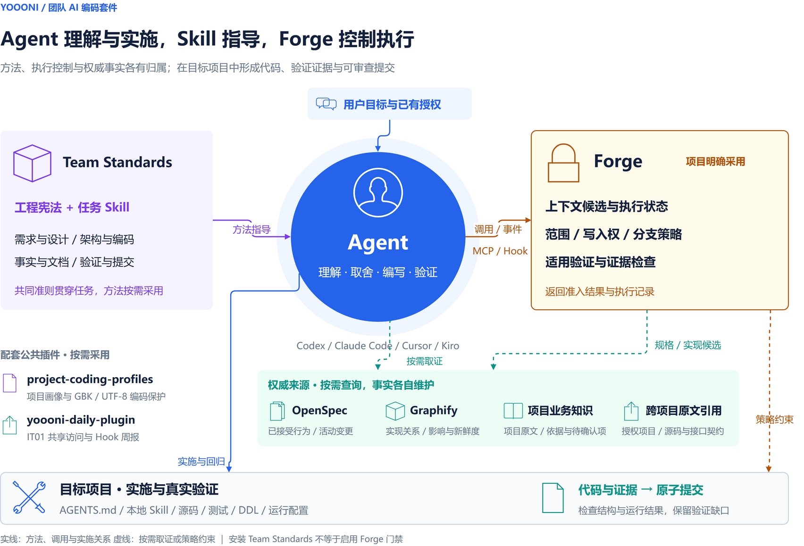

[可编辑 draw.io 源文件](diagrams/ai-coding-architecture.drawio) · [SVG 矢量预览](diagrams/ai-coding-architecture.svg)。源图使用 draw.io 自带 iOS7 Icons，节点、文字、图标和连接器均可编辑；修改后从同一源图重新导出预览。

图中 Agent 是理解、取舍与实施的主体，Team Standards 提供工程宪法与任务方法，Forge 在项目明确采用时提供执行控制，MCP/Hook 承担调用与事件适配。Forge 的候选上下文聚合规格与实现证据；Agent 优先从目标项目的 docs/INDEX.md 与 docs/domain 查领域知识，跨项目问题按已授权的关联项目逐项核查原文与源码。公共知识图谱服务已在源码中退役，业务正文只在所属项目维护，跨项目使用原文引用。各来源保留事实所有权，最终实现与真实验证落在目标项目中。该图表达当前职责关系，不表示所有项目均已接入 Forge，也不将结构检查等同于业务或运行正确。

Team Standards 5.6.2 的项目初始化默认由 Agent 复用已有业务文档，从关键代码补齐主要能力、流程与规则，标注依据和待确认项，并维护一张 draw.io 全景图及同源预览。结构脚本只补入口；后续业务语义变化时原位维护正文与图。该默认行为属于 Skill，Forge 业务咨询与需求分析已在源码中改为从已登记的项目目录读取资料，插件更新同步团队套件并清理旧知识服务注册；目标进程加载与真实咨询验收尚待完成，不能以 Skill 升级或定向测试代替运行验收。

### 项目知识读取与关系查询

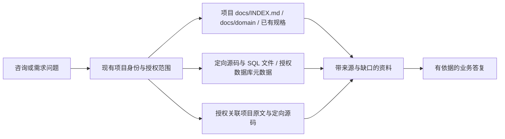

`knowledge_query` 的领域分支每次读取当前授权项目的 Markdown/YAML 原文，不启动旧集中引擎、不使用继承配置或跨项目缓存兜底。图谱是可选证据，关系查询不授予关联项目的访问权。历史文档中的 DDL 不等于当前结构；SQL 文件证据不证明现场数据库已部署对应迁移。需求分析复用项目范围解析端口；常规 schema 文件缺失时明确没有结构证据。插件更新仅同步三个现用套件仓库，并清理 `domain-knowledge` 与 `cross-topology` 的具名 MCP 注册。旧 `source=topology` 查询返回 `RETIRED`，`source=all` 兼容返回项目原文与退役提示。旧图谱状态和链路分析接口返回 410，历史连线与引用可继续读取。项目工作台通过“整理项目知识”调用初始化 skill。实现与运行验收边界见 [退役任务](../openspec/changes/retire-central-topology/tasks.md)。

### Vibe Coding 运行分层与附加能力

[可编辑双页 draw.io](diagrams/ForgeVibeCoding运行架构.drawio) · [运行分层预览](diagrams/ForgeVibeCoding运行架构-运行分层.png) · [附加能力预览](diagrams/ForgeVibeCoding运行架构-附加能力.png)。这是 2026-11-03 的源码视图，补充上图的运行分层，不代表所有功能均已加载到在线进程。预览由 draw.io Desktop 从同一源图导出；图元、文字和连接器保留原生 XML。

运行主线是 **React 工作台 → Java 会话宿主 → Node Sidecar / 引擎适配器 → 原生 Harness / Agent → 目标项目**。Java 管理会话、持久消息队列、准入与 Sidecar 生命周期；Sidecar 统一轮次请求和事件，在各引擎实际支持的范围内适配审批、中断和恢复。模型推理及文件、Shell、联网等工具仍由相应 Harness 提供，Forge 不另造通用执行器。资源中心和项目登记由各自模块维护，SQLite 保存相应业务状态。

手机原生客户端新增 Android WebView 与鸿蒙 ArkWeb 两种工作台载体，加载同一可信 HTTPS 页面；原生桥仅提供有界的系统选择、复制与分享，不改变上述 Harness、队列、资源权限或执行位置。公共地址／包配置和本机签名分离，手机不包含编码运行时。Android 已通过 SDK 编译和内部测试包验签；鸿蒙工程尚缺 SDK／签名，两端均未完成装机验证，不能声称 Mate 60／鸿蒙 7 已可安装，详见[手机客户端](../mobile/README.md)与[实施证据](../openspec/changes/add-forge-mobile-apps/tasks.md)。

| Forge 增加的能力 | 作用与边界 | 实现或规则入口 |
|---|---|---|
| 内置行为引导 | `environment-default` 与 `research-first`；尊重原生环境，重要方案先研究成熟能力。是提示词引导，不是确定性门禁 | [Harness Presets](../sidecar/claude-agent/src/harnessPresets.ts) |
| 会话运行可靠性 | 队列持久化、轮次认领、回执对账与有界恢复；关闭浏览器不等于停止任务，模型自报完成不等于验收通过 | [会话服务](../tools/tool-claude-chat/src/main/java/com/exceptioncoder/toolbox/claudechat/service/ClaudeChatService.java) |
| 模型侧五项产品工具 | 资源发现、资源调用、DDL 核对、页面预览、推进进度上报；继续保留原生工具与用户插件 | [工具与内部兼容边界](../sidecar/claude-agent/src/specResolution/README.md) |
| 工程上下文与执行协作 | 项目登记、初始化、规格与图谱候选证据；已采用的内部门禁维护范围、分支、写入权与验证证据，自动监督提供推进和预算控制 | [执行模块](../sidecar/claude-agent/src/execution/README.md) |
| 工作台体验 | 移动输入、会话控制、主题、Git 引用浏览、语音、预览、评审和执行观测；各引擎能力以实际探测为准 | [引擎注册表](../sidecar/claude-agent/src/engine/engineRegistry.ts)与 [Forge 能力说明](../README.md) |
| 更新与交付协作 | 源码轮询、安全快进、暂存恢复与候选构建；拉取、构建、重启和运行验收分别判定 | [轮询更新任务](../openspec/changes/poll-source-update-safely/tasks.md) |

Team Standards、OpenSpec 与 Graphify 是协作体系的组成部分，不是 Forge 自研替代品：它们分别维护工程方法、行为规格和代码关系。普通任务遵循轻量路径，不强制调用旧的 19 项工程操作。新 Preset 已提交源码，但目标进程加载和真实行为验收仍待完成；五分钟更新轮询的重启策略源码默认为 `manual`，`idle` 自动重启尚未获启用授权。此文档整理不改变这些运行边界，也不触发构建发布或服务重启。

## 维护契约

**改变架构套件的协作契约，必须在同次作业中更新本文；不改变契约，不为凑流程修改本文。** 责任归本次实施 Agent 和变更负责人，不等待用户再次要求更新说明。

以下任一变化触发同步，不以行数、文件数或版本号判断：

- 组件增删、职责转移、权威事实来源或上下文/证据传递方式改变。
- OpenSpec 创建、复用、更新、校验、同步、归档规则改变，或概设/详设触发与维护规则改变。
- Change、Execution、Task、Branch、Commit 的关系或并发、授权、恢复策略改变。
- MCP/Hook 的关键准入、失败处理、验证证据或交付门禁改变。
- 宿主支持范围、部署方式或实际能力边界改变，使现有流程描述不再准确。

普通 Bug 修复、局部样式/措辞调整、保持契约的内部重构，以及不改变套件协作方式的业务模块迭代，不触发本文更新；在现有任务或提交正文说明无架构影响即可，不新增报告。

实施前阅读本文并定位受影响章节；实施期间更新实际职责、分支条件、异常恢复和流程连线；交付前对照代码与验证证据核对正文、流程图、链接和状态。本文只更新受影响部分，不能只刷新日期、堆叠历史日志或生成 v2/v3 副本。行为规格和设计是否更新仍独立按影响判断，不因维护本文而自动生成全套工件。

跨仓变更分别更新实际组件规则/实现与 Forge 的本文，并关联各仓提交。若关联仓库不可访问或运行验收未完成，明确具体缺口，不把待办写成已实现能力。本文记录当前约定和能力边界，精确测试与部署证据保留在对应 Change/验证记录；原有重启、发布授权边界不变。

这是 Agent 的交付约定；当前没有新增能够自动证明文档语义同步的 CI 检查器。

## 前端生产资源与提交后更新

Forge 的受管前端新增可选 static 模式，后端 dev/full 与前端模式分别选择。现有 Java 自动更新继续拥有远端 Git 检查和工作区收敛；Node 前端只观察本地已提交 frontend 树，从不可变归档构建候选并在完整性校验后原子切换资源指针，不读取 dirty 作业发布、不新增 Git 拉取或后端重启链。未启用时仍使用开发前端。

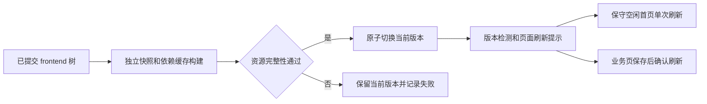

静态服务复用 PM2 前端进程、HTTPS 与固定本机 API/WS/SSE、控制代理。版本化资源保留旧版并采用长期缓存，HTML/版本检查不长期缓存；后台构建不替换运行器代码或重启服务。首次模式切换、配置和运行器生效仍遵守每次重启单独确认，不能以自动构建授权扩大服务重启权限。业务页面不自动刷新，刷新也不等于取消服务端任务。源码、独立验证、日常模式切换、稳定观察与公网真机性能分别记录于[生产前端任务](../openspec/changes/serve-built-frontend/tasks.md)；未切换不能宣称手机首屏已达标。

## 项目原生 CI/CD 交接约定

发布生命周期采用[项目原生 CI/CD 标准](standards/project-native-cicd.md)：项目脚本拥有阶段执行和确定性验收，操作系统或既有管理器托管独立任务。Agent 先发现既有入口，缺失时按模板补建；Forge 只适配触发、任务身份、状态、日志和已有通知。适用产品原则为 AI-01、FEED-01、EVID-01、CTRL-01、IDEM-01，不新增发布菜单、调度引擎或平行事实库。

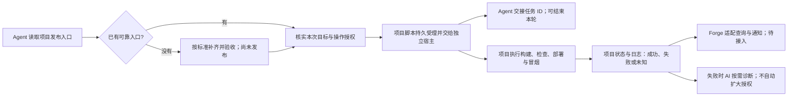

这是新增的目标接入契约与规则入口，**本次没有实现通用发布 API、通知适配或独立 worker**，也没有修改既有监督任务的完成判定。异步受理后结束 AI 回合不代表发布成功，不可自动勾选发布验收任务；后台必须留下可独立查询的终态证据。既有本仓起停与重启后验收流程保持有效，未有可靠独立交接能力时不能套用此路径提前宣称完成。具体项目逐项接入，不把规范或模板计为可运行能力。总体组件关系仍沿用上方整体图，本节流程图表达新增交接边界。

## Team Standards 默认引导边界

Team Standards 以最小复杂度持续交付可靠、可维护的软件。4.14.0 将文件数、行数、分支数等通用阈值改为审阅线索；Agent 根据目标、当前事实和实际风险按需使用 Skill，规格、概设、详设与验证分别按影响维护。小改不自动补齐全模块设计或新增测试套件。

架构路径与注释模式 Hook 默认 `warn`：用于提示核对，不直接证明违规。项目显式设置 `TEAM_STANDARDS_ARCH_BOUNDARY_HOOK=block` 或 `TEAM_STANDARDS_COMMENT_HOOK=block` 时仍按原模式阻断，`off` 仍可关闭。升级不改写项目环境变量、Forge 执行策略、权限、CI 或业务不变量；插件也不保证所有宿主已加载新版本。确定性检查只能证明其覆盖的结果，失败与未验证内容如实交付。

Team Standards 4.11.0 保留 change-readiness 与 delivery-verification 作为方法引导，默认不再注册 SessionStart、规格/就绪检查和交付 Stop 链。普通项目不因安装插件就需要 Forge 绑定、兼容治理记录或机器 PASS；缺失材料允许继续可确认工作，验证失败和未执行仍如实报告。下文 Forge 执行流程适用于项目明确采用 Forge 的场景；项目自有宿主权限、CI 和执行门禁不由插件升级取消。历史适配器及治理 CLI 仅供项目显式接入。

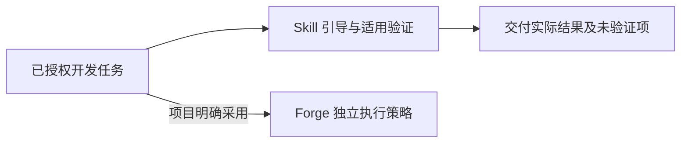

## 项目优先的 OpenSpec 自动分级

Team Standards 4.16.0 提供 `openspec-auto` 标准源，Plan S 项目模板通过独立副本承载执行：一份标准、两种分发方式、项目执行优先。项目有同类 Skill 时使用项目版本，缺失才使用套件补充；套件更新不自动覆盖项目。项目不安装 Team Standards 或 Forge，也能按内置规则运行其已安装的 OpenSpec 与质量门禁。

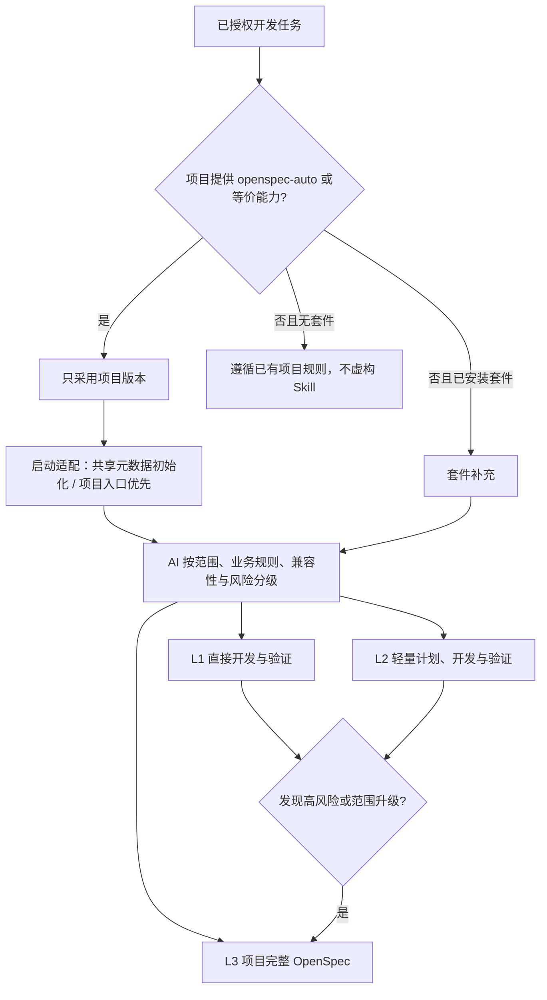

权限边界、数据安全/完整性、破坏性变更等高风险强制 L3；等级决定规格深度，实际风险决定验证范围。项目明确采用的更严格流程仍适用。change-readiness 复用分级判断并补实施依据，不重复分类、初始化或建规格。升级保留原会话、writer、任务和已取得证据，不自动完成任务或归档。Forge 独立执行策略继续负责真实状态与门禁，不能用 L1/L2 绕过已采用的要求。

物理去重由宿主注册/启动适配落实：套件适配器对 Codex 合并有效技能配置并禁用全局重复路径；对 Claude 生成去掉重复 Skill 的会话插件，保留其他能力。AGENTS.md 声明本身不会停用外部入口。组织策略、宿主版本和原生发现路径需核实；Forge 已在 Codex app-server 与 Claude SDK 轮次启动接入套件适配器，不另建分类器：Codex 在同一只读进程内读取实际 skills/list（forceReload=false）与有效配置，仅在本次开发进程停用重复路径；初始化与请求分别计时，不跨账号或跨轮次缓存配置。元数据超时仅在上一进程确认退出后重试一次，取消、配置校验或清理失败不重试；该恢复发生在正式 turn/start 之前，不能用于重放开发任务或跳过项目优先规则；Claude 尊重项目禁用配置，使用临时插件并在轮次结束清理。非原生项目 Skill 路径附加明确读取提示，保留原提示与会话。只读咨询不额外注入插件。源码编译、宿主原生清单及定向回归已通过，**Forge 服务尚未重启加载**；Plan S 发布及业务 OpenSpec 行为验收由接收方实施。普通全局安装不等于已完成物理去重，也不自动恢复既有监督运行。

## 四层工程职责与维护入口

Constitution 管 Agent 如何思考；Skill 管任务如何操作；Forge 管上下文候选、状态、策略和确定性约束；Hook/MCP 连接具体宿主。全局认知原则保持简短，仓库入口仍保留项目命令和约束。Agent 提交语义判断与证据，Forge 不把结构检查当成业务理解或人工批准。

| 层 | 维护内容 | 不承担的内容 |
|---|---|---|
| Constitution | 足够上下文、事实与推断、最小范围、停止探索 | 项目构建命令、OpenSpec 编排、分支与 SQL 策略 |
| Skills | 调查、定位、设计写作、实施和验证方法 | Forge 状态文件、重复策略求值、任务分配器 |
| Forge execution | 会话投影、候选上下文、写入权、分支和验证策略、生命周期决策 | 自动证明控制点正确或业务语义已批准 |
| 已采用的 Hook / CLI | 内部执行身份与事件适配、响应校验与宿主阻断格式 | 新增独立治理状态或复制策略算法 |

现有执行核心从 `sidecar/claude-agent/src/specResolution/` 分离至 `execution/`，保持同一进程和部署单元。`execution/contracts.ts` 定义输入，`context.ts` 聚合规格/Graphify 候选，`session.ts` 提供只读能力与执行投影，`policy.ts` 集中影响映射与分支规则，`service.ts` 管绑定和完成，`lifecycle.ts` 是宿主统一裁决入口，`verification.ts` 运行验证，`guard.ts` 适配原生权限。旧 execution 导入文件仅重导出，旧工具名及 `.forge/spec-resolution` 状态继续兼容。

`specResolution/` 继续负责 Requirement 索引、召回、解析确认和 Delta 校验，execution 单向消费该能力。Graphify、OpenSpec 和领域知识保留事实所有权；本轮没有重建图谱或新增任务数据库。`tools.ts` 仅组合内部 CLI/Hook 的兼容操作。普通模型 SDK/stdio 不再注册这 19 项工程操作，也不引导每个任务调用它们。

### 模型工具与方法去重

普通 Vibe Coding 的 Forge MCP 从 25 项减为 5 项：资源发现与调用、DDL 核对、页面预览、推进进度上报。Team Standards 与项目规则负责需求分级、规格/设计、验证范围和提交方法；OpenSpec/Graphify 保持原事实所有权。`register_pending_sql` 已从 SDK、stdio 与模型权限清单移除，SQL 在回复中直接交付；历史台账与兼容 HTTP API 保留，不迁移或删除数据。移除工具不放宽 DDL 核验、咨询只读及资源写入授权。源码验证与待服务加载状态见 [移除登记工具任务](../openspec/changes/remove-pending-sql-tool/tasks.md)。普通任务不再叠加模型拆分、规格解析确认或执行初始化；保留引擎原生文件/终端能力及用户配置插件，不修改全局 Team Standards。

移出的 13 项执行操作及 5 项规格操作保留为内部 CLI/Hook 兼容接口。已有执行、写入锁、指纹、审计和项目已采用的门禁不被清空或自动关闭。门禁拒绝时原生权限适配给出实际 CLI 路径；兼容维护不能替代用户重启/发布授权。模型中不存在的旧名称不得继续当作 MCP 调用。源码与加载验收分别记录于[工具精简任务](../openspec/changes/trim-vibe-model-tools/tasks.md)。

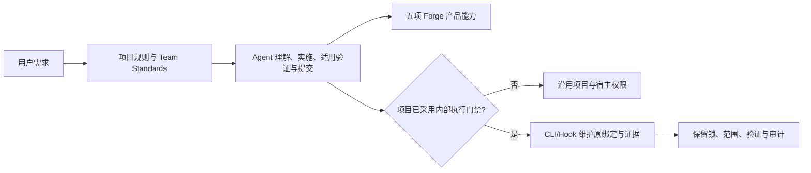

### 已采用执行门禁的内部兼容流程

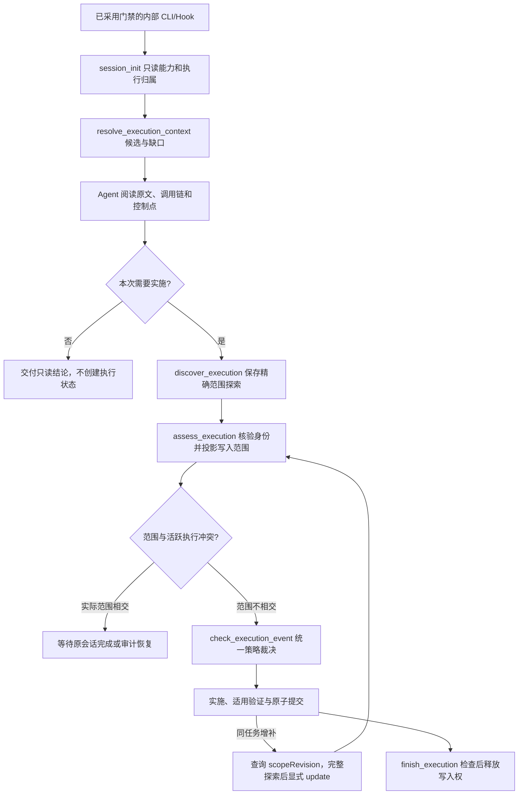

以下旧操作名仅表示内部 CLI/Hook 协议，不是普通模型工具。Agent 判断路径、控制点、修改位置和关键未知是否清楚；已采用的 Forge 门禁另行检查执行范围、分支、写入权和证据，两者不能合并成一个自报 READY。只读查询允许 detached HEAD，不创建 Change、绑定或写入锁。`taskId` 仅作为已有任务的引用，不新建平行 task 清单；OpenSpec/宿主原有任务顺序和生命周期保持权威。执行器按 Maven/包模块及明确的前端功能目录放行不同领域并行编辑；模块内数据库文件归所属模块，前端公共源码按精确文件互斥。具名功能目录和父模块构建配置仍按层级互斥；Sidecar 普通源码、无模块归属脚本和治理文件按精确路径互斥。只有根构建配置与根数据库目录使用全局范围。发现其它 writer 不等于冲突，必须比较投影后的范围。它不自动推断任务依赖、跨会话接管或分配额外分支。

Session 返回配置、可调用性、授权和宿主覆盖的独立字段；未探测的 OpenSpec CLI 与图谱可用性返回 null，图谱新鲜度由具体查询核验。`BOUND` 不是验证通过，`CURRENT` 仅表示验证输入未变。`HOST_DEPENDENT` 明确表示没有由该查询证明宿主已执行强制检查。

### 适配与迁移边界

Forge 安装器的 runtime protocol v2 由插件 `hooks/forge/client.js` 消费；`SessionStart` 调用 `session_init`，写前/提交前/Stop 由 `check_execution_event` 返回 `allowed/code/enforcement/legacyGovernanceRequired`。Stop 只检查，不结束任务。v2 Hook 不读取 Forge 私有执行 JSON；原生权限适配也调用同一裁决入口。v1 私有文件读取集中保留在 `hooks/forge/legacy-v1.js`，仅支持历史运行时，不扩建策略。

自动监督面板提供开发者控制的**项目编码门禁**，默认启用，同一真实项目目录的全部会话共享。唯一记录 `.forge/execution-control.json` 独立于执行存储锁，由会话访问受控的 HTTP API 原子更新并保存版本、操作者、原因及历史，不提供模型修改门禁的 MCP 工具。关闭后 Sidecar 在读取 writer 前放行编码准入，执行治理工具返回 `GOVERNANCE_DISABLED`/`skipped`；不修改旧执行、不扩大登记范围、不将跳过标记为 PASS。原子保存失败或版本冲突可从面板刷新核对，已启动的命令不因开关自动取消。

Java 自动监督的规格严格预检与后续治理阶段同时服从此开关。关闭时按实际未完成开发 task 继续，开发项结束返回未验证的 `DEVELOPER_HANDOFF`，进入所选下一项或停止待开发者验收，不自动归档或勾选人工事项。已有暂停需手动恢复；任务事实、预算、资源访问、生产与重启授权保持独立。重新开启恢复原检查，关闭期间的改动仍可能需要增补范围和重新验证。以下写入准入与强制验证流程均以门禁启用为前提。新代码本地实现与首次加载验收分别记录于[项目控制任务](../openspec/changes/project-developer-control/tasks.md)。

遗留写入会话无法恢复且不满足自动完成回收时，Forge 提供只读 `inspect_execution_writer` 与显式 `abort_execution`。查询返回全部活跃执行；只有单个执行时保留兼容的 `writer` 字段。中止按 executionId 复核原会话、分支、HEAD 和该执行范围，在原记录留下具名原因及状态，只释放目标模块写入绑定；不把中止当作完成、验证或提交。此入口不改变 Hook 的普通 Stop 语义。

项目编码门禁启用时，绑定执行的拒绝始终 block；未绑定旧规格流程保留 warn/block 配置。v2 连接失败时绑定未知，默认失败关闭；显式 failure=warn 或 off 不提供故障阻断保证。协议不匹配要求升级，不静默选择另一套治理。Delta 执行暂时继续要求旧设计/审阅证据检查，这属于兼容验证，尚未迁移为 Forge 原生设计内容检查器。历史绑定与 PASS 不自动升级。兼容治理入口通过 Forge `session_init` 获取当前真实写入执行，以项目、真实会话及 change 选择设计准备与绑定记录；仅同 change 可复用旧单会话记录，跨 change 不覆盖、不继承 PASS。Agent 在自动推进切换后核对三者身份，按证据更新当前计划并修复绑定，设计检查通过后续跑；工具不替 Agent 决定设计内容或认领不明归属改动。

以上描述源码协议；插件安装、新会话加载、宿主事件触发和运行服务更新分别验收。无 SessionStart 接线时通过 Agent 主动调用启动入口。任意 Shell 副作用仍需要宿主权限/沙箱覆盖。本轮不新增夜间整合、默认 block 或自动重启。

## 组件职责与权威位置

| 组件 | 职责 | 权威内容与边界 |
|---|---|---|
| Team Standards | 指导影响判定、规格与设计写作、验证和原子提交；提供薄 Hook | 通用方法归套件 Skill；不复制 Forge 检索和门禁算法 |
| Forge | 模型侧提供五项产品能力；内部兼容接口维护已采用的执行范围、分支与验证证据 | 具体协议见[执行与规格解析模块](../sidecar/claude-agent/src/specResolution/README.md)；不以机器 PASS 代替业务审阅 |
| OpenSpec | 保存正式行为规格及活动变更，校验、同步和归档 | `openspec/specs` 是已接受行为；活动 Change 保存目标增量 |
| Graphify | 快速定位实现、调用和关联证据，报告新鲜度 | 代码事实不是业务批准，未命中不等于不存在既有能力 |
| Agent | 阅读原文、理解业务、审阅映射，编写规格/设计、实施和提交 | 具名 Agent 判断不能冒充人工批准；实质业务歧义需要解决 |

## LLM、脚本与人工的判定边界

**LLM 负责理解语义并提出具名判断，脚本负责按固定规则执行、核验证据和阻断，人工负责业务歧义与明确要求的授权。** “Forge 判定”不是每一步都调用模型：Forge 同时包含确定性执行器和可选的模型辅助解析。下文“脚本”也包括 MCP 服务代码、Hook、CLI 和测试程序。

LLM 分为两处：宿主 Agent 阅读 Team Standards 后理解需求、审阅源码并写文档；Forge 解析模型辅助拆分需求与映射候选规格。后者的模型输出仍需结构与引用检查，不能代替宿主 Agent 审阅，也不能冒充人工批准。Team Standards 的 Skill 是给 Agent 的方法指导，只有接入的 Hook 才执行程序检查。

| 环节 | LLM 判断或产出 | 脚本判定或执行 | 仍需注意的边界 |
|---|---|---|---|
| 探索既有规格与 Change | Agent 提供检索词、范围，阅读候选并判断是否匹配 | `discover_execution` 索引正式规格、列出活跃 Change、召回候选并保存摘要 | 没有命中不能证明需要新建能力；匹配 Change 由 Agent 审阅 |
| Graphify 探索 | Agent 解释调用关系与业务含义；图谱语义提取在启用时使用 LLM | AST 提取、图遍历、关联召回和选中来源哈希检查由程序执行 | Graphify 不是全部由 LLM 生成；来源新鲜不证明全图完整或业务正确 |
| 需求拆分与规格映射 | 解析模型辅助拆分、分类、推荐目标或草稿；Agent 最终确认 | 校验结构化结果、逐字引用与目标，保存 `confirm_spec_resolution` 记录 | 自动草稿和模型置信度均不是业务批准；模型失败保留候选与告警 |
| 是否更新 OpenSpec | Agent 判定 `behavior` 为 `preserved / changed / unknown` 并给出依据 | `assess_execution` 固定映射为 `NO_SPEC_CHANGE / DELTA_REQUIRED / NEEDS_EVIDENCE`；未知则阻断 | 脚本不独立推断业务是否变化；引用存在不证明推理成立 |
| 是否更新概设、详设 | Agent 判定 `design` 为 `none / detail / architecture`，选择受影响文件 | `detail` 要求绑定详设；`architecture` 要求绑定概设与详设；提交前检查适用文件更新 | 文件变化不证明设计质量；大改动不等于无条件补全全部文档 |
| 验证范围 | Agent 判断影响类别，选择有实际断言的测试及输入文件 | 固定推导必需类别：始终有回归；API/权限加 API，SQL/迁移加 SQL，UI 加 UI，行为变化加规格，设计变化加设计 | 类别来自 Agent 输入；误判或漏报影响，脚本不保证自动发现 |
| 分支与任务顺序 | Agent 理解任务依赖、拆分原子任务；额外分支由宿主明确分配 | 绑定当前分支；模块范围互斥、不同模块可并行编辑，已接入入口阻断违规分支操作 | 没有自动依赖调度或并行分支分配器；共享 Git 暂存区须按执行隔离提交，不覆盖任意 Shell 绕行 |
| 陈旧写入权恢复 | Agent 不判断其它会话是否存活，也不删除状态文件 | Forge 仅在同分支、验证当前且通过、已有提交、执行与 Change 范围干净时原子回收并保留审计 | 超时、会话不可见不构成完成证据；无法证明完成时提供核验快照后的显式中止入口，保留原记录和文件 |
| 编写规格与设计 | Agent 按 Skill 编写、审阅 Requirement、Scenario、概设和详设 | OpenSpec 严格校验结构；Forge 检查确认记录、Delta 绑定与版本 | 格式合法不证明需求完整，需处理真实业务歧义 |
| 测试与提交门禁 | Agent 编写测试断言、解释失败并修复，审阅提交原子性 | 真正运行测试命令，检查退出状态、必需类别、内容指纹、范围及暂存一致性 | PASS 只覆盖实际执行的检查；程序退出成功不证明断言充分或已部署新版 |
| 结束与归档 | Agent 判断交付范围和生命周期条件，按授权调用工具 | `finish_execution` 检查提交与范围状态并释放写入权；OpenSpec 工具执行同步/归档 | `finish_execution` 不自动提交或归档，也不代表人工验收 |
| 架构说明同步 | Agent 判断本次是否改变协作契约，并更新受影响正文与图 | 可检查链接、Markdown 和 Mermaid 语法 | 当前没有自动证明架构说明语义同步的 CI |

自动监督轮次由 Runtime 注入无 Docker 标记与无容器验证指引。Sidecar 的 Claude SDK 权限回调拒绝显式 Docker/WSL 命令，Forge `run_execution_verification` 拒绝直接容器命令；Agent 应选择 H2、静态检查或现成独立测试库，并保留未运行的目标库验收项。Codex App Server 在完全访问模式下的命令不都经过审批回调，脚本内间接启动容器也不能仅靠命令文本识别；项目常规测试需将容器用例设为显式启用，不能把提示词或此过滤器声称为系统级进程隔离。

业务意图不清、规格与实际业务冲突时由用户或业务负责人澄清；项目要求的重启、发布等授权按适用规则取得。普通分类无需逐次人工审批。记录中的 `AGENT_REVIEWED` 明确表示 Agent 审阅，不能解读为 `HUMAN_APPROVED`。

例如“修复搜索条件”：LLM 对照既有 Scenario 判断是否恢复原行为；若提交 `preserved + none + api`，脚本就不要求 Delta 或设计更新，但要求回归与 API 检查。若实际新增了搜索语义却被误判为 `preserved`，脚本不会仅凭该标签纠正业务判断，仍依赖原文审阅和有效测试。

## 保存工作目录与项目目录清单

Vibe Coding 的“保存当前目录”和常用目录点选会先核验路径与排除策略，再调用项目库公开能力登记工作区根；目录设置和该操作共用动态配置及首次统一算法，保留已有根，避免第二份扫描配置。ProjectDirectorySource 继续提供根，ProjectCatalog 继续拥有目录库存，项目下拉仅消费原清单投影。旧快捷入口在用户再次保存或选用时补登记，不在只读加载时自动修改全局配置。

登记与常用偏好不是跨存储事务：登记失败不写偏好，登记成功而偏好保存失败必须说明部分成功并允许重试。成功后刷新工作区并更新原新建草稿的工作区与 cwd；移除常用入口不删除文件或撤销工作区，工作区仍从项目库目录设置管理。全局配置的既有权限与并发语义保持，不通过写数据库绕过配置 API。

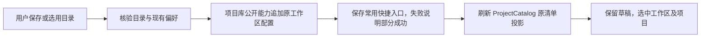

## 按需整理测试资产

Kai 从 Yoooni 提交 `9dfa0377` 接入独立 [test-asset-cleanup Skill](../.agents/skills/workflow/test-asset-cleanup/SKILL.md)，只在历史测试审计、重复夹具整理或失效测试清理时使用。保留本项目 AGENTS 的验证、权限与提交约定，缺失的中台基础 Skill 链接改为本项目规则；不引入中台项目配置或整套平台模板，不给普通需求增加全仓审计。

手动整理先核对被测行为、已有覆盖与发现入口，再做一小批定向验证；不能按数量删用例、降低断言或跳过失败。可选执行器默认只读预览，只有明确 `--run` 才会从基线建立独立工作树并产出候选提交，默认不推送、不合并、不部署、不注册调度。基线优先使用当前分支上游，不等于当前未提交工作区；启动前须确认基线已有 Skill。Kai 当前仅验证手动小批及预览，后台 Codex 写入、候选生成与定时执行均未验收，不通过关闭安全限制获得成功。

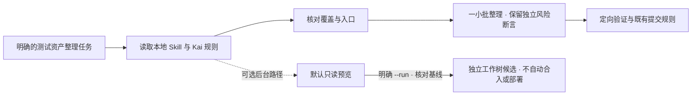

## 会话配置复制与引擎连接

普通“复制会话配置”是 Forge 元数据操作，不是模型任务。登录态 HTTP 命令按用户与持久请求编号，原子提交独立配置副本、Auth 链路、附加目录及回执；不依赖 Sidecar 就绪，不复制原生历史、队列或 Agent 写入权。浏览器先保存编号，再发请求，网络失败最多核对三次，刷新后仍可复用原结果。副本已删除明确告知，不按原编号自动重建；未提交事务不能报告创建成功。

拿到回执后沿用原切会话流程连接引擎，连接失败不改变“配置已创建”的事实，也不改变源任务状态。切换 Auth 的 WebSocket/Ready 显式交接仍保留独立语义，不因普通复制的改造自动升级为可靠交付。源码、回归与待运行项见[复制验证](../openspec/changes/fix-session-duplication-feedback/validation.md)；未授权重启与未实机验证均不能声称生效。

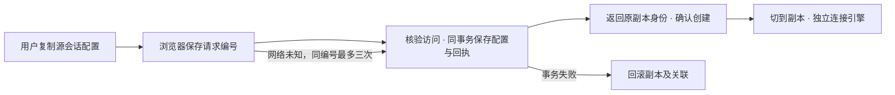

### DeepSeek Harness 本地引擎

VibeCoding 复用已有 EngineAdapterRegistry 与 DeepSeek SDK Adapter，不建立独立 Agent 平台。SDK 和自带 dsh 精确锁定同一发布版本；协议身份、可启动性和模型鉴权是不同证据。凭据优先使用显式运行环境，其次是后端唯一的全局官方 DeepSeek 服务商档案，再回退本机 Harness 原生凭据。后端不扫描用户私人档案、不把第三方网关 Key 交给官方端点；仅在受信 Sidecar 内部环境传递，引擎启动前清除其他凭据。Key 不回传浏览器、不写入项目，原有 `.dsh` Web profile 不改写。

运行数据落入 Forge 独立 Harness Home；Forge sessionId 与 cwd 的绑定只保存身份信息，重建进程或停止后明确恢复原生历史并核对实际目录。恢复缺失、损坏或项目不符时不创建替代会话。原生额外审批与提问复用 Forge Permissions，未知请求和取消不能构成允许。首版只开放普通开发会话的原生 workspace-write 权限，不支持咨询、评审、演示或其他权限模式；图片仍显式拒绝。SDK 推送原生步骤与工具事件，当前发布包不保证逐 Token 文本输出；只有原生 `turn/end` 的 completed 加 idle 才报告成功，停止请求与失败不能被 idle 掩盖。实现、隔离模型验证及待加载状态见[Harness 任务](../openspec/changes/complete-deepseek-harness-engine/tasks.md)。

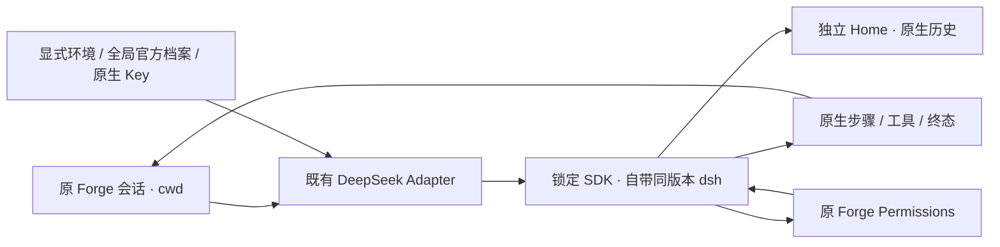

### Codex 普通听写与双向通话

VibeCoding 普通麦克风输入按引擎选择转写。Codex 由已授权会话的服务端 codexHome 决定账号，App Server 只提供认证读取，Sidecar 适配桌面客户端独立的官方听写流；不调用线程、轮次或 realtime API，不改变原会话任务/工具权限。其他引擎和咨询、工作助理保留已有语音服务。浏览器将录音转换成有界 PCM，仅最终文本回填原草稿，必须人工发送；切换对象释放媒体并阻止迟到结果回填。凭据不进入浏览器，音频不持久化，失败不自动换账号、改用 Whisper 或重放。桌面听写是内部协议，握手成功与真实音频验收、制品激活分别记录于[语音任务](../openspec/changes/add-code-native-voice/tasks.md)。

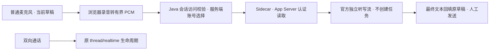

## 从需求到交付

面向用户的重磅更新在同次交付中登记业务咨询[更新小纸条](../frontend/src/features/fore-consult/data/upgradeNotes.ts)，由本次实施Agent维护日期、变化、用法与范围，保留历史。未部署或未验收须明确标注；小纸条是用户沟通内容，不作为规格、验证或部署事实源，不增加自动发布和服务重启授权。具体登记规范见[咨询说明](../tools/tool-fore-consult/README.md#更新小纸条登记)，普通内部重构和无感小修复无需登记。

普通需求按上方方法去重流程实施。下图仅说明已采用内部执行门禁的兼容生命周期，不是每个任务默认再走一套模型工具。关键判断标明执行主体：LLM 提交语义分类，脚本依据分类路由并执行门禁；混合节点的具体职责见上表。

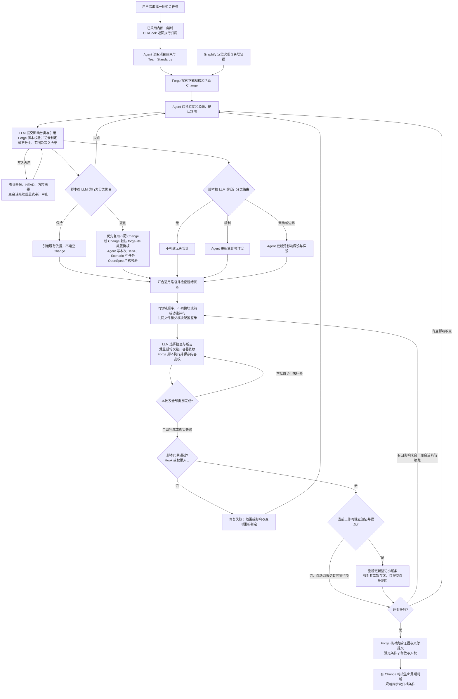

规格和设计是独立判定路径，汇合表示核对全部适用结果，不表示两份文档必须同时生成。并行写入仅在声明范围不冲突时放行；执行中扩大到共同文件须重新探索并绑定范围。会话自动监督先返回当前项目的活动 OpenSpec 目录候选，再由只读推荐 Skill 对最近会话文本与规格摘要做语义排序；用户可选择多个 change。Forge 在启动前逐项复核任务、规格修订与严格校验，以一个持久批次在原会话内按所选顺序推进；当前项完成适用验收后重新检查并进入下一项；归档仅在显式授权时执行，默认保留活动规格，不把未归档描述为已归档或已上线。推荐只提供候选，不替代 OpenSpec 事实或用户确认。推进仍绑定原开发会话；“推进”页签汇总可访问的运行，点击后进入所属会话详情读取原运行状态和 OpenSpec tasks。自动监督在外部验证环境暂不可用时保留未验证项，继续当前 OpenSpec task 内独立可执行的步骤；只有没有可执行工作或确需用户决策才进入 WAITING_USER。同一活动轮次无待决策时，明确下一步与未完成项的 CONTINUE 可恢复监督；其他冲突返回 409 及版本化 resume 入口。APPLY 阶段同一 task 跨多轮未勾选只计为同任务连续轮次，新的进展证据上报后重新计数，不单凭该指标暂停；总轮次和时间预算仍限制自动执行。Sidecar 写入冲突报告占用会话、执行 ID 与范围，旧绑定须审计后解除，不自动授予写入权；未执行的目标数据库验证不能算通过。Windows 下自动监督不通过启动 Docker、WSL 或 Testcontainers 重试来消耗轮次；可先用 H2 MySQL 模式做兼容性检查，证据必须标明实际引擎，目标库要求仍留待回归。

当前会话已绑定的规格从持久监督运行及批次关系读取；项目目录与文本/AI 推荐只作为绑定候选，不构成会话关联事实。未绑定时应明确显示未绑定，不能将全项目候选标作“当前会话相关”。

暂停状态仍接收当前会话的成果报告，保留暂停原因、执行绑定、轮次及预算；完成数只按绑定规格的只读快照更新。读取失败时保留旧计数并在报告中显式提示，不丢弃成果、不据 Agent 自述判定完成。报告不派发消息、不切换任务或归档；恢复时仍走原版本化预检。

会话还提供 **需求持续推进**（`REQUIREMENT_BEST_EFFORT`），与上述按规格推进（`OPEN_SPEC_STRICT`）并存；新建界面默认需求模式；API 未指定策略且没有 change 时使用需求模式，携带 change 的旧调用仍为严格模式。已有运行不自动改模式或恢复。用户在原弹框输入需求与预期结果，无须先选 change。Runtime 复用原会话、持久运行和私有续跑队列，专用指令交接目标、预算及上一轮报告；项目要求规格或 writer 时仍需补齐，不安装或激活严格 OpenSpec Continuous Execution Skill，不扩大写入和运行授权。底层兼容身份 `goal-<runId>` 与证据摘要不代表 OpenSpec change/revision，不读规格适配器或投影到严格任务证据。

需求模式在成功且安全收口后消费结构化报告：有下一步继续；完成须有摘要、非空验证证据和显式空未完成项。界面显示“Agent 自验完成 · 待复核”，保留报告，不声称 OpenSpec 严格验收通过，不自动归档。证据是 Agent 提交的声明，Runtime 的字段和停滞检查不能独立证明实际执行或完整正确性。失败终态、FAILED 报告、需求模式无报告或连续无新增证据进入完成核对：原会话先核对代码、提交和报告，只补剩余事项，最多派发三次；第三次仍失败或不明才挂起。核对次数与运行版本一起落入原步骤表，重启与重复终态不清零；有效进展或完成结束这组核对，摘要换措辞不算新证据。默认 60 轮、8 小时，可在现有限制内调整；手动接管、真实阻塞、权限、重启确认和原预算恢复入口仍有效。实现与本地验证记录在[需求模式任务](../openspec/changes/add-requirement-autopilot/tasks.md)；本次默认与恢复调整见[减负任务](../openspec/changes/lighten-autopilot-flow/tasks.md)，新版尚未激活、真实模型连续运行未验收。

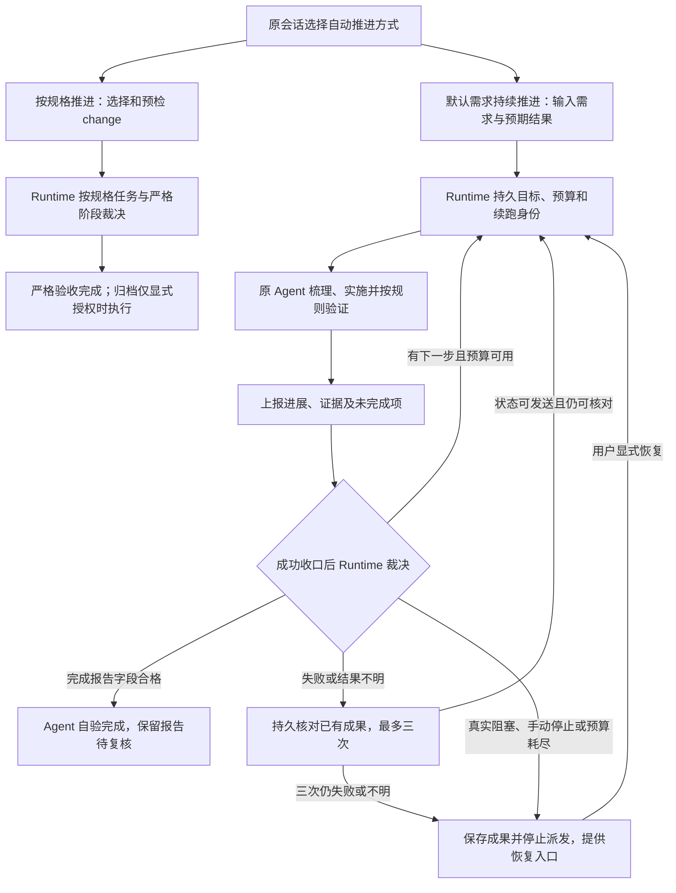

自动监督预算耗尽后暂停继续派发；用户通过携带当前版本的“重置预算并继续”操作恢复，清除旧内部续跑消息、重置轮次和时限，并保留任务、批次及重置审计。已完成或停止的运行不能通过此操作复活。源码与本地验证不等于运行服务已加载，运行验收单列。

OpenSpec 新 Change 默认使用项目级 `forge-lite`，由 `openspec/config.yaml` 的 `schema` 选择，实际大纲、依赖和生成指令位于 [schema 与模板](../openspec/schemas/forge-lite/README.md)。强制产物保留 proposal、specs、tasks 及其原身份；design 不在强制 artifact 链中。日常需求只描述本次目标、行为增量与少量可验收任务；不改变行为的小修复无需创建空 Change，无规格变化但确需跟踪的文档、工具或重构可显式声明 `skip_specs: true`。涉及架构/跨模块契约、新依赖或重要数据模型、安全/性能/迁移风险、关键技术歧义，以及产品哲学要求的 UI/AI 工作流时，Agent 仍须补充当前 Change 的简短 design 或引用准确且适用的现有设计；apply 指令要求读取已有 design。该条件由 Agent 根据实际影响判定，CLI 不自动证明设计是否充分。

已有 Change 保留原 schema；切换默认前为缺少元数据的旧活动 Change 补齐 `schema: spec-driven`，不改写其正文与任务。旧版及严格流程仍按各自 schema 获取产物、任务和校验结果，不从四个固定文档名称推断就绪。`config.yaml` 的 context/rules 是附加生成规则，不能替代实际模板或依赖；项目 fork 随 Git 共享，CLI 升级及 `openspec update` 不自动覆盖它。生成材料与必要验收仍按影响控制，不能以精简章节、场景或测试配额绕过权限、数据安全和主流程正确性。配置和结构校验均不证明实现或运行正确。

自动推进复用引擎维护的原会话上下文，不另起模型监督会话。引擎确认加载执行 Skill 后，Runtime 每轮仅交接任务身份、规格修订、阶段、预算和必要执行提示；未确认加载时保留完整规则兜底。Agent 在首次进入、任务切换、修订变化、上下文缺失及报告完成时核对规格，不在每个工具步骤重读全部历史；输入和指纹仍有效的证据可复用，变更后的受影响检查和必要交付门禁仍须执行。可回退且可本地验证的推荐方案先作为默认实现，保留切换点，人工核实与生产任务在整个批次开发后统一交接。本轮实现已通过本地测试后仍须单列部署与运行验收状态。

自动监督绑定与 Sidecar 写入执行绑定各有职责：前者确定需求或 OpenSpec 目标、阶段和预算，Runtime 从持久记录向 Agent 注入 run ID 与对应模式上下文；按规格模式包含 change、阶段和 task，需求模式只交接目标和报告。后者通过 `session_init` 查看写入权，`execution: null` 只表示尚未取得该权，Agent 应对获授权目标继续完成范围探索和影响评估，项目要求 change 时使用真实规格，取得许可后才写入，无法取得时上报具体阻塞而不是宣称监督任务不存在。Team Standards 指导 Agent 写正文；Forge 校验身份、范围、版本、文件更新和执行证据，不能自动证明正文质量。完整模板与方法留在套件，本文不复制模板。

自动监督的后端定时巡检与前端待发送队列分工不同：巡检只恢复仍为 `ACTIVE` 的持久运行，普通用户消息队列在异常终态保持不发送。普通异常统一进入最多三次的完成核对，而非重新执行原任务。次数在派发前持久化，巡检确认引擎空闲、预算及写入门禁后才排队；无法确认运行状态时仍等待或按原故障边界暂停。已收口的 FAILED 内部控制项可移交监督，未知派发与普通用户项保持原样，不把它们当作已完成；用户主动停止、真实阻塞和必要授权优先暂停。前端是否打开不影响巡检。

前置工具结果同时进入 Runtime：同一 run/generation/change/revision/phase/task 内，Forge execution/change readiness 两个不同调用连续返回相同失败指纹时，持久转为 `WAITING_USER`（任务投影为 BLOCKED），清除内部续跑队列并展示修复后恢复指引。整轮成功不能覆盖该阻塞；旧调度结果派发前复核状态。成功校验、不同失败、任务上下文变化或用户恢复的新 generation 重新计数，回放不重复计数，暂态容量/限流/网络错误不走此阻塞规则。首个失败仅在有界内存中计数，重启后重新累计，已持久阻塞保持；当前引擎轮次可收口，不强杀工具。原始失败保留在工具记录，未自动修复实际配置；本次后端变更尚待加载与真实会话验收。

多规格批次中，当前规格若有未解决的前置或待决策项，Agent 先完成该规格内独立且获授权的步骤并记录具体问题。成功终态后 Runtime 才在用户已确认的其余规格中复核 revision、待执行任务和 strict validation；有合格项时持久暂留当前问题并调整未完成项顺序，全部暂留时进入待处理，不循环派发。暂留不代表完成，也不扩大 Sidecar 写入范围；原会话推进详情展示问题，收到回复并恢复后重新检查该规格。此规则不自动推断跨规格依赖或代替用户对高风险事项的授权。

自动推进以用户确认的 OpenSpec 目标为完成边界，不把普通开发的“一 task 一提交”当作中断条件。共享前置未提交或单个任务暂不能形成独立验证快照时，Agent 记录依赖、归属与缺失证据，继续已授权且可独立执行的工作；只有确无可执行步骤或需要用户决策才待回复。可验证的交付节点再提交自身范围，Sidecar 的文件归属、共享暂存区和提交证据门禁继续生效，不借自动监督合并别的执行文件或宣称未验证任务完成。用户回复后在原运行复核并继续，不产生第二套目标。

迁移类开发 task 未明确要求目标库实测时，可用 H2 MySQL 模式实际执行、静态清单、定向应用测试及装配证据判定开发完成；MySQL/MariaDB 真实迁移和升级路径仍记录为发布前未执行项。Forge 的每轮指令不把缺少 Docker 或目标库变成开发停止条件，也不把 H2 证据描述成目标库通过。明确写入目标库验收的规格必须由负责人修订或按原条件执行。

自动推进统一按“编码与本地基准测试 → 开发任务收口 → 生产验证清单 → 人工生产操作”执行。生产部署、真实数据库迁移及升级、生产调度启用等不作为普通开发任务的隐含完成条件；本地实现和适用回归通过后可收口开发 task，并将生产项集中记录为最终未执行清单，由人工在开发完成后执行。旧规格若混写两类条件，须先维护任务边界，不能直接勾选缺少本地实现的任务，也不能将开发完成称为生产验收或发布完成。Runtime 仍以 OpenSpec 勾选状态推进，不自动执行生产操作。

本地 Java 回归通过项目 `.forge/verify.yml` 的 `maven-test` 场景接入现有质量门禁：Application 注入真实项目路径，Runtime SPI 固定执行指定模块的 Maven test，并核验本次唯一标识的 Surefire 报告。每个指定模块必须有实际执行且无失败的测试；退出失败、超时、全部跳过或旧报告不通过。配置选择本地用例，目标库兼容性测试单列人工验收。该能力执行项目构建，不是进程沙箱；新后端监督接入仍待加载与运行验收。

OpenSpec 的纯人工生产任务在描述首部标记 `[MANUAL_PRODUCTION]`。Runtime 保留其未完成事实，派发时跳过该项并继续后续开发 task；开发项完成后执行本地质量门禁和严格规格校验。单项返回 `PRODUCTION_HANDOFF_REQUIRED` 时，批次调度先持久暂留人工清单，对其余已绑定规格重新读取和严格预检，包括先前因依赖而暂留的规格；有开发任务则继续，旧阻塞由 Agent 重新核对，写入仍须授权。只有批次已无可执行开发项才统一进入人工交接，不自动勾选或归档。未标记任务仍按原顺序执行；混合任务须先拆分，不能根据自然语言或环境失败自动把本地实现归为人工任务。必要实现采用探索后推荐的可逆默认方案，通过配置或策略接口保留切换点，并将假设、证据、风险与后续确认记录在当前规格；确认前不把来源事实说成已验证。

自动推进遇到待确认的来源事实或业务细节时，Agent 先寻找保守、可回退、可本地测试的实现，在当前 OpenSpec change 的设计或验证记录中登记问题、证据、暂定假设、方案取舍、风险、测试和回访条件，并将人工核实拆为以 `[MANUAL_CONFIRMATION]` 开头的未勾选 task。本地代码与测试满足开发验收后可勾选开发项；Runtime 跳过人工核实项继续派发，并在本地门禁通过后与人工生产任务一并交接，不自动勾选或归档。来源键长期稳定、历史流完整等属性不能由本地测试推定为真实来源事实。没有安全可逆路径、需要不可逆操作或缺少必要授权时才提前待回复。Forge 负责持久监督和任务裁决，Sidecar 仍负责文件写入权；暂定决策既不扩大权限，也不替代 OpenSpec 开发验收或最终生产验收。

自动监督巡检对 Sidecar 不可达或快照过期按运行与 generation 独立计数：连续至少 60 秒、至少三次不可确认才持久化暂停，清除自动续跑消息并展示具体原因和恢复入口；正常忙碌或恢复一致状态清零，不把思考时间作为故障。用户恢复后重新统计并复核运行态，保留原任务、用户消息和引擎进程。内存故障窗口在后端重启后重建，持久暂停状态不丢失。Codex stdin 的同步及异步错误由适配器归入请求/轮次失败并清理 pending，正常收轮后的晚到错误不改变结果，已接收轮次不因传输故障重放。

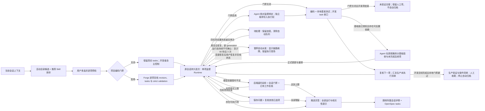

| 情况 | 规格 | 概设/详设 |
|---|---|---|
| 修复搜索条件，使其恢复已约定行为 | 引用原规则，通常无需 Delta | 机制未变则无需更新 |
| 增加淘汰状态或改变权限规则 | 更新既有能力的相关 Requirement/Scenario | 只更新受影响流程、状态与实现章节 |
| 外部行为不变的内部架构重构 | 有行为保持证据时可以无需 Delta | 更新受影响架构与机制 |

执行器以任务声明的源码、设计文件和 Change 路径计算写入范围：源码取最近的模块构建清单目录；设计文档按具体文件、OpenSpec 按 Change 或正式 capability 归属。普通无归属文件、Sidecar 普通源码与治理文件按精确路径；只有根构建配置与根 db/database/migration(s)/schema 目录视为全局共享。不同模块可同时持有写入权；同模块和相同共享目标互斥。共享 Git HEAD 与暂存区不提供物理隔离，Agent 必须按本执行文件暂存，提交前门禁拒绝混入其它执行文件；提交后只以本执行范围内的提交证明完成，不能用其它模块推动的 HEAD 代替。新旧写入索引读取时，先核验项目、执行、会话及存在的会话绑定，再以原 discovery 完整文件、设计路径及 change 重新投影范围；持久化 scopes 仅是缓存。缺失或不一致记录明确拒绝并保留现场，不清锁。旧指针与新索引不重复登记；原验证、历史及精确文件许可保持不变，新增文件仍需重新探索和评估。同任务增补使用 assess_execution.update 指定原执行及 expectedRevision；保留原完整范围、身份和基线，检查新范围冲突，保存原评估与验证审计后使旧验证失效，不能降低门禁。精确重试幂等，过期版本拒绝；更新前启动的验证不得回写新范围。此能力仍由宿主 Hook 覆盖范围约束，不自动生成并行分支或推断完整任务依赖。绑定 execution 后，已接入的入口阻断不就绪操作；未绑定的旧规格流程保留兼容模式。Hook 和权限回调仅覆盖宿主实际触发的工具，不能视为任意 Shell 的安全沙箱。代码实现、插件安装、宿主触发与运行版本验收分别成立；具体未完成项见[本次变更任务](../openspec/changes/parallel-module-execution/tasks.md)。

## 目录速览

```text
kai-toolbox/
├── AGENTS.md                     项目规则与上下文总入口
├── CLAUDE.md                     Claude 适配器
├── docs/                         人工维护的长期知识
│   ├── README.md                 面向人的阅读入口
│   ├── INDEX.md                  面向 Agent 的权威文档索引
│   └── ai-coding-architecture.md 本规范
├── openspec/                     已接受行为与活动变更
│   ├── AGENTS.md                 OpenSpec 局部规则
│   └── config.yaml               项目上下文与 artifact 规则
├── graphify-out/                 Graphify 生成的当前代码事实
├── .codex/skills/                项目特有能力 按需创建
└── source and tests              最终实现与验证证据
```

不提前创建空的项目 Skill、领域、设计、决策或规格目录。`graphify-out/` 由 Graphify 生成，不由初始化脚本伪造。

---

## 六层职责模型

| 层级 | 权威内容 | 典型落位 | 回答的问题 |
|---|---|---|---|
| L1 Instructions | 强制规则与任务路由 | `AGENTS.md`、适配器 | Agent 必须遵守什么 |
| L2 Knowledge | 人工确认的知识与理由 | `docs/` | 为什么这样设计 |
| L3 Specification | 已接受行为与计划变更 | OpenSpec | 系统应该怎样工作或变化 |
| L4 Code Intelligence | 当前模块、调用、依赖与影响 | Graphify | 代码现在怎样连接 |
| L5 Agent Capability | 可复用执行方法 | 项目内 Skills 和脚本 | Agent 怎样完成任务 |
| L6 Implementation | 源码、测试与运行配置 | 项目工程目录 | 精确实现是什么 |

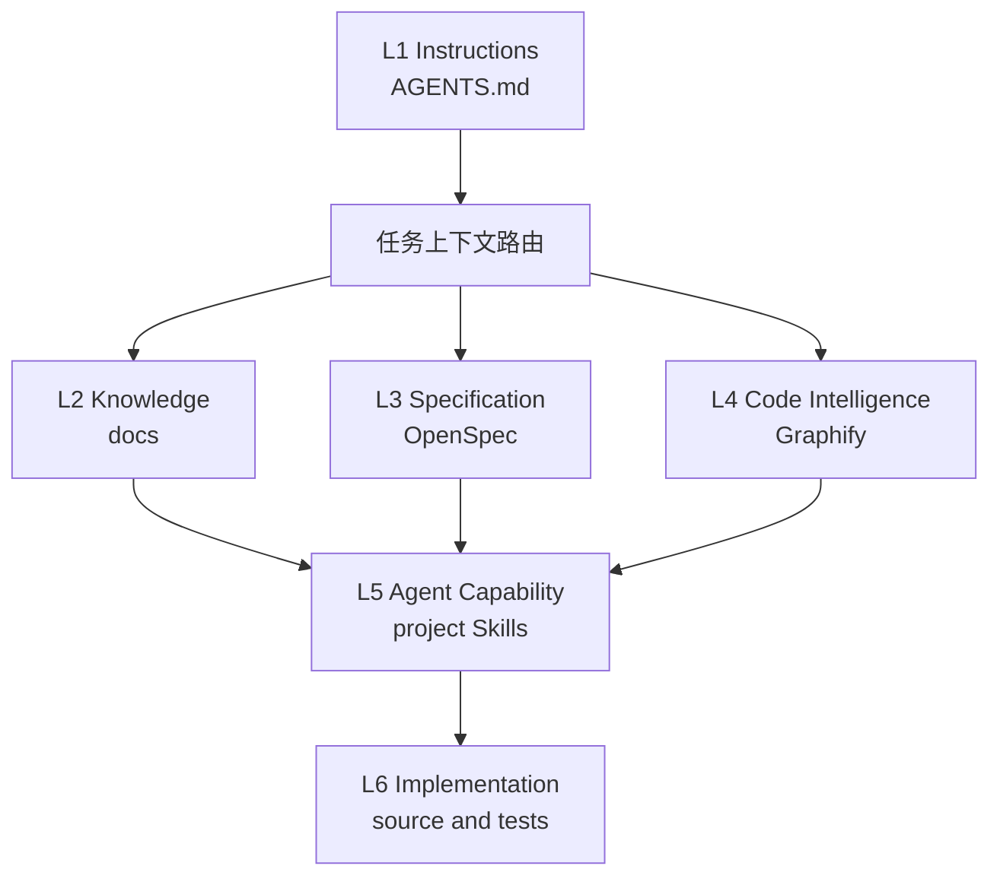

---

## 默认检索路由

1. 先读根或最近作用域的 `AGENTS.md`。
2. 架构原因、术语、开发约定和 ADR 经 `docs/INDEX.md` 定位。
3. 当前接受行为和活动变更分别查询 `openspec/specs/` 与 `openspec/changes/`。
4. 陌生代码入口、调用链和影响范围先查询新鲜 Graphify。
5. 最后只读取任务相关源码、测试、DDL、数据库或运行证据。

不得把宽泛全仓扫描作为陌生项目的默认第一步。Graphify 查询只用于缩小范围，编辑前仍须核对目标源码。

### 多引擎适配边界

Forge Built-in Harness Preset 在普通交互式开发会话中默认提供 `environment-default` 与 `research-first`，通过既有 SessionManager → developerInstructions → 引擎适配器通道传递，不创建独立搜索服务、研究 Agent 或命令审查器。受限工具策略（disabled/review-only/consult-readonly）、演示会话以及显式自定义 systemPrompt 的专用任务保留自己的上下文契约，不注入本组预设。提示词是行为引导，不是保证模型每次遵循的确定性门禁。

`environment-default`：Shell 执行环境由原生 Harness 拥有。Forge 只能确认宿主 OS、会话目录与引擎身份，不能根据 Windows 或已安装的 PowerShell 推定实际 Shell 类型/版本；模型优先消费原生环境与工具定义，缺失时保留未知。失败提醒不拦截命令、不回写工具结果、不新增恢复轮次。按用户本次要求由实验默认关闭改为默认启用，兼容旧环境变量 `FORGE_SHELL_GUIDANCE_EXPERIMENT=0` 显式退出；未配置或值为 1 时启用。此前 A/B 尚未完成，不能据此声称错误率已下降。

`research-first`：技术选型、架构设计、新版本/API、重要工程方案与是否自建能力，先了解项目，再通过已有且获准的原生联网工具核实官方能力和成熟实践，评价版本、来源及项目适用性后给最小充分方案。普通 Bug、文案/样式与已确认方案的继续开发不强制重复检索；证据充分即停止。用户要求离线、工具缺失或失败时如实说明未核验范围，以本地证据继续；不擅自启用联网、不伪造来源、不将缓存等同实时验证、不外传源码和敏感数据，网页内容只作不可信证据。无数据库、管理页面或额外模型调用。源码、目标进程加载和三场景行为验收分别记录于 [Preset 任务](../openspec/changes/add-research-first-preset/tasks.md)。

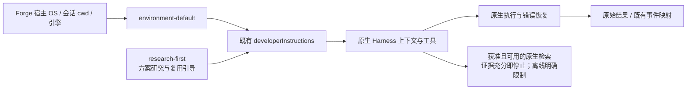

Forge 把 Claude Code、Codex、Qwen Code、TraeCode CLI、Antigravity 与 OpenCode 视为独立 Agent 引擎。Sidecar 的统一引擎契约只承载会话、轮次、权限、中断、运行态、模型目录和公开事件；供应商 SDK/CLI 的请求、消息与错误必须停留在各自适配器内，不能泄漏到 Java 或浏览器。Codex 使用官方 `@openai/codex-sdk`，Qwen Code 使用官方 `@qwen-code/sdk` 并从当前认证的 SDK 控制请求读取模型目录；TraeCode CLI 2.0 通过 `exec --json` 适配，不以二进制版本号 `2.x` 判断产品代际（本机官方安装包报告 `0.206.1`），而按 CLI 命令能力和登录状态探测后开放选择；后续轮次仅通过 `exec resume <SESSION_ID>` 显式恢复所属 Forge 会话。CLI 已安装但尚未登录，JSONL 实流和工具事件仍待登录后的运行验收。QwenWork 桌面端不属于 Qwen Code SDK 的可控制范围，其登录与模型列表不能代替 Qwen Code 的认证和可用模型。切换引擎时清理旧引擎模型 ID；DashScope 模型 API 也不能被描述成完整 Agent 引擎。

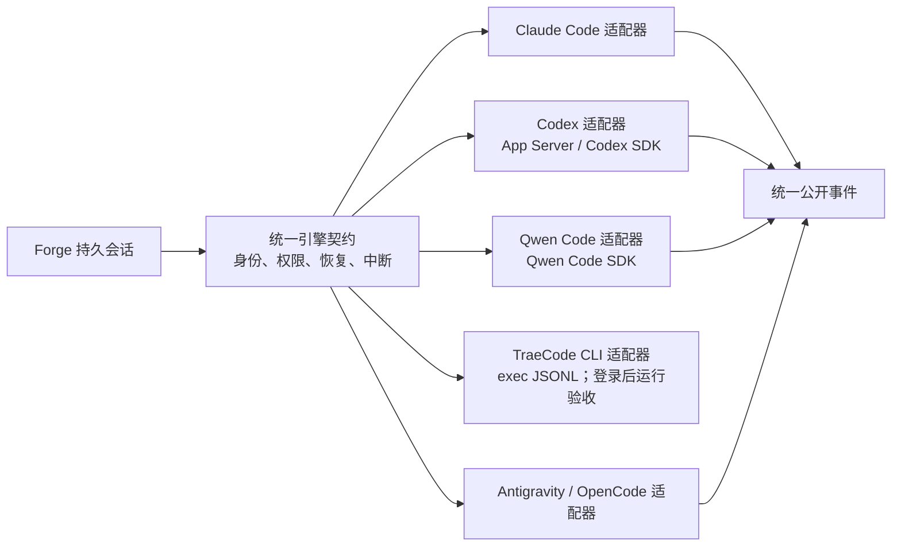

原生会话身份按 Forge 会话持久化并幂等恢复；恢复失败必须显式报出供应商与恢复动作，不得静默换用另一引擎。权限映射采用 Forge 策略下界，供应商默认值不能扩大当前会话权限。SDK 版本发现与升级复用统一管理入口，但源码升级、产物替换、进程重启和运行验收仍是分开的证据与授权阶段。

Codex 的主轮次、预测恢复和只需身份的分叉采用轻量历史响应，保留原生上下文；主执行器的启动、恢复及分叉有独立的 120 秒预算，普通 RPC 保留 20 秒，预测仍受原可选任务整体上限约束。大上下文选定的 HTTPS 配置在安全回退时交接给本轮独立 SDK 客户端，不进入共享客户端缓存；首次实际选择时通过 Codex 官方配置接口在所属授权目录幂等登记兼容 provider，使 ChatGPT/Codex 可独立恢复持久化了该 provider ID 的线程，登记失败则不选择悬空 provider。未取得选择时先进行相同预检。完成后读取最新分叉锚点及终态对账使用倒序单轮且不加载消息内容。日志区分恢复耗时、配置选择和实际上游错误，不把累计文件大小当成网络请求大小，也不把缺失关闭码猜成 1009。已执行或退出未确认的轮次继续禁止自动重放。设计、专项验证与待运行验收见[大上下文传输](../openspec/changes/avoid-oversized-codex-websocket-retries/design.md)。本次恢复与回退扩展尚未加载到服务。

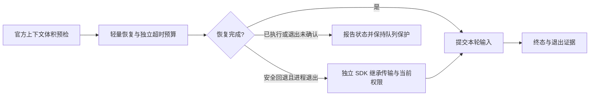

中断请求不等于执行已退出。Sidecar 保持轮次锁直到执行返回，取消会撤销尚未发布的成功结果并暂停队列。Codex 适配器在协议清理期间保留受管进程的重试入口，只操作自己持有的进程；writer barrier 仍防止未确认退出时重叠执行。30 秒未确认时，Sidecar 重试中断并报告等待，浏览器恢复终止重试入口，保留运行状态和队列；不以固定时长伪造完成。其他适配器沿用各自取消能力，重试入口不保证未知引擎一定能强制退出。本次取消恢复改动已进入源码，尚待目标版本加载与真实会话验收。

Codex SDK 回退和第三方网关执行也遵守同一退出门禁：收到 `turn.completed/turn.failed` 后结束 SDK 迭代，不再等待无界的管道 EOF。适配层通过 Node 子进程诊断与异步调用上下文记录本轮实际创建的 SDK 原生进程；SDK 清除事件监听后仍复核其退出属性，确认退出后才处理残留读管道和发布结果。停止重试按会话寻找该进程，不查找或终止其他客户端。缺少进程退出证据时暂停队列，新轮次继续受原有 writer barrier 保护。本次补齐已通过隔离进程回归，未加载到运行服务。

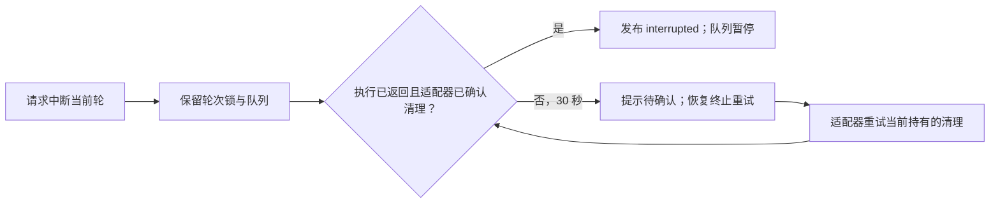

界面历史读取与上述原生引擎恢复分别成立。普通 Codex 对话通过可选字节游标，从尾部有界完整轮次窗口先返回最近页，沿用原会话权限、CODEX_HOME 和消息解析；累计用量仍独立建立完整索引，不阻塞最近页。游标与字节消息身份支持追加及进程重建，替换/截断后要求更新最近页。超长单轮或缺少完整轮次标记的旧格式提供用户主动选择的兼容读取，旧整数游标、其他引擎与公开评审保留原逻辑，评审不能用普通字节游标绕过继承边界。本次只改变界面证据读取，不改变模型上下文或上游 WSS 传输；代码和只读样本验证不代表服务已加载。范围与验证见[首屏恢复](../openspec/changes/accelerate-vibe-coding-entry/design.md)。

```mermaid
flowchart LR
    VIEW["当前授权会话"] --> TAIL["字节快照游标<br/>尾部完整轮次窗口"]
    TAIL --> PAGE["最近消息先呈现<br/>用户向前分页"]
    VIEW --> TOTAL["独立累计用量索引"]
    TAIL -->|文件变化| RETRY["保留内容并重取最近页"]
    TAIL -->|窗口无法确认轮次| COMPAT["用户选择完整历史兼容读取"]
```

### 轻量工作助理

工作助理通过独立的用户逻辑会话组织周报和资源登记，不接管 Vibe Coding 当前会话。Shell 只保留轻量唤醒入口，机器人工作区按需加载。平台保存随包发布的 Skill 全文与 SHA-256；新任务绑定快照，执行前核验并显式交接给 AgentOneShotRunner。每轮复用现有 Claude/Codex 一次性执行器，携带有界可见历史与平台采集证据，不声称复制或持续恢复原生 thread，也不以能力目录存在代替加载证据。引擎账号是否可用仍需目标版本运行验证。

默认入口只保留项目选择与自然语言输入，模型/引擎放在高级设置。周报先通过禁用工具的一次性规划提取明确作者和受控周期，平台按上海日历计算相对日期、复核项目及规模后采集事实，创建会话并幂等发送首轮；缺失条件追问，不猜作者。规划有并发和 90 秒等待上限，未创建会话前不执行 Git。资源粘贴为独立确定性登记流程：在本地按有限环境/类型词表和连接语法识别已标注信息，缺失或歧义只提示补充；密码与原文不进入模型或会话，确认后才写入原资源中心。SSH 主机通过 common 的 HostEnrollmentGateway 路由到原主机模块；密码/passphrase 仓储使用 ResourceCredentialCipher，复用现有 OpsCredentialCipher 的密钥和兼容读取，禁止 tool-to-tool 依赖。资源中心分组和主机 tag 不被当成 Project Registry 绑定。本次自然语言入口及主机扩展待目标版本加载与真实账号/手机验收。

```mermaid
flowchart LR
    ENTRY["机器人首页 / 常驻助理坞"] --> SESSION["当前用户助理会话<br/>Skill 快照 + 有界历史"]
    CATALOG["ProjectCatalog + ProjectAccess"] --> GIT["受控 Git 只读采集"]
    ENTRY --> PLAN["自然需求提取作者与周期<br/>平台校验与上海日历"]
    PLAN --> GIT
    GIT --> SESSION
    SESSION --> RUNNER["原 AgentOneShotRunner<br/>Claude / Codex · 工具关闭"]
    RUNNER --> RESULT["任务状态与正文结果<br/>复制 / Markdown 下载"]
    ENTRY --> SECURE["安全自然输入<br/>本地解析 · 缺项补充 · 预览确认"]
    SECURE --> OPS["原资源中心<br/>管理员校验 · 幂等回执 · 凭据加密"]
    OPS --> HOSTS["HostEnrollmentGateway<br/>原主机模块 · 共享凭据封装端口"]
```

普通助理消息不获得终端、宿主写入或数据库执行能力。周报事实由平台校验项目、作者、日期与采集规模后提供；资源元数据与真实连通性分开。密码经专用登记入口直接进入 ops，不交给模型或会话；原仓储加密新写入、兼容历史读取，密钥与 SQLite 分开保管。登记生产资源不改变原执行环境门禁。会话所有者、资源管理员与菜单权限在服务端检查，不以 UI 显隐或 Skill 代替。

任务请求按会话与请求 ID 幂等，同会话运行互斥，关闭窗口不取消；显式取消后迟到结果不得覆盖终态。服务重启后未完成任务标为中断失败，不自动重放。语音首期复用转写回填，媒体离开工作区即释放；不新增常听唤醒或实时通话。源码实现、独立验证、制品启动及运行验收分别记录于 [工作助理任务](../openspec/changes/work-assistants/tasks.md)，未部署状态不代表真实引擎或账号验证通过。

### 业务咨询延续新建

PC 默认恢复本人最近咨询；显式“延续新建”创建独立咨询，服务端核验来源归属，仅采集最近六轮可见问答（每列1000字符、JSON合计至多16000字符），冻结来源引用与有界摘录。旧回答是可能过期的不可信背景，不是已验证事实、系统指令或原生线程迁移。附件二进制、工具日志、旧提示词、数据库权限不迁移；当前流程、资源绑定和源码范围重新装配。元数据保存在现有证据快照的 continuation 字段，纠正系统时保留。目标UUID与请求指纹支持刷新重试，原咨询不自动归档。实现和待运行验收见[任务](../openspec/changes/consult-desktop-conversation/tasks.md)。

```mermaid
flowchart LR
    OldConsult["本人旧咨询"] --> VisibleExcerpt["有界可见问答与来源引用"]
    VisibleExcerpt --> NewConsultation["独立新咨询：仅作背景"]
    CurrentWorkflow["当前发布流程与资源权限"] --> NewConsultation
    NewConsultation --> VerifyAgain["按当前范围重新核实事实"]
```

### 跨 Auth 会话交接

Codex Auth 目录切换会创建目标 Auth 下的新 thread，不把源 Auth 的原生 thread、隐藏模型状态或工具状态视为可迁移资产。Forge 使用版本化结构交接包承接连续性，交接包只陈述来源明确的事实，并保留有界可见对话作为兜底。

```mermaid
flowchart LR
    SOURCE["源 Auth 会话<br/>可见对话与运行配置"] --> PACKAGE["forge.codex-auth-handoff/v1<br/>目标、状态、规格线索、缺口"]
    PACKAGE --> TARGET["目标 Auth 新 thread"]
    TARGET --> RULES["重读 L1 指令"]
    RULES --> SPEC["核验 L3 OpenSpec<br/>complete / partial / missing / stale / conflict"]
    SPEC --> FACTS["核验 L2/L4/L6<br/>文档、Graphify、源码、Git、测试"]
    FACTS --> CONTINUE["恢复任务并继续"]
```

交接遵循以下边界：

- OpenSpec 是行为权威，但“存在规格路径”不等于规格完整或已实现；交接时未知的完整度必须标为 `UNKNOWN`，仅从会话识别到路径时标为 `PARTIAL_UNVERIFIED`。
- 目标会话按默认检索路由重新读取同一工作目录，明确记录 `missing / partial / stale / conflict`，不得用旧会话摘要覆盖仓库和运行事实。
- 模型、Skills、Plugins、MCP 与账号权限属于目标 Auth 能力，必须重新加载；工作目录与 Forge 运行配置可以复制。
- 原生同 Auth `thread/fork` 与跨 Auth 结构交接是两种语义；跨 Auth 不声称复制 thread。即使后续使用 App Server 后台注入，仍须保留交接 schema、来源和核验状态。
- 同一逻辑会话链路以持久化 `lineage_id + auth_key` 作为幂等身份：目标 Auth 已有关联会话时直接恢复，仅首次进入该 Auth 时创建 thread 并注入交接包；关联会话确已删除或失效后才允许重建。

### 业务咨询的统一运行账号

上述跨 Auth 开发会话关联保持原规则。业务咨询以稳定咨询 ID 和平台聊天 ID 为边界，复用已有默认模型/账号设置；`ConsultationRuntimePolicy` 公共端口由咨询模块提供业务归属、只读状态及当前策略版本，聊天执行器在实际轮次准入时读取，并再次确认版本。排队项在释放时解析；已运行轮次保持其账号快照，普通用户不选择账号。受控检测通过后才保存默认策略，审计只记录操作者、前后账号、版本及检测结果，不记录凭据。

```mermaid
flowchart LR
    CONSULT["原咨询与用户归属"] --> POLICY["实际准入：默认账号与版本"]
    POLICY --> CHECK["账号和工作区检测；确认版本"]
    CHECK --> SAME["同账号：原生线程继续"]
    CHECK --> NEW["换账号：新原生线程段"]
    NEW --> JOURNAL["平台持久问答＋原文索引＋近期问答"]
    JOURNAL --> READ["签名工具分页读取原文、SQL与原附件"]
    READ --> TURN["本轮固定账号；结果写回原咨询"]
    SAME --> TURN
    CHECK --> FAIL["失败保留原记录与草稿；不回退或重放问题"]
```

原生线程段归聊天模块保存，包含账号、原生句柄和资料索引边界；索引边界不表示模型已读完所有原文。切回曾用账号也建立新段并接续当前历史，原段保留，不恢复过期线程。旧咨询保留服务端保存的模型，缺失时才采用平台默认模型；目标账号不支持时明确拒绝，不静默改模型。平台历史日志由服务端从原生磁盘历史、已保存咨询问答及新轮次事件生成，不依赖浏览器加载范围，也不要求旧账号还能登录。较长历史交接采用结构化原文索引与近期摘录，索引不冒充模型完整摘要；`read_consult_history` 按原咨询签名分页提供完整 SQL、用户修正、工具依据及生成文件引用。原图片可经原附件归属校验返回图片内容；生成文件目录与预览仍按原咨询身份读取。缺失历史、附件失效及不可读取文件必须说明缺口。

历史资料作为用户数据交接，不能变成系统/开发指令；资源工具继续核验既有咨询范围和当前绑定状态。会话锁、持久请求 ID、轮次及原生段身份共同防止并发重复创建、发送和迟到结果覆盖；发送结果未知不自动重放。其他工具及 Vibe Coding 的账号规则不受影响。实现与专项证据见[统一咨询账号任务](../openspec/changes/unify-consult-runtime-account/tasks.md)；当前尚待服务加载及真实多账号、多用户运行验收。

---

## 计划评审与原会话交接

评审空间持有来源开发会话身份及独立的讨论、需求修订和公开链接。AI 只提供候选，评审员主动加入清单并确认具体正文版本；旧需求不推定已确认，编辑和显式合并后重新确认。AI 不自动覆盖、删除或重建人工清单。唯一交付入口先核对服务器确定的目标项目及已确认摘要，后端拒绝未确认或过期版本；以所选需求身份与版本组成稳定交付键，同事务保存原文、提交人、时间、目标项目和来源会话待办。匿名分享访问者如实标明未登录，不伪造实名。后续修改作为新版本交付，不静默覆盖旧快照。

评审提交不构成编码授权。原会话有权限的用户可以调整、选择及合并待办，显式“确认并执行”后才在同一事务保存队列原文和任务关联；原会话忙碌时顺序等待，空闲时仍须权威执行准入。日常小改沿用比例适当的规划，不因交接强制扩展完整规格。类型、问题、预期行为及验收标准复用既有正文，截图和来源复用评审历史与附件授权，不创建平行需求系统。

```mermaid
flowchart LR
    R[讨论与 AI 候选] --> B[人工加入清单]
    B --> C[确认当前正文版本]
    C --> S[核对目标并统一提交]
    S --> H[不可变交付快照]
    S --> T[原会话持久评审待办]
    T --> A[原会话用户修订及确认]
    A --> Q[既有持久队列及执行准入]
    Q --> E[引擎接收及完成核对]
    E --> P[按消息身份保存任务状态]
    P --> V[原会话及评审页进度投影]
```

评审空间、需求身份和源修订防止重复登记；编辑版本与队列消息身份防止旧确认、重试或迟到回执覆盖新任务。已执行原文不随新版需求修改，尚待确认的旧版可明确被替代。结果未知沿用既有回执对账与三次完成追问，不能只凭队列消失或页面发送成功写已完成。公开页仅有本空间提交与状态读取，不能批准原会话执行，也不返回开发侧修订、队列身份或内部错误。Ready 声明实际评审执行策略，普通工作台打开评审会话同样禁止自动写开发设置与插入命令；不扩大评审执行权限。移动端以单行导航、消息流、底部清单入口与输入区为主，详情和清单按需覆盖，保持消息锚点与草稿。实现和各阶段验证记录见[评审确认执行](../openspec/changes/review-confirmed-execution/tasks.md)及[评审工作台](../openspec/changes/refine-review-workbench/tasks.md)，服务未加载与真机未验收保持明确。

## 事实冲突处理

- 项目规则冲突时，以作用域最近且明确适用的 `AGENTS.md` 为准。
- OpenSpec 与代码不一致时，先确认 change 状态；不要自动把任一侧覆盖另一侧。
- Graphify 与源码不一致时，以当前源码为实现事实并刷新图谱。
- 文档业务语义与运行证据冲突时，记录候选差异并交由 owner 确认。
- OpenSpec、Graphify、测试和发布制品必须分别验证，不能相互代替。

---

## 目录落位规则

- 项目特有规则和能力归项目仓；团队通用规范只引用，不复制。
- 长期文档必须登记到 `docs/INDEX.md`，临时分析不自动升级为权威文档。
- OpenSpec 只承载可观察行为与变更，不复制代码结构报告。
- Graphify 产物保持可再生；共享文件与本地缓存边界由 `.gitignore` 明确。
- `.codex/skills/`、`.claude/` 和知识子目录只有在出现真实内容时才创建。

## 会话工作目录的 Git 更新

会话的 Git 操作继承当前关联目录身份，通过 SessionGitRepositoryService 和 ProjectAccess 重新解析与授权，浏览器不传任意宿主路径。公共 GitPullOperations 只定义检查与确认端口，projects 模块实现 fetch 快照和固定提交快进，复用原 Git 命令边界；推送和拉取共用规范仓库互斥。预览仅获取上游引用，确认后才修改工作树，重新核对版本、分支、上游配置与工作树状态；不自动 stash、rebase、覆盖脏文件或解决分叉。业务咨询只读 Git 能力不获得此写入口。

```mermaid
flowchart LR
    UI["当前会话与选中仓库"] --> AUTH["服务端关系解析与路径授权"]
    AUTH --> PORT["公共拉取端口"]
    PORT --> CHECK["项目模块：互斥检查与 fetch"]
    CHECK --> SNAPSHOT["脱敏来源与固定版本快照"]
    SNAPSHOT --> CONFIRM["用户确认与重新校验"]
    CONFIRM --> FF["共享仓库锁：仅快进更新"]
    FF --> RESULT["刷新提交与推送状态，保留结果"]
```

写操作期间保护弹框及目录上下文；失败结果未知时先核对实际状态，不自动重试。互斥限于应用内，不替代 Git 文件锁或协调宿主终端；用户需停止其他仓库写入。此能力不授予重启、部署或任意 Git 命令权限，运行验收边界见[会话拉取任务](../openspec/changes/add-session-git-pull/tasks.md)。

## 工作台渐进加载边界

工作台路由采用当前锁定 React Router 的同步位置提交：菜单点击先更新路径与高亮，页面代码由局部骨架承接，不用路由级过渡保留旧页面。菜单与首页入口复用 FeatureLink，只有悬停、聚焦或触摸意图才调用页面公开的 preload；preloadable 与首次渲染共享模块请求，失败可重新请求，禁止调用组件函数或 React 私有 lazy 初始化器来预加载。弱网/省流量跳过，预加载不挂载组件，不主动查询业务数据；权限及会话启动仍由原页面生命周期负责。

HTML 内联骨架负责主应用下载前的反馈；导航仍由 FeatureManifest 生成，只在本地登录与权限快照有效时展示入口。React 外壳保留可用导航，各工具和展示页的代码加载由局部 Suspense 骨架承接；页面自己的数据请求仍由所属模块负责，不能把骨架当成数据已就绪。聊天 Context 与外壳先挂载，独立 ChatRuntimeEngine 首次激活才下载，以旁挂组件发布聊天实例，避免引擎接管时卸载页面和草稿；激活后跨路由常驻，保持原会话恢复、通道与权限规则。失败使用现有错误边界，慢加载提供返回或重载，不触发服务重启。

```mermaid
flowchart LR
    HTML["HTML：骨架与受权限约束的导航"] --> SHELL["React 外壳与稳定 Context"]
    SHELL -->|点击即提交位置| PAGE["局部骨架 → 页面代码 → 模块数据"]
    SHELL -->|导航意图，仅下载代码| PRELOAD["共用页面加载请求"]
    PRELOAD --> PAGE
    SHELL -->|首次激活| ENGINE["下载并挂载聊天引擎"]
    ENGINE -->|发布共享实例，不重建页面| SHELL
```

能力状态及验收范围见[渐进页面加载](../openspec/changes/progressive-page-loading/tasks.md)；未实测的手机公网冷加载不能按本机构建结果宣称提速。

## Forge 系统资源工具

数据库连接和测试应用账号属于系统资源，不属于会话专属 Tool。`tool-ops` 持有多数据源、应用站点凭据和系统绑定；凭据仅在服务端执行时使用，目录、浏览器和模型只接收脱敏元信息。项目库系统身份仍由 Project Registry 提供，资源关系不复制系统或凭据。

普通开发会话只装配一个 `forge` MCP，并通过稳定的 `discover_resources`、`execute_resource` 动态发现和调用已绑定资源。新增系统、数据库或应用站点不增加 MCP 名称；服务端在每次执行时重新校验绑定、环境和能力。数据库只允许只读查询，应用调用只允许已配置同源的 LOCAL、DEV、TEST、UAT 目标并保留写操作审批语义。受限业务咨询仍使用自己的只读证据装配，不能借统一执行入口扩大权限。

业务咨询的 `source_git_history` 是源码证据的只读补充，通过同一 `consult-readonly` MCP 返回已定位文件的本地提交及行归属，不开放通用终端或 Git 写入。新默认流程登记此能力；已冻结流程仅在已有 `source_read` 时由服务端装配追加，缺少源码权限或流程快照时不补授，原快照不变。Sidecar 限定文件、HEAD、行数、条数、时间与输出预算，拒绝越界及父仓库，不自动 fetch/pull；作者、提交者和最新修改者只提供联系线索，不是责任或部署证据。受影响能力图见[咨询架构](../tools/tool-fore-consult/README.md#架构总览)，实现及未部署、未验收项见[只读 Git 任务](../openspec/changes/consult-readonly-git-history/tasks.md)。

业务咨询的数据库只经`consult_resources / consult_resource_query`访问同一资源服务，授权选择来自已发布流程节点的`resourceBindingIds`，并冻结在原咨询中。系统按完整源码目录唯一关联Project Registry；未登记、绑定为空、跨系统、停用、非QUERY能力、PROD或未知环境一律拒绝，不扫描其他连接、不回退旧配置。跨系统证据路由只指导分析，不授予其他系统的数据库访问权。每次查询重新校验当前资源状态，连接修改影响后续查询，绑定停用立即撤销；流程选择发布仅对新咨询生效。查询结果包含资源绑定和实际环境，日志以绑定及系统标识关联原数据源查询历史，不记录凭据。流程节点支持多个绑定；连接及系统关联仍由系统资源管理拥有，授权选择仍由Agent管理的业务咨询流程拥有。咨询配置抽屉通过这两个模块的公开组件就地编辑原连接、多个系统关联及流程选择，不增加配置副本；保留各自权限，选择变更清除旧评测结果，业务咨询候选可直接发布，评测状态仅供参考，能力安全及原权限仍校验（见[发布策略](../openspec/changes/allow-unevaluated-consult-release/design.md)，当前尚未部署验收）。旧快照只兼容读取，不重新授予旧固定连接能力。

```mermaid
flowchart LR
    Settings[咨询配置抽屉] --> Resources[系统资源公开编辑组件]
    Resources --> Connections[原数据源与多个系统绑定]
    Settings --> Workflow[Agent公开数据库选择组件]
    Workflow --> Candidate[流程节点多选绑定 / 保存候选]
    Candidate --> Evaluation["显式发布：能力安全校验，评测可选"]
    Evaluation --> NewConsult[新咨询冻结已发布选择]
    NewConsult --> Scope[当前系统 / 当前绑定状态 / 非生产只读校验]
    Connections --> Scope
```

咨询语音复用原咨询身份：录音转写经登录级`/api/fore-consult/stt`调用已有语音服务，结果只回填草稿；官方Codex实时语音经原consult WebSocket、SessionVoiceService及同一只读工具装配处理，不切换开发权限或数据库目标。音频连接的callId、所有者、心跳与恢复沿用原协议，挂断仅关闭音频，媒体离开页面必须释放；实际账号语音能力与部署验收见[咨询语音任务](../openspec/changes/consult-voice/tasks.md)。

业务咨询管理员配置是附件策略与数据库现状的聚合视图，不是第二份连接事实源。附件大小复用动态配置中心持久覆盖，全体用户共用；存储模块通过`SessionAttachmentPolicy`读取当前咨询上传上限，普通开发会话保持原限制。`read_consult_attachment`经会话签名和附件存储拥有方的`SessionAttachmentReader`读取已登记附件，每次校验动态读取上限与真实路径归属，不放宽`source_read`源码边界。文本沿用字符分页，不执行HTML脚本；XLSX使用POI SAX列出工作表，按表名与独立行游标有界读取，保留坐标、显示格式与原值，公式只返回表达式及保存缓存。解压规模、表格行列、返回量、时间和并发由解析器限制；任何拒绝均不能改走宿主终端绕过。旧XLS、Word/PDF仍需转存受支持格式，图片继续走既有视觉输入，模型容量不因此扩大。Excel受控导出支持每表5000数据行、全表100000单元格（含表头）、1000000字符；目录、下载鉴权与幂等不变。附件配置见[管理员配置任务](../openspec/changes/archive/2026-11-10-consult-admin-attachment-policy/tasks.md)，XLSX实现及待部署验收见[附件读取任务](../openspec/changes/archive/2026-11-10-consult-xlsx-attachment/tasks.md)。数据库地址编辑仍更新原资源ID，流程选择仍先保存候选再显式发布，业务咨询评测可选，旧咨询保留原选择快照。

```mermaid
flowchart LR
    ADMIN["咨询管理员配置"] --> POLICY["动态配置中心<br/>SQLite持久覆盖"]
    POLICY --> LIMIT["咨询上传/读取策略<br/>每次取当前值"]
    USER["用户附件"] --> STORE["claude-chat附件存储"]
    LIMIT --> STORE
    AGENT["Codex / Claude<br/>read_consult_attachment"] --> SIGN["咨询会话签名校验"]
    SIGN --> READER["附件拥有方<br/>元数据+真实路径+分页"]
    LIMIT --> READER
    STORE --> READER
    READER --> TEXT["文本 / HTML<br/>字符游标分页"]
    READER --> XLSX["XLSX ZIP限额 + SAX<br/>工作表与行游标分页"]
    STORE --> IMAGE["图片输入<br/>沿用Claude / Codex视觉链路"]
    ADMIN --> DBVIEW["资源目录+已发布流程投影"]
    DBVIEW --> ORIGINAL["原资源记录编辑<br/>不复制凭据"]
```

新建业务咨询默认自动定位系统：从ProjectCatalog、ProjectAccess及咨询可见配置投影候选，用户首问选中的系统置首，其余保留管理员sortOrder相对顺序，再截取最多八个；没有选择时按管理员顺序。从上往下逐项结合截图核对，未命中再查下一项，不按历史频次或由模型重排。管理员在原配置调整顺序，批量保存要求ADMIN并使用事务；新咨询冻结该顺序，旧咨询不因配置更新而重排。启动cwd仅为锚点，助手沿前端请求核对服务端；`source_projects`只保存原咨询的模型推断或用户纠正焦点，不能生成已确认业务事实。它是具名元数据写入例外，MCP标记readOnlyHint=false，服务端逐次签名与真实路径核验才是执行边界。Sidecar按调用隔离源码根，核验失败不回退。版本2快照将源码候选与原确认数据归属分离，旧数组保留单项目行为。AUTO无有效焦点不得查询数据库，定位后仍使用原冻结绑定和环境校验；首查选择不构成数据库授权。图谱等待不缓存为完成证据，可用有界结构线索继续定位；原理及未部署、未验收项见[自动系统定位](../openspec/changes/automatic-consult-system-routing/design.md)和[任务](../openspec/changes/automatic-consult-system-routing/tasks.md)。

```mermaid
flowchart LR
    REGISTRY["Project Registry<br/>系统身份"] --> BINDING["tool-ops<br/>资源配置与绑定"]
    DB["多个 DB<br/>服务端凭据"] --> BINDING
    APP["多个 APP<br/>服务端账号"] --> BINDING
    SESSION["Vibe Coding 会话"] --> FORGE["forge MCP<br/>discover / execute"]
    FORGE --> BINDING
    BINDING --> POLICY["绑定 · 环境 · 能力 · 同源校验"]
    POLICY --> QUERY["QUERY<br/>强制只读数据库"]
    POLICY --> WRITE["普通开发 EXECUTE<br/>Agent 引用本次用户授权与范围"]
    WRITE --> CLAIM["原操作历史认领请求 ID<br/>未知结果不重放"]
    CLAIM --> WRITE_DB["非生产库单条 DDL/DML<br/>更新原执行记录"]
    POLICY --> TARGET["已授权测试应用调用"]
    CONSULT["业务咨询<br/>只读 Agent"] --> DOC_TOOL["generate_consult_document<br/>结构化内容 + 服务端会话签名"]
    CONSULT_UI["咨询语音输入 / 实时语音"] --> CONSULT_CHANNEL["原consult WS / SessionVoiceService<br/>官方账号 · 原会话 · 同一只读装配"]
    CONSULT_CHANNEL --> CONSULT
    CONSULT --> SOURCE_ROUTE["source_projects<br/>原会话签名 + 当前候选核验"]
    SOURCE_ROUTE --> SOURCE_CATALOG["ProjectCatalog + ProjectAccess<br/>用户所选置首 · 其余管理员排序 · 最多8项"]
    SOURCE_ROUTE --> SOURCE_READ["逐调用源码根隔离<br/>前端证据追到服务端焦点"]
    SOURCE_READ --> SOURCE_FOCUS["模型推断 / 用户纠正<br/>原咨询快照 · 不授予数据库权限"]
    CONSULT --> QUERY_TOOL["consult_resources / consult_resource_query<br/>有效服务端焦点 + 原冻结绑定"]
    QUERY_TOOL --> BINDING
    DOC_TOOL --> DOC_STORE["tool-fore-consult<br/>固定目录 · 格式/容量限制 · 内容幂等"]
    DOC_STORE --> DOC_DOWNLOAD["原咨询和归档下载<br/>登录 + 会话所有权校验"]
```

旧ERP/SRM/SCM数据库查询和连通性执行入口停止访问数据库，返回迁移说明；旧配置与历史保留。固定工具不进入普通开发或业务咨询，修改独立配置不会改变新查询目标。资源中心的AI只读SQL入口同样采用非生产环境门禁；人工通用SQL入口仍遵循原有确认流程，不向咨询开放。实现及未完成的运行验收见[统一咨询数据库入口](../openspec/changes/consult-bound-databases/tasks.md)。

普通 Vibe Coding 的资源工具另提供 `EXECUTE`：仅在用户明确授权当前目标与具体写操作后，由 Agent 附上授权原话、范围及单条 SQL 的稳定 UUID；运行会话 ID 由 SDK/stdio 装配注入。Agent 负责授权语义，字段是可追溯声明，不是服务端已独立核实的人审凭证，也不以全访问模式或工具注解代替用户授权。后端继续重读绑定、数据源及 LOCAL/DEV/TEST/UAT 环境，QUERY、咨询和计划评审保持只读边界。写前复用 `ops_query_history` 主键持久认领，完成更新同一记录；同 ID 复用结果，不同目标/SQL/声明拒绝复用，RUNNING/UNKNOWN 必须核对实际数据，禁止换 ID 自动重放。幂等依赖历史保留；人工删除历史后的重放不在保证范围内。待人工执行的脚本直接在回复中交付，不再自动登记；已执行的脚本明确报告执行结果，既有人工待办需要核对执行状态。代码实现、专项验证和待授权启动/运行验收分别见[授权 SQL 写入任务](../openspec/changes/authorize-resource-sql-writes/tasks.md)。

业务咨询的 Office 产物是受限只读策略的具名写入例外：`tool-fore-consult` 持有文档生成、固定的用户目录下 `.kai-toolbox/consult-artifacts/<consultId>/`、内容哈希索引及下载授权。快速导出提交结构化正文；文档创作允许模型向专用工具提交纯JavaScript代码，由Sidecar独立Worker内的QuickJS WASM在无宿主函数、文件、网络或凭据的环境中转换为正文与受限版式，后端重新校验后生成可编辑Office。解释器与Worker均限时限资源；不在宿主Node/终端执行模型代码，不接受任意路径、模板、宏或网络素材，不授予源码、配置及业务数据写入权。两引擎复用服务端会话装配与 HMAC；旧咨询缺少冻结证据流程时仅增文档能力，不回退加载生产证据配置。生成后返回预览供模型检查修订：PPT实际渲染、可分批检查，Word/Excel仅为明确标注的结构预览；未完成检查不得声明已验收。浏览器下载/预览复用原咨询owner/admin策略，MCP预览复用会话签名，与资源凭据、SQL登记和通用附件路径读取分离。相同正文与版式重试复用结果，修订保留旧文件，达到配额返回可恢复错误，不自动清理历史文件。实现与验收状态见[受控咨询文档变更](../openspec/changes/controlled-consult-documents/tasks.md)和[模型文档创作](../openspec/changes/consult-model-document-design/tasks.md)；当前运行版本是否具备能力仍以部署和真实验收为准。

```mermaid
flowchart LR
    Model[原咨询 Codex / Claude] --> Design[受限JS设计工具]
    Design --> Wasm[无宿主能力的WASM]
    Wasm --> Validate[后端正文与版式校验]
    Validate --> Office[原会话受控Office产物]
    Office --> Preview[鉴权预览与诊断]
    Preview --> Model
    Office --> Download[owner/admin鉴权下载]
```

## Existing Spec Resolution

下述是已采用内部执行门禁的兼容行为，不是普通会话的默认 MCP 流程。实施批次与 OpenSpec Change 分离：内部 Forge execution 绑定项目、会话和分配分支，changeId 仅在行为变化时需要。先探索既有规格和 Graphify，再分别判定行为、设计层次及验证范围；风险不自动增加文档。相关任务顺序执行、原子提交，额外分支由宿主分配。执行记录、范围、分支和实际验证输入摘要复用规格解析模块，不增加平行项目配置。完整协议见 [模块说明](../sidecar/claude-agent/src/specResolution/README.md)。

内部 CLI/Hook 兼容保留 Requirement 级召回、具名 Agent 决策、Delta 和新鲜度检查，不再向模型 SDK/stdio 注册。使用与限制见[解析服务](../sidecar/claude-agent/src/specResolution/README.md)。OpenSpec 仍为行为权威；Graphify VERIFIED_SOURCES 仅证明本次来源文件通过检查，不证明全图完整；readiness 不替代业务审阅或测试。

已采用流程的内部验证仍按单次预算运行，按相同输入摘要累积不同类别的真实检查结果。超时或取消不得把仍在运行的子进程记作通过；输入变化使旧结果失效。移除模型 MCP 包装不改变退出码、摘要及适用类别的验证规则，不以进度通知替代结果。

同一活跃 Change 支持多个按顺序确认的 resolution 批次；readiness 校验当前批次对应的 Delta 子集，而不是要求整个 Change 的历史 Delta 数量等于本批决策数。重复稳定 ID/标题和并行 Change 同目标仍阻断。证据文件必须是项目内不超过 4 MiB 的普通文件，拒绝时返回具体路径与原因，避免 Agent 在不清楚失败对象时重复调用。

### 执行恢复的存储边界

兼容设计绑定的开发恢复与交付验收分阶段处理。Team Standards 4.10.11 的 `recover-writer` 面向真实 writer 已有未提交改动、当前 task 未完成且缺少兼容绑定的状态：通过内部 CLI/Hook 的 `session_init` 与 `inspect_execution_writer` 核对原会话、当前 change、分支、HEAD、精确文件及并行归属；Agent 重新审阅当前设计与输入后，保留原始起点和恢复审计，建立当前开发检查点，再 bind/preflight。它不释放或接管 writer、不补造历史 PASS、不关闭 task；提交交付仍需适用的真实验证与 delivery。已验证并提交的切片继续使用 resume。

Runtime 已进入 `WAITING_USER` 时，进度上报的 HTTP 409 是状态冲突。用户已授权恢复且版本与绑定核验完成后，通过宿主监督面板或带当前 expectedVersion 的 resume 动作恢复原运行，重新读取实际插件版本并继续原 task。不得通过循环上报、删除会话、手改缓存或伪造新身份绕过状态与归属检查。

共享分支的独立外部提交使用 4.10.12 的 `--external-commit` 逐个完整 SHA 声明并审阅。入口验证线性提交链，拒绝触及当前 writer 模块/文件、change、设计输入或 registry 的提交；外部文件不认领、不继承 PASS，SHA 与文件单列审计。未声明或混合归属的提交继续阻断。

4.10.13 的 `resume-writer` 补齐已有兼容绑定、HEAD 已推进、当前任务尚未完成的开发续接。它保留原绑定和证据审计，核对当前 writer、完整提交范围与当前审阅；已绑定且干净的历史文件可保留，未提交改动仍需当前写入权。准备检查点通过后执行正式设计 upsert；输入变化须重新审阅及续接，再 bind/preflight。绑定消费核验过的检查点并清空交付指针，不能将开发恢复当作 delivery PASS。

规范 `governance-evidence.json` 是当前 change 的输出，保留在文件归属范围中，但从自身源输入摘要中排除，避免 record 后立即自判过期。其他 JSON、业务源码、设计与规格仍校验新鲜度；规范输出也不能充当自身的审阅或验证引用，旧证据不会自动升级为当前 PASS。

```mermaid
flowchart LR
    WR["原真实 writer + 未提交改动"] --> REVIEW["当前设计审阅 + 输入快照"]
    REVIEW --> REC["缺绑定 recover-writer / 已绑定 resume-writer"]
    REC --> BIND["同会话同 change bind / preflight"]
    BIND --> RESUME["宿主恢复原监督运行"]
    RESUME --> TASK["继续原 task / 实际验证 / delivery"]
```

完成校验与释放指针在同一 SQLite 排他事务互斥范围内执行；SQLite 只持有内部互斥，JSON 仍是执行事实来源。内部锁与任务写入权分开：进程退出释放内部锁，不等于任务完成；已记录终态的中断清理可续完。终态执行不可复活，新任务使用新执行身份。

中止需核对原身份、当前分支、HEAD、工作文件和暂存区摘要；分支漂移仍可核验后中止而不改分支。新版内部锁遗留自动恢复；旧版无身份锁通过 inspect_store_lock / recover_store_lock 在操作者确认旧进程全部停止后归档并记录原因。此入口不授予重启权限，也不证明任意 Shell 写入已被隔离。最低 Node 版本为22.13；本次源码修复的部署与运行验收另行记录。

Forge 运行入口提供 Cloudflare 本地隧道的 Node 控制（tunnel start/stop/status/check），复用工作区私有 PM2。本机显式启用 `FORGE_CLOUDFLARE_ENABLED` 后，固定域名隧道随项目启动与完整重载运行，控制器重建时恢复，PM2 对意外退出做有限次数重试；全量 stop 仍停止它。启动完成判断要求本机服务与固定域名首页、API 均可回源，status/check 区分进程与公网状态，不能以 PM2 online 代替公网可用。远端域名、DNS 和凭证仍由 Cloudflare 及本机现有配置负责；Quick Tunnel 保持手动控制，不随登录默认启动，也不改变工程上下文、Agent 重启授权或交付裁决。固定/临时入口与网络边界见 [启动说明](../scripts/STARTUP.md#cloudflare-固定域名隧道)。

Java 自动更新器继续独占远端 Git 检查，默认改为每五分钟轮询 origin/main；daily 仍可显式选择。先等待远端 SHA 稳定并在独立 worktree 构建候选，再按 restart-policy 决定交接。manual 为安全默认，仅准备候选；明确启用 idle 后，在无任务、待处理授权和持久队列的情况下观察五分钟空闲，Agent admission 世代捕获两次观测间完成的短任务。等待阶段不关闭任务入口，最终短暂排空与重新 fetch/HEAD 核对后，以持久恢复记录保护原生 stash、固定 SHA 快进与 --index 恢复。未跟踪文件留在原处，ahead/diverged、恢复冲突或未知状态均阻断，不 reset/clean/rebase。只构建和运行远端提交，恢复的未提交源码不进入候选制品。既有 Forge/PM2 是唯一重启接管者；交接失败恢复入口并等待人工确认，不自动再次重启。旧每日授权不自动扩张为全天重启许可，本次未改变运行配置或重启服务。实施与运行证据见[轮询更新任务](../openspec/changes/poll-source-update-safely/tasks.md)。

```mermaid
flowchart LR
  Poll[Java 每五分钟 fetch] --> Compare{引用可快进且有更新}
  Compare -->|是| Build[稳定 SHA / 独立候选构建]
  Compare -->|否| Keep[保留当前服务 / 报告原因]
  Build --> Policy{重启策略}
  Policy -->|manual| Ready[候选就绪 / 等待确认]
  Policy -->|已授权 idle| Quiet[正常接收任务 / 观察空闲五分钟]
  Quiet --> Check[短暂关闭 admission / 最终复核]
  Check --> Save[记录恢复意图 / stash 已跟踪改动]
  Save --> Merge[固定 SHA 快进 / 恢复 index 与工作树]
  Merge -->|成功| Forge[既有 Forge 与 PM2 接管]
  Merge -->|失败或未知| Recover[保留备份与记录 / 阻断重试]
  Forge -->|失败| Confirm[恢复任务入口 / 等待再次确认]
```


```mermaid
flowchart LR
    GUIDE["forge-startup / 引擎兼容入口"] --> RUNBOOK["forge-runtime / 唯一运行正文"]
    RUNBOOK --> CHECK["环境与已有实例检查 / 保持授权边界"]
    CHECK --> START["Forge start / 已授权完整重载"]
    START --> CTRL["Forge 控制器"]
    CTRL --> APP["本机前后端"]
    CTRL -->|本机显式启用| TUNNEL["PM2 固定域名隧道"]
    TUNNEL -->|有限重试| TUNNEL
    APP --> READY["启动等待"]
    TUNNEL --> PUBLIC["公网首页与 API 回源"] --> READY
    READY -->|全部可达| VERIFY["当次日志 / 功能冒烟 / 60 秒稳定观察"]
    VERIFY --> SUCCESS["按实际范围交付"]
```

项目内 [forge-runtime](../.agents/skills/forge-runtime/SKILL.md) 是首次启动、日常运行和故障诊断的唯一流程正文；[forge-startup](../.agents/skills/forge-startup/SKILL.md)、Claude Code 与 Cursor 启动入口仅路由到该正文。授权仍由 AGENTS.md 管理，配置引用 scripts/STARTUP.md，CLI 是唯一执行入口。三种客户端实际发现与启动效果未因文档整理而视为已验收。

项目 Skill 按职责划分为 **6 份实质正文，另有 1 个启动兼容入口**：

| 类型 | 实质正文 | 装配与维护边界 |
|---|---|---|
| 开发者按需使用（3） | forge-runtime、quiet-luxury-ui、workflow/test-asset-cleanup | `.agents/skills` 为正文；UI 的 Claude 入口只引用；测试整理不自动用于普通开发 |
| Forge 监督专用（1） | forge-openspec-continuous-execution | 后端 `resources/skills` 为唯一源；`node scripts/sync-continuous-skill.mjs` 生成已忽略的本地 `.agents`、`.claude` 副本，`--check` 检查漂移 |
| 咨询产品运行装配（2） | consult-plain-writing、consult-suggestion-development | 原路径经 Maven 白名单打包，宿主加载；后者保留无工具补丁生成及 JSON 合同 |

五个未实现的 `design-*` 模板保存在 `.agents/skill-drafts/*.md`，不属于可发现能力。不要把模板数量或兼容副本计为新增能力。

持续执行技能的恢复与数据库细节位于随包 `references/`，只在对应场景加载。分发器预检每个目标中的所有文件所有权，冲突时保留用户文件；先发布参考文件，再原子替换入口。指纹覆盖入口与参考内容，版本声明与 Java 分发版本一致。它仍是逐文件写入，并非跨目录事务；写入失败不报告 ready，可安全重试。现有运行进程须加载新后端后才具备该分发行为，本次整理不授权重启。

### Vibe Coding 消息队列的可靠续发

消息队列属于聊天会话的持久执行输入，不是浏览器定时任务，也不等同于 OpenSpec 自动监督。`QueuedChatMessageService` 保存原文，`QueueDeliveryStore` 在同一 SQLite 维护轮次准入、单会话派发认领与完成追问次数；`ClaudeChatService` 复用已有会话锁、权限、项目排除、运行态门禁和更新排空门禁。入队唤醒与有界服务端巡检共同驱动，关闭浏览器不停止续发。单次巡检至多处理 16 个会话，间隔 5 秒；这不是所有队列都在 5 秒内完成派发的 SLA。

Sidecar 在执行前持久保存轮次接收回执，整轮收口后先保存终态再通知 Java。接收只表示已接收，正常终态也不等于功能验收。Java 保留原队列项直到正常终态、明确中断或人工明确确认完成，通过同一事务更新完成准入并删除已完成项。手动发送同样由服务端认领，不再由浏览器先删队列再发送。回执按轮次去重；裁剪已完成回执时更换证据代际，不能把旧代际查无记录当作从未执行。

失败或执行结果不明时，先查询 Sidecar，仍运行、待授权或有后台作业时不得重叠追问。已确认空闲后，沿用原会话上下文追问当前任务是否完成，并允许在原权限内继续未完成部分。每项任务最多三次追问，次数在发送前持久化；完成答案必须匹配本轮最后一行的明确结论，且本轮安全收口，才能释放下一项。连续三次仍异常或未确认完成则挂起，保留原文及次数，由用户“已核对，继续队列”恢复。此结论标记是模型自报，不是独立测试或严格规格验收；不能据此标记 OpenSpec delivery 通过。

```mermaid
flowchart LR
    SAVE[队列原文落 SQLite] --> WAKE[入队唤醒与服务端巡检]
    WAKE --> GATE[真实运行态与既有准入门禁]
    GATE --> CLAIM[持久认领稳定轮次]
    CLAIM --> RECEIPT[Sidecar 接收回执后执行]
    RECEIPT --> DONE{安全终态或完成核对}
    DONE -->|正常完成或明确确认| NEXT[事务收口并发送下一项]
    DONE -->|明确中断| CANCEL[结束当前派发，不标记任务完成；其余队列暂停]
    DONE -->|失败或结果不明且已空闲| ASK[同一任务追问并处理剩余项]
    ASK -->|未达到三次| RECEIPT
    ASK -->|三次仍不明确| HOLD[挂起并等待人工核对]
    HOLD -->|用户明确确认且引擎空闲| NEXT
    RECEIPT -->|用户终止询问或删除| USER_CANCEL[持久撤回当前轮次并请求中断]
    HOLD -->|用户终止询问或删除| USER_CANCEL
    USER_CANCEL --> CANCEL
    RECEIPT -->|用户暂停核对| USER_PAUSE[持久暂停自动化，保留队首与原生运行事实]
    HOLD -->|用户暂停核对| USER_PAUSE
    USER_PAUSE -->|用户明确核对且引擎空闲| NEXT
```

明确中断会撤销当前派发记录及其已派发队列项，任务仍记为未完成，其余待发送项不动、完成准入保持关闭。用户新指令仍走真实运行态准入。旧版残留中断派发仅在 Sidecar 确认无活动轮次、授权请求或后台作业后收尾；UNKNOWN 派发不能凭点击视为已经停止。使用者可先撤回自动化与移除输入，但必须保留原生终止未确认的事实。

队列入口提供暂停核对、终止询问和逐项删除，沿用原会话访问权限。暂停持久保存为 `user_paused`，保留队首及原生运行事实，阻止自动调度与追问；停止或删除先保存 `user_cancelled` 撤回意图，再在锁外查询原生状态，只向匹配轮次中断。发送失败、状态未知或引擎切换不撤销自动化撤回，也不声明引擎已停止或任务完成；运行回执与消息撤回分开保留。删除 ID 留存于 SQLite 撤回记录，关联任务投影为 CANCELLED，暂停投影为 PAUSED；旧登记请求与迟到列表不能复活删除项。已派发项撤回后移除其队列记录，单纯终止前一任务的追问则保留尚未发送的队首；其他消息暂停。迟到成功、恢复及巡检不得自行放行，显式继续仍经原生空闲门禁；清空仅作用于确认过的 ID 集合。源码已补充，目标版本加载和真机验收待授权，详见[队列用户控制](../openspec/changes/control-pinned-queue-inquiry/tasks.md)。

边界：明确取消、中断、待授权和更新排空不能被追问绕过；内部 OpenSpec 监督续跑消息保留原监督恢复语义，不叠加三次追问。断线时保留队列，恢复后对账，不因超时猜测完成或换随机会话重做原任务。同一回执代际证明未接收时才允许同一轮次的有界重投。新后端与新 Sidecar 需一同启用回执协议；旧 Sidecar 不支持该协议时暂停自动派发，不退回浏览器删除发送。该实现不增加 MQ、Redis 或新服务。

### Sidecar 生命周期与启动隔离

Java 继续拥有 Agent Sidecar 进程；Sidecar 通过所属 JVM 的独占 stdin 管道感知父进程退出，先释放监听，再执行有截止时间的异步清理。正常启动器在修改依赖和构建前等待端口释放，只回收经实际监听 PID、绝对工作区入口及父进程状态核验的孤儿。未知监听者不被终止或当作健康运行时；无法释放的冲突仅阻止 AI 准备与使用，宿主继续启动并保留明确恢复原因。此隔离不改变 PM2 有限重试、AI 任务权限和每次服务重启授权。旧版相对入口无法自动证明归属，仍需通过原所属进程管理器处理。源码、隔离测试和待运行验收分别记录于 [Sidecar 修复任务](../openspec/changes/recover-orphan-sidecar-startup/tasks.md)。

```mermaid
flowchart LR
    PREP["启动前检查 Sidecar 端口"] --> OWNER{"端口空闲或可验证孤儿?"}
    OWNER -->|是| BUILD["确认释放后构建"] --> HOST["启动 Forge 后端"]
    OWNER -->|否| BLOCK["保留占用者和产物并阻止 AI"] --> HOST
    HOST --> JVM["Java 懒启动所属 Sidecar"]
    JVM --> PIPE["父进程管道关闭"] --> CLOSE["释放监听与限时清理"]
```

### 分批验证与实现期证据

关联开发任务可在原 tasks.md 的任务 ID 后标注 `[VERIFY_GROUP:name]`，设计中登记共同实现边界和验证范围。Runtime 依据持久 change、revision 和当前 task，从权威快照投影最多 6 个连续同组本地任务，写入本轮持久队列指令；未标注时仍单任务推进。任务 ID 和验收条件保留，共享验证须逐项记录覆盖；人工项、不同组、版本漂移和阶段切换截断批次。Agent 可整理历史规格的关联标记，但必须先报告修订，由 Runtime 重读后下发批次，不自行跨任务或扩大 writer。

普通会话和监督会话统一按可用功能检查点验证。小改动不自动新增测试，优先补已有用例，仅为具体风险或验收缺口增加覆盖；Scenario 是验收义务，不是测试配额。全量构建、全套测试与浏览器验收先记录实际影响或用户/CI/发布要求的触发理由，模型轮次、小切片、提交和进度回报不触发。

项目在监督面板通过原 `.forge/execution-control.json` 选择验证方式，继承项目身份、版本与审计。标准检查点在完整功能完成后定向验收；PER_TASK 保留逐项兼容。CODING_FIRST 先完成全部授权编码，不自动编译、测试、构建、严格规格或浏览器验收。普通会话与新监督交接读取相同设置，当前轮及旧队列不被改写。未验收的已实现任务描述开头登记 `[IMPLEMENTED]`，保持未勾选；Runtime 跳过实现标记继续下一实现任务，原勾选数保留为验收进度，交接另列实现数。全部实现后交接开发者，不自动归档；切回标准并恢复监督后对标记项集中验收，通过后移除标记并勾选。验证工具返回明确延期与空执行列表，不写通过证据；实现提交可延期验收，正式执行完成仍要求实际验收。身份、写入范围、分支、资源、重启与发布授权不变。直接终端命令通过引擎指令遵循模式，不宣称设置可拦截任意命令。

```mermaid
flowchart LR
    MODE{项目验证方式} -->|标准| CHECK[完整功能定向验收]
    MODE -->|编码优先| CODE[连续实现授权任务]
    CODE --> MARK[未勾选 + IMPLEMENTED 标记]
    MARK --> NEXT{还有未实现任务?}
    NEXT -->|有| CODE
    NEXT -->|无| HANDOFF[待开发者集中验收]
    HANDOFF -->|切回标准并恢复| CHECK
    CHECK --> ACCEPT[真实通过后勾选验收]
```


Runtime 的任务检查点在清理本轮报告前投影上轮候选信息，只有 run、会话、项目、仓库、分支、工作区、change、修订、generation、阶段及 task 均一致才继承；新轮持久状态清空旧 disposition，避免重复消费 COMPLETE。当前授权任务、上轮剩余项、证据和下一步有界交接，不自动修改任务完成状态。MCP 与生命周期拒绝统一附 recovery 分类和下一工具；恢复必须改变对应输入或状态，不能把原样重试当作推进。

引擎负责一轮内的规划、工具调用、实现和验证；Forge 在正常收轮或可恢复空闲时，核对剩余工作并续接已绑定任务。完成标准以当前确认的规格验收为边界，优先交付高频主流程可用、关键权限与数据正确、通过必要验证的基础版；用清晰边界保留扩展能力，可选增强后置，不为未来扩展预造框架。AI 原生项目默认先交付基础版，再逐项补齐扩展和外部接入。混合任务按已授权目标在现有 OpenSpec 中拆分基础验收与明确后续任务，保留原要求、依赖和未完成状态；不可用能力保持关闭。关键权限、数据安全和主流程正确性不能后置。缺外部配置只询问一次并保留待办，继续无依赖工作；不重复验证未变的通过项。规格更新后按正式流程重绑，由 Runtime 选择可执行任务，无授权可执行工作时才等待用户。普通续跑只给出当前目标、检查点和验证节奏；默认直接完成当前 task，显式验证组作为可选组织方式，不要求先改规格才能编码。已加载 Skill 的会话仅在明确恢复错误时追加对应提示；公开续跑文本包含任务 ID 与验收摘要。

空闲巡检先沿用运行态、待决策与后台作业检查，再核对权威任务。开发项已结束时复用原收尾与批次切换逻辑：门禁关闭则未验证交接或进入下一已选规格，门禁开启则进入已有 VERIFY 阶段；巡检本身不运行测试、质量门禁或归档，不伪造收轮事件，也不增加轮数。版本保存成功后只删除预先捕获的旧内部消息，保留用户队列和并发产生的新消息；冲突时保留现场，下一次从当前状态重读。

内部队列将 Runtime 上下文持久化到服务端专属 server_context 列；公开客户端不能创建 autopilot: 消息或写入该列，响应不暴露该字段。领取时核对当前运行、预算和消息身份，再通过既有 sessionContext 通道交给 Sidecar，普通 Codex 编码轮同样接收此上下文。旧版消息从当前权威快照重建，过期控制消息不反复恢复到队首；普通发送失败保留原消息及上下文。启动迁移成功后才开始监督巡检。该链路已实现的本地验证与待重启运行验收分别记录于可靠规格推进 change。

执行交付区分普通提交与范围提交：普通 BEFORE_COMMIT 仍检查整个实际暂存区；commit_execution 核对执行身份、HEAD、范围及验证快照后使用 Git --only，只提交本执行文件并保留其他暂存，保留真实 hooks。提交后对账内容与执行，成功请求可复用；结果未知先核对，不自动释放。STOP/finish/已完成回收只核对本执行成果，不受无关暂存清单阻断。规格可显式登记经审阅的完整 specDependencies（含共享规则），按文件摘要失效；旧记录无清单时仍保守检查，通过正式重评估迁移，不自动推断依赖完整。详见 [可靠规格推进](../openspec/changes/reliable-spec-progression/design.md)。

Sidecar 对相同 execution、完整输入指纹、类别、命令参数和 cwd 的 regression/spec/design 成功结果去重，返回 executedCheckIds 与 reusedCheckIds，旧耗时是原验证记录而非本次运行耗时。force=true 强制重跑；失败、输入变化、API/SQL/UI 外部状态检查不复用。环境或时间敏感的 regression 必须强制执行。本阶段保留完整输入快照失效机制，尚未实现逐测试依赖图或跨执行缓存；减少重复调用不等于降低验证门禁。

```mermaid
flowchart LR
    SNAP["当前 change / revision / task"] --> IDLE{"运行空闲且无需人工决策？"}
    IDLE -->|否| KEEP["等待原引擎或开发者"]
    IDLE -->|是| WORK{"仍有开发任务？"}
    WORK -->|否| CLOSE["沿用收尾或切换已选规格，不增加轮数"]
    WORK -->|是| GROUP["当前 task 或已声明验证组"]
    GROUP --> HANDOFF["当前验收 + 同任务候选检查点"]
    HANDOFF --> QUEUE["服务端队列持久化并核对身份"]
    QUEUE --> ENGINE["sessionContext 交给原引擎"]
    ENGINE --> CODE["引擎自主连续编码与工具调用"] --> CHECK["完整功能检查点"]
    CHECK --> MATCH{"本地成功命令及完整输入未变？"}
    MATCH -->|是且非强制| REUSE["复用原证据并标明"]
    MATCH -->|否或外部检查| RUN["执行受影响检查"]
    REUSE --> ACCEPT["按覆盖证据逐 task 验收"]
    RUN --> ACCEPT --> FINAL["开发收口后执行必要最终门禁"]
```

Forge 将工具执行结果和交付许可分开：本批通过但类别或延期检查未补齐时返回 VERIFICATION_PENDING，MCP 不标记工具错误，allowed 仍为 false；真实失败保留 checkId，重跑成功或同类别显式替代通过后才解除阻断。实际调用预算有限，未运行项持久化并阻止提交；调用预算不按每项超时上限简单相加。输入、范围和暂存一致性仍由交付门禁检查。

确认规格时保存范围外图谱证据基线；已确认 implementationFiles 的正常编辑由执行验证内容指纹跟踪，不再要求每次编辑后重复解析。图谱索引、正式规格和范围外证据变化仍需重新审阅。旧记录首次升级需在证据当前时重新确认，证据已变则重新解析后确认一次。Windows 已知 npm CLI 通过已安装的 Node 入口执行，参数作为 argv 传递，不启用通用 Shell。当前源码行为不等于目标服务已部署验收。


## Web 修改的登录后页面预览

回复中的 `site-preview` 是独立的轻量展示声明：前端校验 HTTP(S) 地址，用户点击后在受限 iframe 弹框打开站点，可全屏、缩小、刷新或新窗口恢复。它不调用下面的无头预览服务，不读取资源账号/DPAPI，不自动登录，不改变 Agent 执行、重启授权或验收流程；跨域加载与登录结果保持未知，受目标站证书和嵌入策略约束。声明和公共组件用法见[站点弹框预览](development/site-preview.md)。

```mermaid
flowchart LR
  DECL["AI 回复中的站点声明"] --> VALID["前端校验地址与字段"]
  VALID --> CLICK["用户点击入口"]
  CLICK --> FRAME["浏览器 iframe 弹框"]
  FRAME --> VIEW["全屏 缩小 刷新 关闭"]
  FRAME --> FALLBACK["嵌入受限时新窗口打开"]
```

Web 修改交付在工具可用时默认通过 Forge 的 `prepare_page_preview`（SDK/stdio 同名）给出包含目标路由、设备及查看状态的入口。外部测试应用必须引用已在资源中心配置的 `resourceId`，不能把外部路由当作 Forge 当前身份预览。工具准备阶段返回 `WAITING_VIEWER_AUTH`，用户打开入口后，由现有登录守卫取得访问者真实身份，再经 `/api/page-previews` 创建短期无头浏览器。Vibe 回复中的预览链接在当前会话弹框复用同一工作台，支持全屏/缩小、调整账号和错误恢复，不交给本地路径 API。不能从匿名 Agent 请求推定 admin 或为便利签发身份；登录、目标就绪、运行版本核验与功能验收分别报告。

```mermaid
flowchart LR
  A[Agent 完成 Web 改动] --> B[prepare_page_preview 准备交付入口]
  B --> C["访问者登录并打开页面或会话内弹框"]
  C --> D[browser-request 预览用例]
  MANUAL["管理员人工选站点"] --> CONFIRM["PROD 打开前确认"] --> D
  D --> E["当前身份快照或已授权资源账号"]
  E --> F[独立 headless context 路由与目标状态]
  F --> G[本人实时画面与显式接管]
  G --> H[记录实际页面和验收证据]
```

browser-request 拥有渲染上下文及预览生命周期，复用既有 Playwright worker；tool-ops 通过 common 的 BrowserLoginResources 端口提供资源，不复制账号配置或跨工具查询表。默认 targets/require 继续只提供非生产资源给 Agent/业务咨询；interactiveTargets/requireInteractive 仅供已认证管理员的人工预览，允许已登记 PROD。预览服务对 PROD 强制 productionConfirmed，取凭据后再复核环境，未确认不启动浏览器；前端不从交付链接读取此确认，生产 auto 链接停留在设置。确认只复用于同一已打开预览的设备切换/重开；换账号、调整配置清除确认。此人工例外不改变 prepare_page_preview、资源执行或咨询的非生产限制。应用站点保存的运行账号是自动登录的唯一凭据源，本机 DPAPI 文件不自动导入服务。未指定网页登录路径时从目标受保护路由进入；唯一标准表单/简单 SPA 可以自动填写，字段或登录结果不明确时等待接管，不反复猜测登录。仍显示密码框的登录页不标 READY。上下文不进入录制目录、不写登录态文件；预览只向创建用户开放，过期或关闭释放。弹框显式重开使用新请求 ID，尺寸切换不重建；关闭及切会话尽力释放弹框新建上下文，迟到创建结果也关闭，失败仍由服务端 TTL 兜底。受限业务咨询不获得交付工具。手机和桌面视口预览不等于对应实机通过。

前端入口 `/tools/fore-consult/preview` 沿用业务咨询权限，站点录制编排提供入口；不新增平行项目或菜单。跨域 SSO、视频推流和运行版本指纹未实现。源码标记与运行版本分别展示，页面 READY 不证明修改已部署。当前服务未加载时明确待运行验收；预览工具不构成服务重启授权，不改变验证节奏或提交规则。完整用法与 API 见[浏览器页面预览](../tools/tool-browser-request/README.md)，交付证据见[初始预览任务](../openspec/changes/add-authenticated-page-preview/tasks.md)、[运行账号与弹框闭环](../openspec/changes/complete-runtime-account-preview/tasks.md)和[人工生产预览](../openspec/changes/allow-manual-production-preview/tasks.md)。


## 咨询的多环境 Web 证据

业务咨询的Web账号复用资源中心应用资源和系统绑定，在原流程节点选择、发布并冻结；数据库QUERY与Web页面读取保持不同执行端口。fore-consult核验既有会话签名和节点工具，ops通过WebResourceGateway核验系统、绑定、环境和地址，browser-request通过WebPageReader复用受管worker的隔离浏览器。SDK/stdio均通过consult_web执行DISCOVER/READ；不开放任意应用CALL，不把密码交给模型。

```mermaid
flowchart LR
  A[管理员登记环境账号与绑定] --> B[流程选用并发布]
  B --> C[咨询冻结工具与资源选择]
  C --> D[consult_web 会话签名校验]
  D --> E[资源环境 来源与路径校验]
  E --> F[隔离浏览器登录和页面读取]
  F --> G[实际环境与外部页面证据]
```

URL与明确环境指导账号选择，歧义时才询问地址；不能把DEV结果当成UAT或生产证据。登录态仅在隔离context内短期复用，不写普通录制目录；失败不反复尝试同一账号。当前仅支持同源标准表单，跨域SSO、验证码和任意业务操作不在此边界。实现、开发验证与真实业务页面验收分别记录于[多环境Web账号任务](../openspec/changes/consult-web-environment-accounts/tasks.md)，不因工具可用绕过本次重启确认。

## 咨询源码同步与证据新鲜度

咨询源码工具的只读业务边界增加一个服务端同步前置阶段：MCP以运行会话签名和既有项目ID调用POST，fore-consult复核当前ProjectCatalog/ProjectAccess与会话范围，再通过common的GitPullOperations端口复用tool-projects的安全快进与仓库互斥。模型不获得Git写命令、目录选择或凭据；GET发现不执行同步。同目录五分钟复用检查，并发和结果未知时不读取，完成后再次核验文件授权。

```mermaid
flowchart LR
  Tool[咨询源码请求] --> Scope[运行签名与当前项目范围]
  Scope --> Sync[服务端安全同步]
  Admin[管理员配置一键Pull] --> Candidates[当前已保存候选与ADMIN校验]
  Candidates --> Sync
  Sync --> Port[GitPullOperations 与既有仓库锁]
  Port --> Evidence[同步状态及检查时提交]
  Evidence --> Read[重验范围后读取源码]
  Read --> Agent[模型区分本地源码与部署事实]
```

管理员也可在咨询配置对已保存候选逐项主动同步：与自动探索共享同一同步服务、仓库互斥和目录授权复核，手动绕过五分钟缓存，不向模型开放写命令。发现使用GET，更新使用ADMIN保护的POST；逐项失败不影响其余项目，断连结果未知需重新检查。管理入口实现与待运行验收见[管理同步任务](../openspec/changes/consult-manual-source-sync/tasks.md)。

Graphify仍是结构事实源，System Profile和领域快照仍适用原新鲜度规则；同步源码不重建索引、不代替运行与DDL验证、不改变资源授权。不满足安全快进条件时保留本地内容并报告未确认最新。源码实现、宿主装配、实际远端同步及运行验收分别记在[同步任务](../openspec/changes/consult-source-auto-sync/tasks.md)，本轮未启动或重启服务。

## 咨询表达Skill的版本化装配

咨询默认表达规则由仓库内[consult-plain-writing](../.agents/skills/consult-plain-writing/SKILL.md)维护，Maven按明确白名单复制进fore-consult模块；运行时仅加载随包资源，不读取开发者个人Skill或业务项目指令。统一提示词出口在证据规则之后装配，覆盖旧版管道和已发布/冻结流程；无快照会话由工具装配入口补入。旧快照保持原样，平台Skill仅调整正文深度与组织，证据校验、机器识别和资源权限不变。

```mermaid
flowchart LR
  Repo[项目Skill唯一源] --> Maven[模块资源打包]
  Maven --> Rules[受控表达Skill]
  Workflow[旧版管道与冻结流程] --> Render[统一提示词渲染]
  Rules --> Render
  Rules --> Legacy[无快照会话装配]
  Render --> Agent[既有执行引擎]
  Legacy --> Agent
```

业务正文默认只给简短结论，旧节点的来源/环境/未验证项不强制转成正文尾注；必要限制就地表达，实际查询数据的环境范围仍须真实。明确技术问题按需展开，不通过角色或关键词硬分类。装配验证不等于真实回答质量通过；实现、部署和模型效果分别记录于[咨询人话任务](../openspec/changes/consult-plain-writing-skill/tasks.md)。本次没有新增工具、模型调用或安全例外。

## 业务咨询的项目组 SDK 接入

项目组 SDK 的权威入口为 [Forge Consult Client](../sdk/forge-consult-client/README.md)。它是无框架的浏览器/Node.js 客户端，现有嵌入式 Widget 保持原协议。新增 `/api/fore-consult/client/ws` 只是版本化业务适配：HTTPS 以真实 Forge 用户换取短时单次票据，WSS 首帧验证后仅接收咨询创建、提问、恢复与取消；不接受开发命令、账号选择、源码路径或系统指令。默认关闭，开启仍需现有认证、精确 Origin 和受控资源配置；不为外部接入新建平行 Agent 执行器或绕过普通用户权限。

`ConsultClientApplication` 由咨询模块持有咨询身份、首问/追问编排与幂等请求；`ConsultClientRuntime` 由聊天模块创建只读运行元数据，二者通过 toolbox-llm 公共端口装配，不跨工具读表。咨询和运行关联在事务内建立，执行时沿用最新默认 AI 账号和资源范围。历史日志由聊天模块拥有，外部仅投影业务问答/状态及不透明附件 ID；`accepted` 只证明请求登记，模型结果、原生内部状态及真实跨项目运行验收不能由连接或 SDK 构建推定。

一个连接绑定一个咨询。断线仅停止观察；SDK 持久化非秘密检查点，重连恢复有界事件并读取持久历史，绝不自动重发业务问题。请求不确定时保留原 requestId 与输入，服务端拒绝同键不同问题、附件或咨询。现有准入拒绝同咨询重叠轮次，外部一期不隐式排队；终态以 stopReason 为准。鉴权票据、限额、身份过期/撤销检查和客户端恢复均有界，不因调用方声称的 appId/userId 扩大权限。

静态协作及执行恢复图见 [可编辑 draw.io](diagrams/forge-consult-client.drawio)、[架构预览](diagrams/forge-consult-client-architecture.png)、[流程预览](diagrams/forge-consult-client-flow.png)。源码/包验证、部署与实际多用户 HTTPS/WSS 结果分开记录于 [接入交付任务](../openspec/changes/consult-client-distribution/tasks.md)。旧 Session Client/Starter 规格及残留 target 产物不代表本次仓库仍含对应可发布源码；本次不承诺 API Key、跨用户代理身份或其他语言 SDK。

应用后端采用独立的 [分析 API v1](../sdk/forge-consult-client/BACKEND.md)，不能复用员工 WSS 凭据或把 MCP 当作生产入口。fore-consult 持有管理员签发的应用/企业/项目授权、随机凭据与短期票据摘要、持久分析任务和结果；不生成平台用户身份，不扩大开发会话权限。精确分析路由由专用认证保护，其他用户路由继续原 JWT 与权限规则。原 WSS 协议及其图示保持原用户接入含义，不代表这条应用任务通道。

```mermaid
flowchart LR
    APP["应用后端<br/>保存问题与幂等键"] --> AUTH["Forge 应用认证<br/>绑定企业和项目范围"]
    ADMIN["本实例管理员<br/>颁发 轮换 撤销凭据"] --> AUTH
    AUTH --> IMAGE["应用原图上传<br/>隔离 幂等 24小时有效"]
    IMAGE --> TASK["持久分析任务<br/>提交 查询 请求取消"]
    AUTH --> TASK
    TASK --> DATA["有界文字 原图 人工资料 授权源码片段<br/>业务规则不授予工具权限"]
    DATA --> AGENT["现有 AgentOneShotRunner<br/>业务默认账号 工具禁用"]
    AGENT --> CHECK["分析 图片回执 候选校验<br/>明确未知和信息缺口"]
    CHECK --> APP
    APP --> HUMAN["FLEX按需回复与业务结果<br/>调用方保存 人工确认发送"]
```

一个任务独立运行，调用方 conversationId 只用于关联，不作为原生线程身份。平台账号在实际执行前确定并记录配置版本，输入资料永远不提升为系统指令。依据是调用方文字、应用身份上传的原图及显式授权源码引用；没有自主查库或 Web 登录，缺少证据时明确说明。输出不包含 AI 凭据或本机绝对路径；结构合法不等于因果结论已由人工核验。新任务缺省 FORGE_FLEX，Forge 返回 1.2 结果、0–8 条实际有用的通俗候选及调用方规则指导的 businessResult。businessInstructions 只在数据层约束表达和结果形状，businessContext 作为 CALLER_BUSINESS_CONTEXT 人工资料证据，不提升为已核验事实或执行权限。旧任务及显式 FORGE/CALLER 保留原合同，既有凭据不变；选择来源、人工修改和飞书发送由 yoooni-agent 负责，Forge 没有消息发送或业务修改端口。

clientId + requestId 唯一绑定完整规范化调用方输入，重复登记先返回原任务，同键异内容拒绝；只为新任务固化缺省模式，原任务输入与摘要不改写。新版合同和实际加载状态见[新版分析任务](../openspec/changes/consult-flexible-backend/tasks.md)。取消与超时先进入 CANCEL_REQUESTED，新增 runManaged/cancelManaged 端口复用原执行器并等待引擎终态，不通过直接中断 Java 等待线程伪造已停止；终态及线程退出后才释放名额，旧 runOnce 调用不变。进程重启将执行中任务标为 INTERRUPTED，不自动重放问题。首版单实例、全局 2 个受管模型调用，队列和调用频率有界。管理员轮换使旧票据失效，续期保留任务归属；撤销不删除问题与结果。合同、专项回归及待启动验收见 [本次设计和任务](../openspec/changes/consult-backend-analysis/design.md)。代码与包交付不代表已加载服务或跨应用流程已验收。

原图扩展复用受管执行器的图片协议，新增多模态 runManaged 重载，默认实现拒绝图片而非丢弃。执行前以本账号模型目录的明确 image 输入能力检查，不按模型名字猜测；原图以真实内容传入，失效/不可读/未知能力不能降为文本成功。上传唯一键为 clientId+uploadId，规范化任务摘要包含有序图片 ID 和回复模式，旧字段省略时维持原摘要。原图 BLOB 与归属及摘要原子保存，过期清理有配额，结果和任务引用独立保留；候选、证据和图片回执严格验证后才持久发布。资料永远不授予系统/工具权限。详细边界及真实联调待办见[原图与候选设计](../openspec/changes/consult-backend-images/design.md)。

管理员从业务咨询原配置进入 `/tools/fore-consult/access`，复用同一应用授权存储及管理员身份，查看有界的安全元数据并颁发、轮换/续期、撤销凭据。管理允许在分析开关关闭时先准备授权，换票/分析仍独立受功能开关约束；页面不修改启动配置或重启服务。可选 Idempotency-Key 按管理员与请求 UUID 确定稳定 clientId，已完成的相同意图返回 409，不重复颁发或重显密钥；页面 sessionStorage 只保留该 UUID 及非敏感申请草稿，不含密钥。原无请求头的签发合同保留，同一应用的独立授权不受限制；重复撤销不增加版本，首版单实例，不新增分布式锁或迁移。明文密钥仅在当次写响应及组件临时内存出现，元数据查询不读取摘要，Query 缓存和持久存储不保存密钥。配置交付由管理员显式复制/下载，应用本地部署须由其本地 Forge 颁发，凭据不跨实例通用。流程补充为“管理员 → 本实例凭据管理 → 现有应用认证”，不改变上述分析任务及人审发送链路。

## 咨询建议整理与登记

咨询平台的需求建议由fore-consult模块持有，区别于单轮回答评分和需求池待执行开发任务。登录用户输入原文，已有AgentOneShotRunner在禁用工具、无项目目录的纯文本请求中整理；服务端校验有界JSON，用户可编辑并提交，模型输出不直接入库。作者来自服务端身份，唯一用户与提交键保证安全重试，原文与标准描述同时保留。模型不可用时支持手填，不引入新的执行器或外部任务系统。

```mermaid
flowchart LR
  Raw[建议原文] --> Runner[既有无工具纯文本能力]
  Runner --> Validation[结构和长度校验]
  Validation --> Confirm[用户核对修改]
  Confirm --> Record[咨询模块幂等保存]
  Record --> Board[统一建议卡片与分页清单]
  Record --> Review[禁用工具语义审核]
  Review --> Reject[非咨询或扩权拒绝]
  Review --> Queue[公共端口幂等需求排队]
  Queue --> Human[复杂需求人工接续]
  Queue --> Patch[同仓Skill生成展示补丁]
  Patch --> Guard[独立工作树固定范围与验证]
  Guard --> Commit[真实commit 待合并与运行验收]
  Commit --> Board
  Review --> DevSession[清单专属后台开发会话]
  Patch --> DevSession
  Guard --> DevSession
  Commit --> DevSession
  DevSession --> Observe[关闭页面只停止观察]
```

需求池端口不接收未评审建议；审核通过后使用来源键幂等登记到既有需求池，不跨模块读表。咨询模块持有审核/开发状态及关联任务、提交号；旧建议保持待评审，不自动执行。失败不放行；普通用户只能提交及重试本人失败审核，不能设置目录或命令，不因此获得开发/管理员权限。

同仓`consult-suggestion-development` Skill随模块打包，复用无工具AgentOneShotRunner，仅生成四个咨询展示组件的精确替换。AST护栏限制文字和样式，拒绝程序结构、权限、接口、测试与依赖修改；宿主创建独立worktree、执行固定检查及代码审核，最多两次修正后真实作者commit。该有界能力不替代Forge连续监督，不伪造会话绑定或执行归属。复杂需求人工接续；隔离分支提交不等于需求交付，不自动merge/push/启动/重启/发布，当前工作区及运行版本不变。中断保留产物等待核对，不盲目重复提交。

schema启动时幂等执行，无人工SQL。开发验证、夹具模型的真实临时Git提交、真实模型效果及服务运行分别记录于[自动开发任务](../openspec/changes/consult-suggestion-automation/tasks.md)，未部署/未验收必须明确。

需求清单的后台开发会话由咨询模块持久拥有，事件按建议UUID与单调sequence关联，最近50条及稳定历史游标按需读取。它复用已有单工作者和runObserved：真实引擎会话标识仅内部留存，公开只读阶段、结果和时间；不建立新的通用Agent或伪造Forge监督绑定，模型阶段不是共享原生Thread。关闭前端视图不取消队列。公共RequirementRegistrationPort新增来源校验的状态回写，由需求池自己持久化PENDING_EXECUTION/IN_DEV/READY_FOR_RELEASE，咨询内部状态投影为待实现/实现中/待发布，不能自动写DONE或复活CANCELLED。验证失败、中断和回写异常保留证据并明确人工接续，待发布仍需合并及运行验收。
