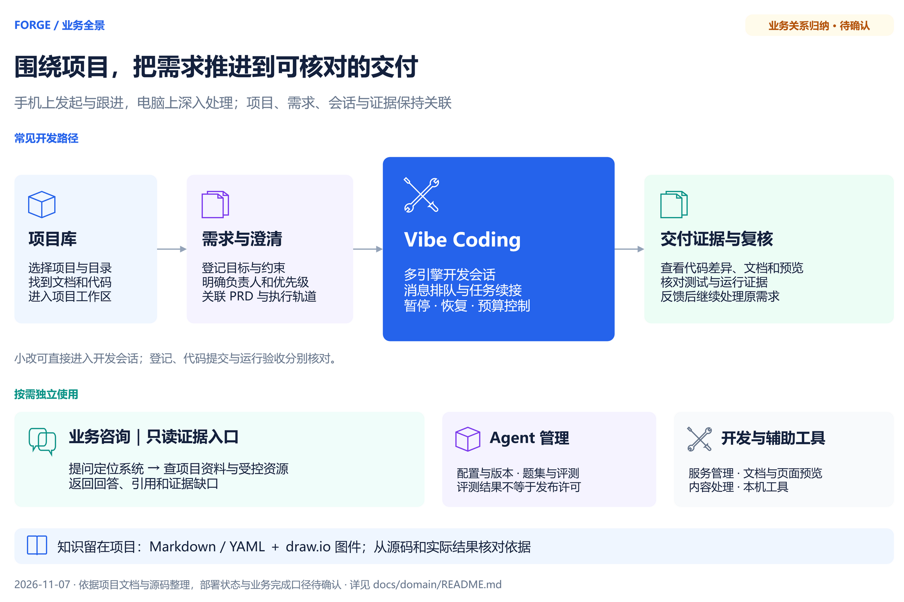
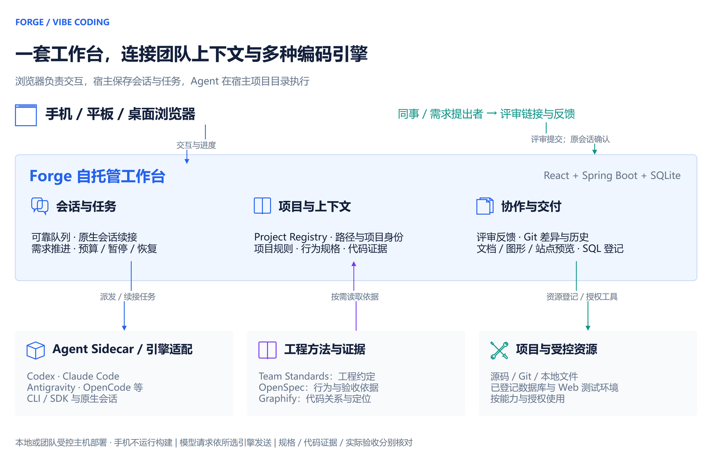

# Forge 平台过会方案（讨论稿）

2026-11-11。说明 Forge 有哪些板块、各自做什么、与直接使用 Codex / Claude Code 相比增加了什么，以及治理层下一步投入。每块下面列出需要会上确定的事；本文为讨论稿，尚无会议结论。

相关资料：[产品说明](../../../README.md) · [业务全景图（可编辑 draw.io）](../../diagrams/Forge业务全景图.drawio) · [团队开发协作架构（可编辑 draw.io）](../../diagrams/Forge团队开发协作架构.drawio) · [AI 编程架构与治理边界](../../ai-coding-architecture.md)

## 目标与范围

| 事项 | 本期安排 |
| --- | --- |
| 一句话定位 | Forge 不是另一个编码模型，而是把 Codex、Claude Code 等编码引擎接入团队日常工作的自托管工作台：项目、需求、会话、评审、受控资源和交付证据在同一处关联，并在引擎之上统一加一层团队治理。 |
| 本次要达成 | 1）参会者知道各板块用途；2）对齐不直接使用 Codex / Claude Code 的理由；3）确定治理层下一步投入。 |
| 本次不讨论 | 具体页面改版、库表设计、发布排期。 |
| 状态口径 | “已实现”指源码与测试完成；“待验收”指尚未在真实环境验证。待验收能力不写成已上线。 |

## 整体架构与分工

主线是：项目库 → 需求与澄清 → Vibe Coding → 交付证据与复核；业务咨询、Agent 管理和开发辅助工具按需独立使用。

看图要点。

| 看图要点 | 说明 |
| --- | --- |
| 开发主线 | 选项目进入工作区，登记需求与约束，在 Vibe Coding 中多引擎推进，最后核对代码差异、测试与运行证据。 |
| 小改与大需求 | 小改直接进入开发会话；需求登记、代码提交与运行验收分别核对，不互相替代。 |
| 按需独立使用 | 业务咨询是只读证据入口；Agent 管理负责配置、评测与发布；开发辅助工具服务日常运维与内容处理。 |
| 知识位置 | 项目知识留在各项目仓库：Markdown / YAML + draw.io，从源码和实际结果核对依据。 |

运行分层。浏览器负责交互，宿主保存会话与任务，Agent 在宿主项目目录执行。

| 层 | 负责什么 | 不负责什么 |
| --- | --- | --- |
| 手机 / 平板 / 桌面浏览器 | 交互、查看进度、确认与复核 | 不运行构建，不保存会话 |
| Forge 工作台 | 保存会话、队列、任务、评审与资源登记；统一权限与治理 | 不替代引擎本身的推理与编码能力 |
| Agent Sidecar / 引擎适配 | 对接 Codex、Claude Code、Qwen Code、OpenCode、Antigravity、Pi、Copilot、TraeCode 等原生会话，注入团队约束 | 不复制供应商的探活与模型规则 |
| 工程方法与证据 | Team Standards 提供工程约定，OpenSpec 提供行为与验收依据，Graphify 提供代码关系，按任务读取 | 不把“已生成”当作正确性证明 |
| 项目与受控资源 | 源码、Git、本地文件；已登记的数据库与 Web 测试环境 | 生产与未知环境不放开写入 |

核心对象与关系。过会只对齐对象含义，表结构以各功能技术方案为准。

| 对象 | 含义 | 关系与事实来源 |
| --- | --- | --- |
| 项目 | 一个代码仓库或业务系统的稳定身份 | 一个项目有多个会话、多个需求；以项目库为准 |
| 会话 | 一次开发对话，绑定项目目录与引擎 | 可先后使用多个引擎，各引擎保留原生会话标识 |
| 需求 / 任务 | 要交付的目标与验收条件 | 对应 OpenSpec 变更与执行轨道，可由多个会话推进 |
| 评审 | 同事针对成果的意见与待办 | 待办经开发者在原会话确认后才入队执行 |
| 受控资源 | 已登记的数据库、Web 环境与测试账号 | AI 只能按资源能力与授权使用，凭据不交给模型 |
| 账号 / 角色 / 部门 | 使用者身份与权限 | 决定可见板块与可访问会话 |

## 板块说明

按使用场景分三组。括号内为侧边栏入口。

### 开发主线

| 板块 | 用来做什么 | 状态 |
| --- | --- | --- |
| 项目与上下文（项目库、代码审阅） | 登记系统与项目身份，AI 初始化与 System Profile；让会话知道在哪个项目、按什么规则做 | 已实现 |
| 需求与交付（AI 交付中心、规格工作台、应用需求与任务） | 从需求登记、澄清、OpenSpec 任务到验收，查看执行轨道与真实证据 | 已实现，部分实施中 |
| Vibe Coding（会话、推进 / 监督、用量、团队依赖、代码与分支） | 多引擎开发会话；消息排队与续接；有预算的连续推进，可暂停、恢复、人工接手；Git 差异与提交 | 已实现；需求模式长任务待真实验收 |
| 移动端（手机浏览器 / PWA、Android、鸿蒙） | 手机负责指挥、确认和复核，代码读取与构建在宿主机执行 | 浏览器已可用；Android 已打包待真机验收；鸿蒙待 SDK 与签名 |

### 非开发同事使用

| 板块 | 用来做什么 | 状态 |
| --- | --- | --- |
| 业务系统咨询 | 按系统、模块提问，只读查阅项目资料，回答带引用和证据缺口 | 已实现 |
| 嵌入式业务助手 | 嵌入企业内部 Web 系统，在业务页面里直接咨询 | 受控试用 |
| 评审参与 | 不操作引擎也能查看成果、提意见；待办经开发者在原会话确认后执行 | 已实现 |

### 平台与治理支撑

| 板块 | 用来做什么 | 状态 |
| --- | --- | --- |
| 受控资源（系统资源与测试账号、DB Console） | 登记数据库、Web 测试环境与测试账号，AI 按能力和授权使用；SQL 按目标环境核对 | 已实现 |
| Agent 与自动化（Agent 管理、调度中心、工作助理） | Agent 配置、回归评测与版本发布；定时任务；周报、环境资源登记等工作机器人 | 已实现 |
| 组织与权限（账号、角色、部门、配置中心） | 账号、角色、三级权限、部门树；配置热刷新 | 已实现；对外定位待确认 |
| 开发辅助与运维（项目开发、本机工具、内容工具、frp、启动性能治理等） | 各业务系统开发模块入口，本机端口 / 终端 / 隧道，内容处理与运维小工具 | 已实现 |

## 与直接使用 Codex / Claude Code 对比

Codex 本身已支持手机远程开发、任务排队、代码评审和 worktree，这些不写成 Forge 独有。只需要单引擎原生体验时，直接用 Codex 就合适；Forge 的价值在于连接多种引擎与团队既有工作方式。

### 核心优势：去中心化

去中心化指团队的开发能力不被某一个中心卡住，拆成四点。

| 不依赖什么 | 直接使用引擎 | 使用 Forge |
| --- | --- | --- |
| 单一引擎厂商 | 会话、上下文和习惯锁在一个工具里，换工具要重建 | 同一业务会话内切换引擎，保留各自原生会话并交接增量上下文；额度用完或故障可换另一个 |
| 单一设备 / 终端 | 本地 CLI 关窗即断，跨设备续接依赖各工具自身能力 | 会话、队列、任务状态保存在宿主机服务端，手机、平板、桌面都能接着做 |
| 中心化知识仓 | 项目知识靠个人提示词或个人记忆 | 知识随项目仓维护；Team Standards 插件统一分发，可检查版本并一键更新 |
| 外部托管平台 | 云端环境需要把代码与凭据交给第三方托管 | 部署在本机或团队受控主机，代码与资源不出受控范围；模型请求仍按所选引擎发送 |

### 其他增量价值

| 关心的问题 | 直接使用引擎 | Forge 增加的部分 |
| --- | --- | --- |
| AI 怎么理解项目和约束 | 每人各自维护提示词 | 项目身份、工程约定、行为规格、代码关系按任务读取 |
| AI 能否安全使用数据库和测试环境 | 需要把连接信息贴给 AI | 资源中心登记，凭据不进模型；写操作仅限 LOCAL / DEV / TEST / UAT，且需用户本次明确授权 |
| 能否少输入“继续” | 逐轮手动推动 | 有轮数与时间预算的连续推进；完成状态区分实现完成、Agent 自验完成、实际验收通过 |
| 同事怎么参与 | 只能看截图或代码 | 评审空间分享成果、收集意见，确认后回到原会话处理 |
| 写完怎么核对与交接 | 在终端、文件和聊天间来回找 | 会话内看 Git 差异、Markdown / draw.io / SQL 预览、站点预览与会话导出；forge-quality 质量门禁 |
| 团队用量与权限 | 各人各管 | 账号、角色、部门与权限码；按引擎和账号查看 5 小时 / 周额度 |
| 非开发同事能否使用 | 基本不能 | 业务系统咨询（只读、带引用）与嵌入式业务助手 |

需要如实说明的边界：团队协作聚焦需求沟通、成果复核和开发续接，不是多人实时共同编辑，也不自动解决 Git 冲突；连续推进不会自动获得发布、重启或数据库写入权限。

## 治理层现状：以 Windows / PowerShell 命令失败为例

近期会话常见“shell 命令返回非零结果”。Forge 已在引擎之上做了一层治理，但目前以提示约束和失败归类展示为主，还没有形成数据闭环。

### 已经做了什么

| 治理手段 | 做法与覆盖范围 | 状态 |
| --- | --- | --- |
| Windows 命令执行规则 | 提示用 rg / fd 搜索、`Get-ChildItem -Name` 是开关参数、Maven 系统属性加引号、优先 `mvnw.cmd`、不额外套 `pwsh -Command`，构建或测试非零退出视为开发反馈；覆盖 Claude、Codex、Antigravity、OpenCode | 已实现 |
| Shell 环境引导 | 要求首条命令前按原生工具说明确认实际 shell，不混用语法，仅在真实语法错误时提醒一次；覆盖全部引擎（演示与只读会话除外） | 代码完成，待重启后做效果对比 |
| 先调研再设计 | 技术选型、方案设计前先查成熟方案与官方文档；覆盖范围同上 | 代码完成，待真实场景验收 |
| 命令失败归类 | 区分语法错误、参数转义、命令不存在、权限、超时、无匹配、测试失败、构建失败，在界面显示可理解的标题 | 已实现，仅用于显示 |
| 浏览器自动化失败恢复 | 页面节点失效时提示重新快照并重试一次，成功后标记“已自动恢复”；仅 Codex | 已实现 |
| 数据库与凭据约束 | SQL 交付规则、写入授权、禁止在 SQL 中包含凭据；覆盖全部引擎 | 已实现 |

### 还没做什么

| 缺口 | 影响 |
| --- | --- |
| 不检测、也不上报实际 shell 类型和版本 | AI 只能自己推断，PowerShell / Bash 语法混用仍会发生 |
| 失败归类只显示、不统计 | 说不清首条命令成功率是否提升，规划中的效果对比缺数据 |
| 归类规则只识别英文报错 | 中文系统的 PowerShell 报错会落入笼统的“进程失败” |
| shell 失败没有自动重试与恢复 | 只有浏览器自动化有“重试一次”机制 |
| 推进 / 监督不感知命令失败 | 连续推进时反复踩同一个坑不会被识别 |

### 建议方向

按投入从小到大：

1. 统计：把已有的失败归类写入会话记录，按引擎、项目、失败类型汇总首条命令成功率和同类失败重复次数，作为判断治理是否有效的前提。
2. 补齐识别：增加中文 PowerShell 报错识别；Sidecar 上报宿主实际 shell 与版本，替换现在固定的“未上报”说明。
3. 推进联动：连续推进中同类命令失败超过阈值时暂停，提示人工接手或换引擎。

不建议拦截或改写 AI 的命令。现有设计已明确不阻断、不改写工具结果、不额外加恢复轮次，避免治理层本身制造新的不确定性。实现依据见 [Shell 环境引导](../../../openspec/changes/guide-native-shell-environment/design.md) 与 [先调研预设](../../../openspec/changes/add-research-first-preset/tasks.md)。

本块待拍板。

| 要定的事 | 建议或选项 | 影响 |
| --- | --- | --- |
| 是否先投入命令失败统计 | 建议本期先做统计，再决定识别补齐与推进联动 | 决定治理效果能否量化 |
| 推进中同类失败暂停阈值 | 待定，候选：同类失败连续 3 次 | 决定自动推进何时停下交给人 |
| 宿主 shell 类型上报 | 会后研发核实各引擎差异与可行性 | 决定能否消除“未上报”提示 |

## 风险与验收边界

| 事项 | 说明 | 建议 |
| --- | --- | --- |
| 凭据出现在会话中 | 近期有会话在聊天消息里明文发送了管理员密码，内容会留在会话历史和引擎原生记录中 | 立即修改该密码；对话中改用资源中心登记的账号，由 AI 按资源调用 |
| 多项能力待运行验收 | DeepSeek Harness 端到端、Android 真机、鸿蒙打包、需求模式长任务、Shell 引导效果对比 | 宣讲材料保留“待验收”标注，不写成已上线 |
| 定位描述不一致 | 项目说明仍写“本机单用户、无认证”，系统已有账号、角色、部门与权限 | 会上明确对外定位后统一文档 |

## 待确认事项

下表是会议索引；背景和影响见对应板块。研发核实不视为业务决定。

| 对应板块 | 类型 | 需确认或核实的事项 |
| --- | --- | --- |
| 目标与范围 | 业务拍板 | 对外定位为个人自托管工作台，还是团队受控主机部署的共享平台；建议后者并同步修订项目说明 |
| 与直接使用对比 | 业务拍板 | 是否以“去中心化”作为核心卖点，并保留“Codex 已有能力不写成独有”的边界 |
| 治理层现状 | 业务拍板 | 是否先投入命令失败统计 |
| 治理层现状 | 业务拍板 | 推进中同类失败暂停阈值 |
| 治理层现状 | 研发核实 | 宿主 shell 类型上报的可行性与各引擎差异 |
| 治理层现状 | 研发核实 | Shell 引导与先调研预设何时重启加载并做效果对比（需重启授权） |
| 风险与验收边界 | 业务拍板 | 会话中出现明文凭据的处理规范：发送前提示、脱敏或拦截 |

依据为本页链接的产品说明、AI 编程架构与 OpenSpec 变更记录。本文是过会讨论稿；未确认事项不视为决定。
