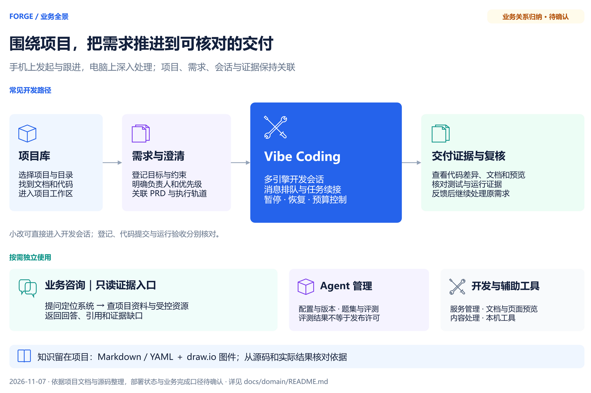
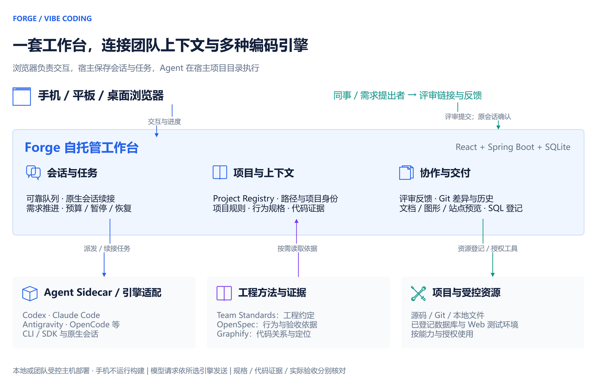

# Forge 整体架构与演进规划（讨论稿）

2026-11-10。说明 Forge 整体架构、各板块用途、相比直接使用 Codex / Claude Code 的优势，以及后续值得补充的能力和推进顺序。本文为讨论稿，尚无会议结论；Vibe Coding 模块细节见同目录的 Vibe Coding 过会方案。

相关资料：[产品说明](../../../README.md) · [业务全景图（可编辑 draw.io）](../../diagrams/Forge业务全景图.drawio) · [团队开发协作架构（可编辑 draw.io）](../../diagrams/Forge团队开发协作架构.drawio) · [Vibe Coding 过会方案](../VibeCoding过会方案/VibeCoding过会方案-current.md) · [Vibe Coding 治理评估](../../development/VibeCoding治理评估.md)

## 目标与范围

| 事项 | 本期安排 |
| --- | --- |
| 一句话定位 | Forge 不是另一个编码模型，而是把 Codex、Claude Code 等编码引擎接入团队日常工作的自托管工作台：项目、需求、会话、评审、受控资源和交付证据在同一处关联，并在引擎之上统一加一层团队治理。 |
| 本文要达成 | 1）对齐整体架构与板块分工；2）对齐相比直接使用编码引擎的优势；3）确定后续补充能力的优先级与推进顺序。 |
| 不在本文范围 | 单个模块的页面设计、库表与排期。 |
| 状态口径 | “已实现”指源码与测试完成；“待验收”指尚未在真实环境验证。待验收能力不写成已上线。 |

## 整体架构

主线是：项目库 → 需求与澄清 → Vibe Coding → 交付证据与复核；业务咨询、Agent 管理和开发辅助工具按需独立使用。

运行方式。浏览器负责交互，宿主保存会话与任务，Agent 在宿主项目目录执行。

各层职责。

| 层 | 负责什么 | 不负责什么 |
| --- | --- | --- |
| 手机 / 平板 / 桌面浏览器 | 交互、查看进度、确认与复核 | 不运行构建，不保存会话 |
| Forge 工作台（React + Spring Boot + SQLite） | 会话、队列、任务、评审、资源登记；统一账号权限与治理 | 不替代引擎本身的推理与编码能力 |
| Agent Sidecar / 引擎适配 | 对接 Codex、Claude Code、Qwen Code、OpenCode、Antigravity、Pi、Copilot、TraeCode、DeepSeek Harness 的原生会话，注入团队约束 | 不复制供应商的探活与模型规则 |
| 工程方法与证据 | Team Standards 提供工程约定，OpenSpec 提供行为与验收依据，Graphify 提供代码关系，按任务读取 | 不把“已生成”当作正确性证明 |
| 项目与受控资源 | 源码、Git、本地文件；已登记的数据库与 Web 测试环境 | 生产与未知环境不放开写入 |

核心对象与关系。

| 对象 | 含义 | 关系与事实来源 |
| --- | --- | --- |
| 项目 | 一个代码仓库或业务系统的稳定身份 | 一个项目有多个会话、多个需求；以项目库为准 |
| 需求 / 任务 | 要交付的目标与验收条件 | 对应 OpenSpec 变更与执行轨道，可由多个会话推进 |
| 会话 | 一次开发对话，绑定项目目录与引擎 | 可先后使用多个引擎，各引擎保留原生会话标识 |
| 评审 | 同事针对成果的意见与待办 | 待办经开发者在原会话确认后才入队执行 |
| 受控资源 | 已登记的数据库、Web 环境与测试账号 | AI 只能按资源能力与授权使用，凭据不交给模型 |
| 账号 / 角色 / 部门 | 使用者身份与权限 | 决定可见板块与可访问会话 |

## 板块与用途

按使用场景分三组。括号内为侧边栏入口。

### 开发主线

| 板块 | 用来做什么 | 状态 |
| --- | --- | --- |
| 项目与上下文（项目库、代码审阅） | 登记系统与项目身份，AI 初始化与 System Profile；让会话知道在哪个项目、按什么规则做 | 已实现 |
| 需求与交付（AI 交付中心、规格工作台、应用需求与任务） | 从需求登记、澄清、OpenSpec 任务到验收，查看执行轨道与真实证据 | 已实现，部分实施中 |
| Vibe Coding（会话、推进、用量、团队依赖、代码与分支） | 多引擎开发会话；消息排队与续接；有预算的连续推进；Git 差异与提交 | 日常使用；大量新能力待验收 |
| 移动端（手机浏览器 / PWA、Android、鸿蒙） | 手机负责指挥、确认和复核，构建在宿主机执行 | 浏览器可用；Android 待真机验收；鸿蒙待 SDK 与签名 |

### 非开发同事使用

| 板块 | 用来做什么 | 状态 |
| --- | --- | --- |
| 业务系统咨询 | 按系统、模块提问，只读查阅项目资料，回答带引用和证据缺口 | 已实现 |
| 嵌入式业务助手 | 嵌入企业内部 Web 系统，在业务页面里直接咨询 | 受控试用 |
| 评审参与 | 不操作引擎也能查看成果、提意见；待办经开发者确认后执行 | 已实现 |

### 平台与治理支撑

| 板块 | 用来做什么 | 状态 |
| --- | --- | --- |
| 受控资源（系统资源与测试账号、DB Console） | 登记数据库、测试环境与账号，AI 按能力和授权使用 | 已实现 |
| Agent 与自动化（Agent 管理、调度中心、工作助理） | Agent 配置、回归评测与版本发布；定时任务；工作机器人 | 已实现 |
| 组织与权限（账号、角色、部门、配置中心） | 账号、角色、三级权限、部门树；配置热刷新 | 已实现；对外定位待确认 |
| 开发辅助与运维 | 业务系统开发模块、本机工具、内容工具、frp、启动性能治理等 | 已实现 |

## 核心优势

Codex 本身已支持手机远程开发、任务排队、代码评审和 worktree，这些不写成 Forge 独有。只需单引擎原生体验时直接用 Codex 即可；Forge 的价值在于连接多种引擎与团队既有工作方式。

### 去中心化

团队的开发能力不被某一个中心卡住。

| 不依赖什么 | 直接使用引擎 | 使用 Forge |
| --- | --- | --- |
| 单一引擎厂商 | 会话与上下文锁在一个工具里，换工具要重建 | 同一会话内切换引擎，保留原生会话并交接上下文；额度用完或故障可换另一个 |
| 单一设备 / 终端 | 本地 CLI 关窗即断 | 状态保存在宿主机服务端，手机、平板、桌面都能接着做 |
| 个人提示词与记忆 | 项目知识靠个人维护 | 知识随项目仓维护，团队规则统一分发并可一键更新 |
| 外部托管平台 | 云端环境需要交出代码与凭据 | 部署在本机或团队受控主机，代码与资源不出受控范围 |

### 其他增量价值

| 关心的问题 | 直接使用引擎 | Forge 增加的部分 |
| --- | --- | --- |
| AI 怎么理解项目和约束 | 每人各自维护提示词 | 项目身份、工程约定、行为规格、代码关系按任务读取 |
| AI 能否安全使用数据库和测试环境 | 需要把连接信息贴给 AI | 资源中心登记，凭据不进模型；写操作限测试类环境且需用户本次授权 |
| 能否少输入“继续” | 逐轮手动推动 | 有预算的连续推进；完成状态区分实现完成、Agent 自验、实际验收 |
| 同事怎么参与 | 只能看截图或代码 | 评审空间分享成果、收集意见，确认后回到原会话处理 |
| 写完怎么核对与交接 | 在终端、文件和聊天间来回找 | 会话内看 Git 差异、文档 / 图形 / SQL / 站点预览；质量门禁 |
| 团队用量与权限 | 各人各管 | 账号、角色、部门与权限码；按引擎和账号查看额度 |
| 非开发同事能否使用 | 基本不能 | 业务系统咨询与嵌入式业务助手 |

需要如实说明的边界：团队协作聚焦需求沟通、成果复核和开发续接，不是多人实时共同编辑，也不自动解决 Git 冲突。

## 现状与主要问题

| 问题 | 影响 | 依据 |
| --- | --- | --- |
| 交付积压 | 147 个未归档 OpenSpec 变更中 104 个只差重启加载后验收，大量能力未进入真实使用 | [OpenSpec 待验收清单](../../development/OpenSpec待验收清单.md) |
| 核心文件过大、修改频繁 | 近 70 天 327 次提交中 46% 为修复；ChatPage、ClaudeChatService、sessionManager 等 2000～3400 行 | [Vibe Coding 治理评估](../../development/VibeCoding治理评估.md) |
| 模块边界失控 | Vibe Coding 后端模块混入 ERP / SRM、咨询、插件更新等功能，改动与发布互相牵连 | 同上 |
| 安全前提与定位冲突 | 第三方网关密钥明文入库；项目说明仍写“单用户、无认证”，系统已有多账号与权限 | 同上 |
| 治理只提示不度量 | 命令失败、引擎可用性等只做显示，无法评估治理效果 | Sidecar 命令失败归类仅用于界面 |

## 后续值得补充的能力

按价值与依赖分组。“现有基础”说明可以复用的部分，避免重复建设。

### 交付闭环

| 能力 | 解决什么 | 现有基础 | 优先级 |
| --- | --- | --- | --- |
| 固定加载与验收窗口 | 代码完成到真实可用之间长期断档 | 重启授权规则、待验收清单、forge-startup | 高 |
| 发布与版本可见 | 说不清当前运行的是哪个版本、包含哪些变更 | 前端提交产物发布、PM2 受管运行 | 高 |
| 验收证据自动归集 | 验收靠人工翻日志与截图 | Delivery 结构化证据、质量门禁、页面预览 | 中 |

### 安全与团队化

| 能力 | 解决什么 | 现有基础 | 优先级 |
| --- | --- | --- | --- |
| 密钥统一托管 | 网关密钥明文入库、对话中出现明文密码 | 资源中心“凭据不交给模型”机制 | 高 |
| 发送前凭据识别 | 用户误把密码发进会话 | 会话发送链路 | 中 |
| 团队级权限与审计 | 多账号下谁能看哪些会话、做了哪些写操作 | 账号、角色、部门、会话访问策略、写入授权 requestId | 中 |
| 团队用量与成本看板 | 只能看个人额度，无法按团队、项目统计 | 按引擎与账号的额度读取 | 低 |

### 引擎与治理度量

| 能力 | 解决什么 | 现有基础 | 优先级 |
| --- | --- | --- | --- |
| 引擎分级与准入 | 9 个引擎维护成本高、多数未验收 | 引擎目录与探活 | 高 |
| 命令失败与治理效果统计 | 无法衡量 Shell 引导、先调研等预设是否有效 | 命令失败归类、轮次记录 | 中 |
| 运行可观测性 | 故障靠日志人工排查 | 已引入 OpenTelemetry 依赖 | 中 |
| 推进中的失败感知 | 自动推进反复踩同一个坑 | 自动推进与完成核对 | 中 |

### 知识与协作

| 能力 | 解决什么 | 现有基础 | 优先级 |
| --- | --- | --- | --- |
| 需求完成口径统一 | 需求状态名不能证明生产验收完成 | AI 交付中心需求状态与证据 | 中 |
| 评审到需求的闭环 | 评审意见与需求池分开维护 | 评审清单、交付中心 | 中 |
| 项目知识新鲜度提示 | 规格与代码不一致难以发现 | OpenSpec 主规格（已归档 72 个能力）、Graphify | 低 |

### 体验与入口

| 能力 | 解决什么 | 现有基础 | 优先级 |
| --- | --- | --- | --- |
| 会话、推进、语音入口收敛 | 同一目的多个入口，理解成本高 | 产品哲学 NAV-03 | 中 |
| 原生客户端交付 | 手机只能用浏览器 | Android 已打包、鸿蒙工程已建 | 低 |

## 推进路线

| 阶段 | 内容 | 完成标准 |
| --- | --- | --- |
| P0 止血（1～2 周） | 建立固定加载与验收窗口清理积压；密钥托管方案与会话凭据规范；删除死代码 | 待重启验收变更降到 20 个以内；密钥不再明文入库 |
| P1 夯实（2～4 周） | 拆分超大文件与越界模块；引擎分级；发布版本可见 | 核心文件不超过 800 行；Vibe Coding 模块只含本域功能；当前运行版本可查 |
| P2 度量（1～2 个月） | 命令失败与治理效果统计；运行可观测性；推进失败感知 | 能回答“首条命令成功率”“各引擎故障率” |
| P3 团队化 | 团队权限与审计；用量成本看板；评审与需求闭环 | 多人使用时权限、费用与追溯清楚 |

## 待确认事项

下表是会议索引；研发核实不视为业务决定。

| 对应部分 | 类型 | 需确认或核实的事项 |
| --- | --- | --- |
| 目标与范围 | 业务拍板 | 对外定位为个人自托管工作台，还是团队受控主机部署的共享平台 |
| 核心优势 | 业务拍板 | 是否以“去中心化”作为核心卖点 |
| 后续能力 | 业务拍板 | 各项能力优先级是否认可；P0 何时启动 |
| 后续能力 | 业务拍板 | 团队正式支持的引擎范围 |
| 安全与团队化 | 研发核实 | 密钥托管方案（加密入库或统一由资源中心引用） |
| 推进路线 | 业务拍板 | 加载与验收窗口的频率与负责人 |

依据为本页链接的产品说明、业务全景图、Vibe Coding 过会方案、治理评估与 OpenSpec 记录。本文是讨论稿；未确认事项不视为决定。
