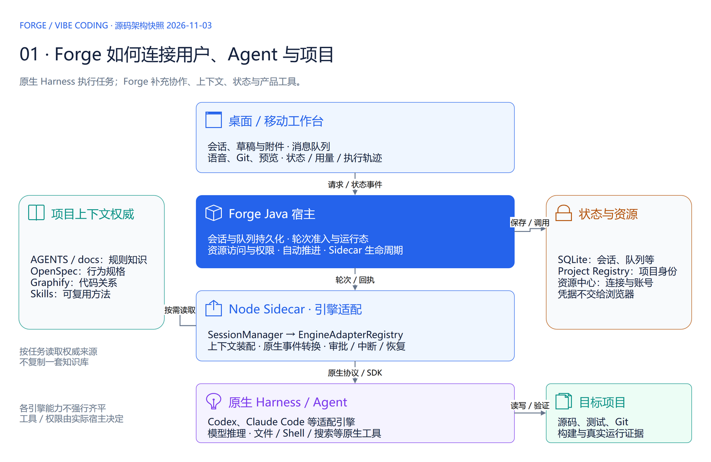
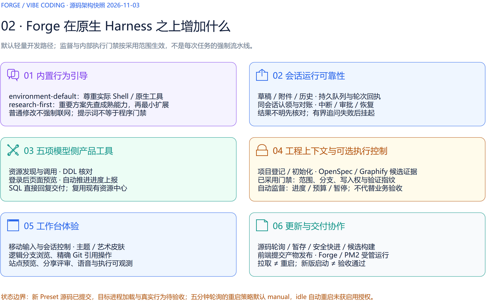
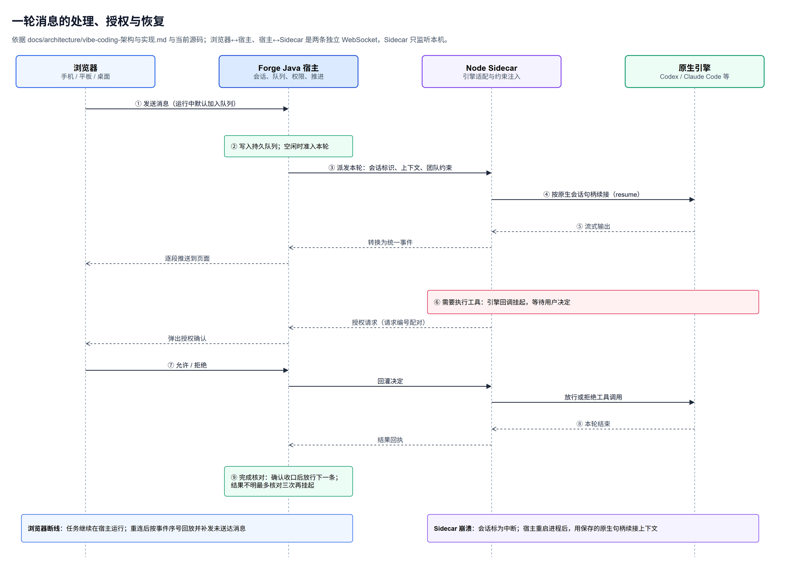
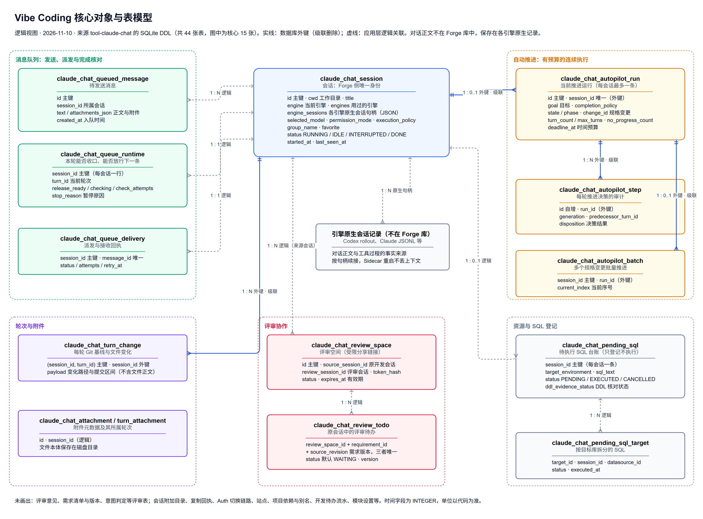

# Vibe Coding 架构与演进规划（讨论稿）

2026-11-10。说明 Vibe Coding 模块的架构要点、相对直接使用编码引擎的优势、当前主要问题，以及后续值得补充的能力与推进顺序。功能逐项规则与截图见 Vibe Coding 过会方案；本文为讨论稿，尚无会议结论。

相关资料：[Forge 整体架构与演进规划](../Forge整体架构与演进规划/Forge整体架构与演进规划-current.md) · [Vibe Coding 过会方案](../VibeCoding过会方案/VibeCoding过会方案-current.md) · [架构与实现](../../architecture/vibe-coding-架构与实现.md) · [运行架构（可编辑 draw.io）](../../diagrams/ForgeVibeCoding运行架构.drawio) · [核心对象与表模型（可编辑 draw.io）](../VibeCoding过会方案/VibeCoding核心对象与表模型.drawio)

## 目标与范围

| 事项 | 本期安排 |
| --- | --- |
| 模块定位 | Forge 的核心开发工作台：在浏览器（手机 / 平板 / 桌面）里驱动 Codex、Claude Code 等编码引擎，在受控主机的项目目录中开发，并把会话、队列、推进、评审和交付证据保存在一起。 |
| 本文要达成 | 1）对齐架构要点与需要坚持的设计；2）对齐当前主要问题；3）确定后续能力优先级与推进顺序。 |
| 不在本文范围 | 页面字段与交互细节、具体排期。 |

## 架构要点

模块分四层：浏览器负责交互，Java 宿主保存会话与任务并统一权限，Node Sidecar 适配各编码引擎并注入团队约束，原生引擎在目标项目里实际执行。

Forge 在原生引擎之上增加的六类能力。默认走轻量开发路径，监督与执行门禁按需启用。

一轮消息的处理、授权与恢复。

需要长期坚持的架构决策。

| 决策 | 做法 | 带来的好处 |
| --- | --- | --- |
| 会话身份与原生句柄分离 | Forge 会话编号负责路由；各引擎原生会话句柄持久化，正文留在引擎原生记录 | Sidecar 重启或崩溃后续接，进程近乎无状态；不复制对话正文 |
| 两条链路分别恢复 | 浏览器↔宿主、宿主↔Sidecar 两条 WebSocket；前者按事件序号回放，后者按句柄续接 | 弱网与进程故障互不牵连 |
| 引擎目录为唯一准入来源 | 可选引擎由 Sidecar 实时探活决定，快照后台刷新 | 不在前端或 Java 复制供应商规则；新增引擎只需接入目录 |
| 幂等与有界重试 | 请求编号去重、派发回执、完成核对最多三次、删除撤回防复活 | 断线、刷新、重复点击不制造重复执行 |
| 授权挂起配对 | 工具调用挂起等待用户决定，按请求编号回灌 | 危险操作必须经人确认，参数不会被偷换 |
| 凭据不进模型 | 资源中心登记，模型只拿资源能力；写操作限测试类环境且需本次授权 | AI 能用数据库和测试环境，又不接触密码 |

核心数据以会话为中心，周围是队列、自动推进、轮次记录、评审与 SQL 登记。

## 相对直接使用编码引擎的优势

| 关心的问题 | 直接使用 Codex / Claude Code | Vibe Coding |
| --- | --- | --- |
| 换引擎、换设备 | 会话锁在一个工具和一台电脑 | 同一会话切换引擎并交接上下文；手机、桌面随时接着做 |
| 长任务 | 逐轮手动输入“继续” | 持久队列与有预算的连续推进，可暂停、恢复、人工接手 |
| 团队规则与项目知识 | 各人维护提示词 | 项目规则、规格与代码关系按任务注入，团队规则统一分发 |
| 数据库与测试环境 | 把连接信息贴给 AI | 资源中心授权调用，凭据不进模型 |
| 成果复核与协作 | 终端、文件、聊天来回找 | 会话内看 Git 差异与文档、图形、SQL、站点预览；同事经评审链接参与 |
| 进度真实性 | 靠模型自述 | 区分实现完成、Agent 自验完成、实际验收通过 |

边界：Codex 已有的手机远程、任务排队、代码评审能力不算独有；协作不是多人实时共同编辑。

## 当前主要问题

| 问题 | 严重度 | 现象 | 依据 |
| --- | --- | --- | --- |
| 交付积压 | 高 | 104 个变更只差重启加载后验收，大量能力未在真实环境使用 | [OpenSpec 待验收清单](../../development/OpenSpec待验收清单.md) |
| 核心文件过大且频繁修改 | 高 | ClaudeChatService 3413 行、ChatPage 2538 行、sessionManager 2143 行、useClaudeChatSocket 2131 行；近 70 天修复占 46% | [Vibe Coding 治理评估](../../development/VibeCoding治理评估.md) |
| 后端模块越界 | 高 | 59 个 Controller，混入 ERP / SRM、咨询、插件更新等非本域功能 | 同上 |
| 安全前提过时 | 高 | 第三方网关密钥明文入库，按单机单用户设计 | 同上 |
| 入口冗余 | 中 | 会话相关组件约 30 个，监督推进约 8 处入口，语音三条路径 | 同上 |
| 引擎抽象不彻底 | 中 | Sidecar 仍有 50 处按引擎名分支；依赖实验协议 | 同上 |
| 治理只提示不度量 | 中 | 命令失败只做显示，无法评估引导效果 | 同上 |

## 后续值得补充的能力

“现有基础”说明可复用部分，避免重复建设。

### 交付与运行

| 能力 | 解决什么 | 现有基础 | 优先级 |
| --- | --- | --- | --- |
| 运行版本可见 | 说不清当前运行版本、有哪些变更待加载 | 前端提交产物发布、PM2 受管运行、OpenSpec 待验收清单 | 高 |
| 验收窗口工具化 | 重启、验收、勾选、归档全靠人工串联 | forge-startup、待验收清单、openspec archive | 高 |
| 完成与阻塞通知 | 推进完成或卡住时人不在电脑前 | 通知设置、自动推进状态 | 中 |

### 引擎与执行

| 能力 | 解决什么 | 现有基础 | 优先级 |
| --- | --- | --- | --- |
| 引擎分级与能力矩阵 | 9 个引擎能力参差、多数未验收，用户不知道选哪个 | 引擎目录、探活结果 | 高 |
| 引擎差异下沉适配器 | 新增或修改引擎要改核心文件 | engineContract / engineRegistry | 中 |
| Codex 单一主通道 | SDK 与 App Server 两套实现并行维护 | 两个通道均已可用 | 中 |
| 会话与推进成本预算 | 长任务费用不可控 | 用量与额度读取、推进轮数和时间预算 | 中 |

### 治理与度量

| 能力 | 解决什么 | 现有基础 | 优先级 |
| --- | --- | --- | --- |
| 命令失败与治理效果统计 | 说不清 Shell 引导、先调研等预设是否有效 | 命令失败归类、轮次记录 | 中 |
| 宿主 Shell 识别与上报 | PowerShell / Bash 语法混用 | 环境引导预设 | 中 |
| 推进中的失败感知 | 同类失败反复发生仍继续推进 | 自动推进、完成核对 | 中 |

### 协作与安全

| 能力 | 解决什么 | 现有基础 | 优先级 |
| --- | --- | --- | --- |
| 密钥托管与发送前凭据识别 | 密钥明文入库、对话中出现密码 | 资源中心凭据隔离 | 高 |
| 会话交接给同事 | 人员调整时会话与上下文难以移交 | 复制会话配置、会话访问策略 | 中 |
| 评审到需求池闭环 | 评审意见与需求分开维护 | 评审清单、AI 交付中心 | 中 |
| 会话操作审计 | 多账号下难以追溯谁做了写操作 | 写入授权 requestId、轮次变更记录 | 低 |

### 体验

| 能力 | 解决什么 | 现有基础 | 优先级 |
| --- | --- | --- | --- |
| 会话、推进、语音入口收敛 | 同一目的多个入口 | 产品哲学 NAV-03 | 中 |
| Android 原生客户端交付 | 手机只能用浏览器 | Android 已打包签名 | 低 |

## 推进路线

| 阶段 | 内容 | 完成标准 |
| --- | --- | --- |
| P0 止血（1～2 周） | 固定验收窗口清积压；运行版本可见；密钥托管方案；删除死代码 | 待重启验收变更降到 20 个以内；能查到当前运行版本 |
| P1 拆分（2～4 周） | 拆分 ChatPage、ClaudeChatService、sessionManager；越界功能迁出；引擎分级 | 单文件不超过 800 行；模块只含本域功能 |
| P2 收敛与度量（1～2 个月） | 入口收敛；命令失败统计与 Shell 上报；推进失败感知；Codex 主通道决策 | 同一目的一个入口；能回答首条命令成功率 |
| P3 协作 | 会话交接、评审到需求闭环、审计、成本预算 | 多人使用时可移交、可追溯、费用可控 |

## 待确认事项

下表是会议索引；研发核实不视为业务决定。

| 对应部分 | 类型 | 需确认或核实的事项 |
| --- | --- | --- |
| 后续能力 | 业务拍板 | 各能力优先级是否认可；P0 何时启动、谁负责 |
| 引擎与执行 | 业务拍板 | 团队正式支持的引擎；Codex 是否以 App Server 为主通道 |
| 体验 | 业务拍板 | 入口收敛后的形态；手势控制、艺术皮肤是否保留 |
| 协作与安全 | 研发核实 | 密钥托管方式（加密入库或资源中心引用） |
| 推进路线 | 业务拍板 | 验收窗口频率 |

依据为本页链接的过会方案、架构文档、治理评估与 OpenSpec 记录。本文是讨论稿；未确认事项不视为决定。
