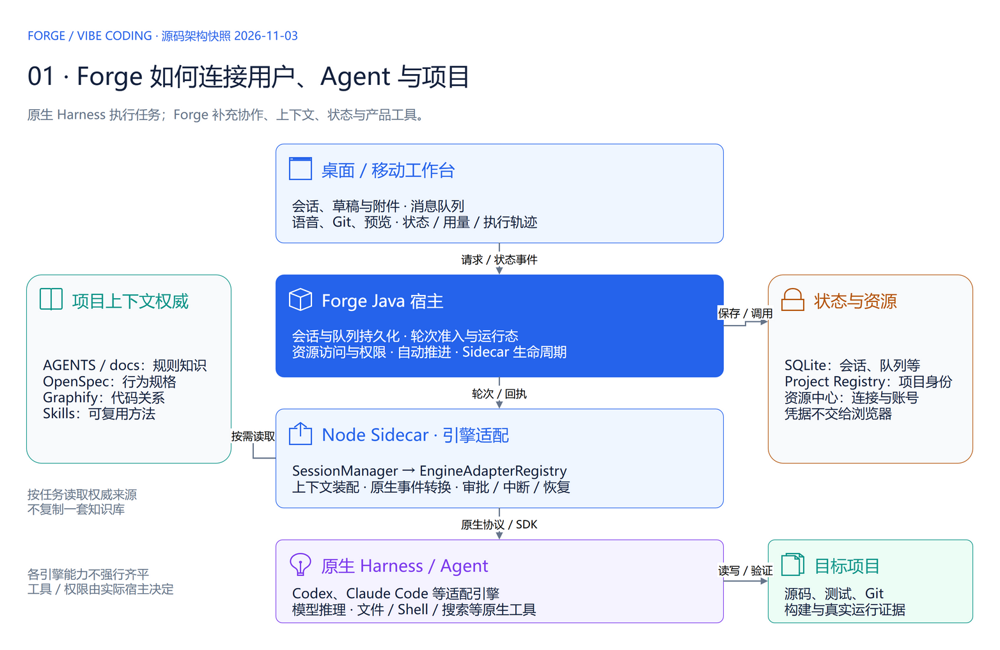
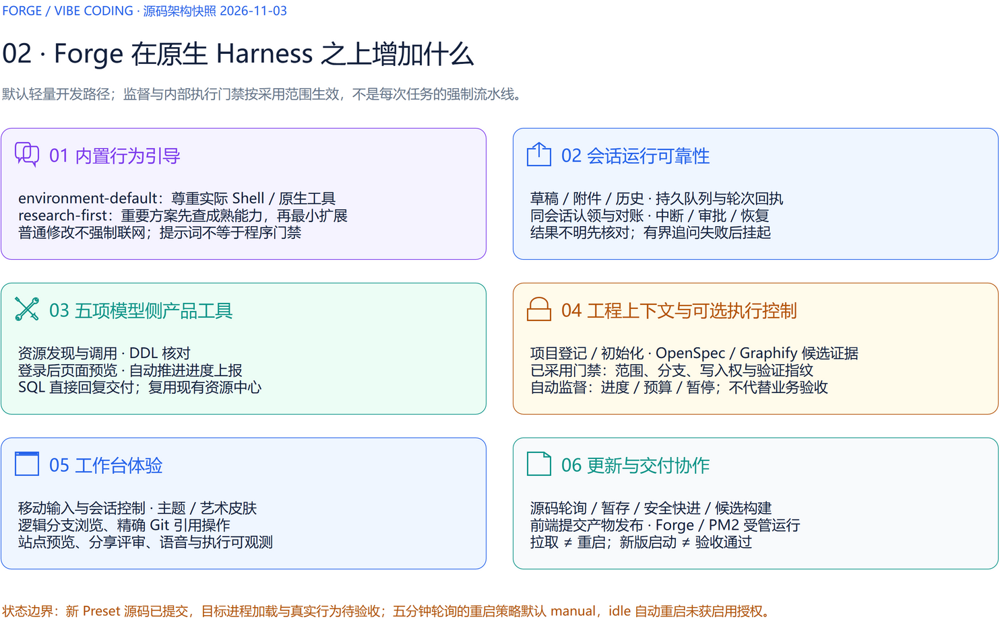
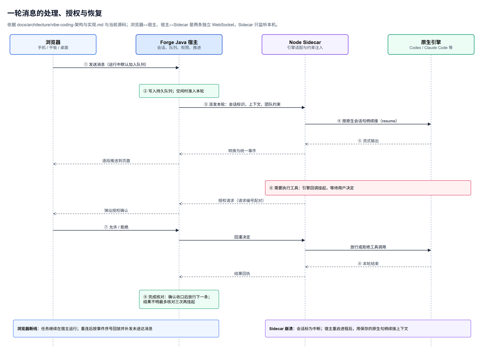
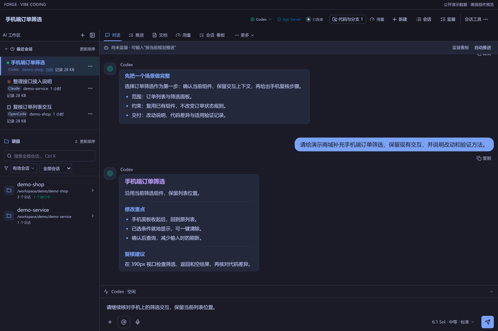
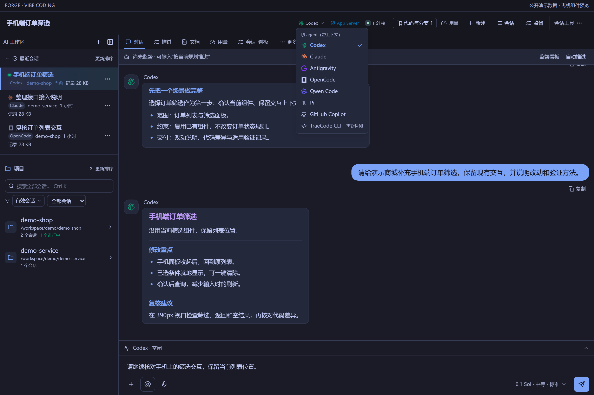
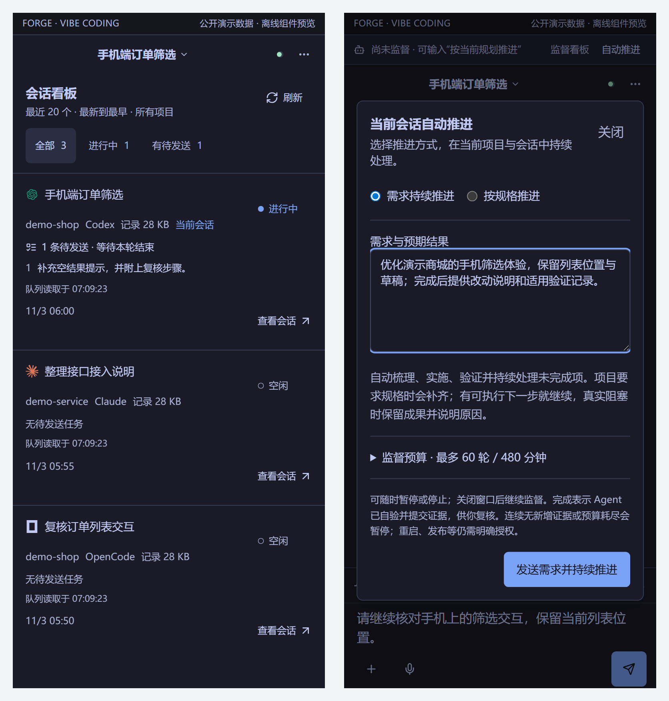
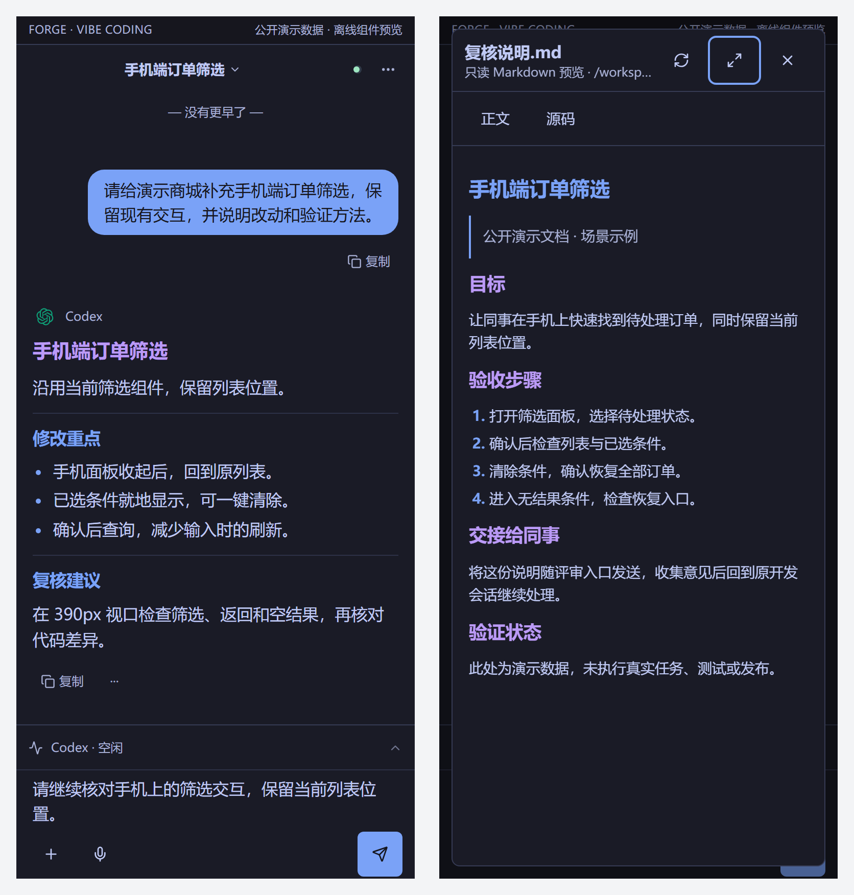
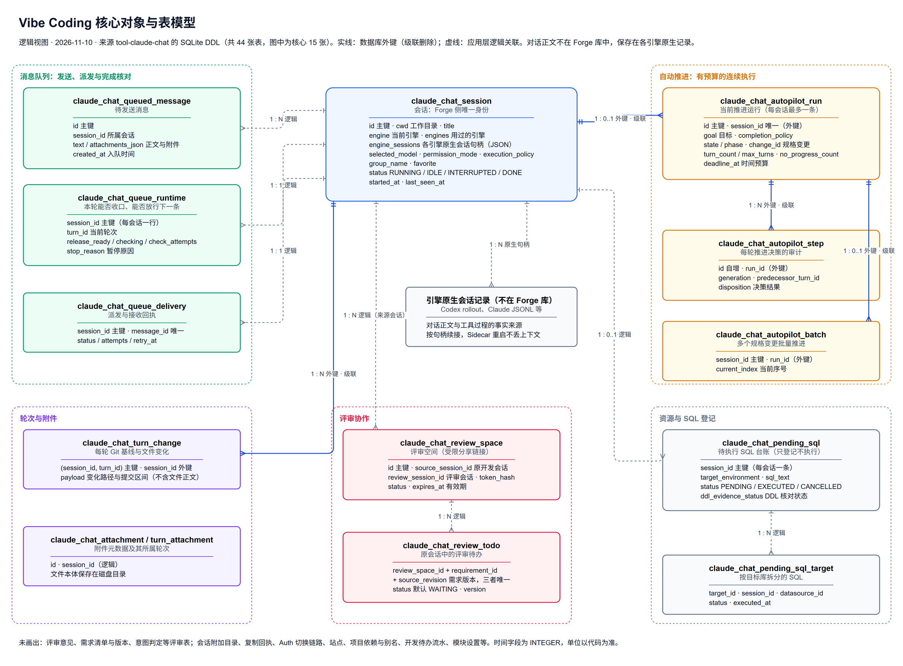

# Forge Vibe Coding 过会方案（讨论稿）

2026-11-10。说明 Vibe Coding 模块的整体设计、各功能块怎么工作、数据放在哪里，以及当前做到什么程度。每块下面列出需要会上确定的事；本文为讨论稿，尚无会议结论。界面截图来自真实前端组件渲染（2026-11-03，演示数据），不代表线上会话或真机验收。

相关资料：[架构与实现](../../architecture/vibe-coding-架构与实现.md) · [模块使用说明](../../../frontend/src/features/claude-chat/README.md) · [运行架构（可编辑 draw.io）](../../diagrams/ForgeVibeCoding运行架构.drawio) · [核心对象与表模型（可编辑 draw.io）](VibeCoding核心对象与表模型.drawio) · [一轮消息时序（可编辑 draw.io）](VibeCoding一轮消息时序.drawio)

## 目标与范围

| 事项 | 本期安排 |
| --- | --- |
| 模块定位 | Vibe Coding 是 Forge 的核心开发工作台：在浏览器（手机 / 平板 / 桌面）里驱动 Codex、Claude Code 等编码引擎，在受控主机的项目目录中完成开发，并把会话、队列、推进、评审和交付证据保存在一起。 |
| 解决的问题 | 编码引擎只能在本机终端使用、换设备或换引擎要重来、长任务要反复输入“继续”、团队规则和受控资源无法统一注入、成果散落在终端与聊天里难以复核。 |
| 本次要达成 | 1）讲清整体设计与各功能块；2）对齐当前真实状态（哪些已验收、哪些只完成代码）；3）确定下一步验收节奏与优先级。 |
| 不在本次范围 | Forge 其他板块（项目库、交付中心、业务咨询、Agent 管理等）只在关联处提及；具体页面改版与排期另议。 |
| 状态口径 | “已完成”指任务全部勾选并通过运行验收；“代码完成待验收”指源码与定向测试完成，但新版本尚未加载到运行服务或未经真机验证。 |

## 整体设计

模块分四层：浏览器负责交互，Java 宿主保存会话与任务并统一权限，Node Sidecar 适配各编码引擎并注入团队约束，原生引擎在目标项目里实际执行。项目规则、行为规格和代码关系按任务读取，不另建一套知识库。

各层职责。

| 层 | 负责什么 | 关键设计 |
| --- | --- | --- |
| 桌面 / 移动工作台（React） | 会话、草稿与附件、消息队列、语音、Git、预览、用量与执行轨迹 | 同一套组件适配手机与桌面；页面关闭不影响服务端任务 |
| Forge Java 宿主（Spring Boot） | 会话与队列持久化、轮次准入与运行状态、资源访问与权限、自动推进、Sidecar 生命周期 | 虚拟线程承载阻塞式调用；SQLite 保存会话元数据与队列 |
| Node Sidecar（引擎适配） | SessionManager 统一调度，各引擎适配器负责上下文装配、原生事件转换、审批、中断与恢复 | 只监听本机；一条连接按会话标识复用；不复制供应商的探活规则 |
| 原生引擎（Harness） | Codex、Claude Code 等完成模型推理与文件、Shell、搜索等原生工具调用 | 各引擎能力不强行拉平，可用性以运行时引擎目录为准 |

Forge 在原生引擎之上增加六类能力。默认走轻量开发路径，监督与执行门禁按需启用，不是每次任务的强制流水线。

### 一轮消息怎么跑

关键设计。

| 设计 | 做法 | 解决的问题 |
| --- | --- | --- |
| 两条独立链路 | 浏览器↔宿主、宿主↔Sidecar 分别建立 WebSocket，故障互不牵连 | 手机锁屏或弱网时任务照常在服务端运行 |
| 全程流式 | 引擎每输出一段，经 Sidecar、宿主逐段推到页面 | 长回复边生成边阅读 |
| 工具授权挂起 | 引擎请求执行工具时挂起，按请求编号把用户决定送回对应调用 | 危险操作必须经人确认，且不会批准新参数却执行旧参数 |
| 两个身份分开 | Forge 会话编号负责当前路由；各引擎原生会话句柄保存在库中，对话正文留在引擎原生记录 | Sidecar 重启或崩溃后按句柄续接，对话不丢 |
| 断线恢复 | 浏览器重连按事件序号回放并补发；Sidecar 崩溃时会话标为中断，宿主重启进程后续接 | 弱网与进程故障分别恢复，不互相替代 |
| 队列完成核对 | 本轮确认收口才放行下一条；结果不明最多核对三次再挂起 | 不因回执丢失重复执行，也不无限追问 |

## 核心功能设计

### 会话工作台与多引擎

桌面工作台：左侧最近会话与项目分组，中间对话，底部执行摘要与输入区（演示数据）。

页面功能逐项确认。

| 功能 | 规则与当前做法 |
| --- | --- |
| 新建会话 | 选择工作区、项目目录、引擎与服务商；当前浏览器记住上次选择，不保存密钥。工作区列表与引擎状态改为预取并后台刷新，提供手动刷新（代码完成待加载） |
| 会话列表 | 最近会话跨项目平铺、可置顶；项目按主工作目录自动归组，也可手动分组；后台活动只提示“有新活动”，不打乱当前位置 |
| 会话看板 | 最近 20 个开发会话的状态与待发送队列，每 15 秒刷新，离开即停止轮询 |
| 引擎切换 | 同一业务会话内切换引擎，保留各引擎原生会话句柄并交接增量上下文 |
| 服务商档案 | Claude、Codex、Pi、Copilot、OpenCode 可使用第三方服务商；只作用于本会话，不改写本机全局配置 |
| 复制会话配置 | 继承目录、引擎、模型、服务商与分组创建独立副本；按请求编号去重，网络失败可核对同一副本 |
| Codex 会话导入 | 从本机 Codex 授权目录导入项目与未归档会话，只保存恢复元数据，打开后按原生线程续接 |
| 用量 | 按引擎与账号显示 5 小时 / 本周剩余额度，读取服务商真实窗口，不用本地 Token 推算余额 |

会话内切换引擎（演示数据）。

引擎接入现状。可选引擎以 Sidecar 实时探活结果为准，实验引擎必须探活就绪才开放选择。

| 引擎 | 接入方式 | 当前状态 |
| --- | --- | --- |
| Codex | 官方 SDK / App Server 双通道 | 主力引擎，稳定使用；续问建议、原生语音待真实账号验收 |
| Claude Code | 官方 Agent SDK | 稳定使用；官方模型选择与完整回复兜底已修复，待加载 |
| Qwen Code、OpenCode、Antigravity | 各自 CLI / SDK 适配 | 已适配；Qwen 待运行验收，OpenCode 第三方路径待真实供应商验收 |
| Pi、GitHub Copilot | 固定版本 SDK | 代码完成，待真实账号验收 |
| TraeCode CLI | CLI 2.0 探活 | 代码完成，需登录 CLI 后验收 |
| DeepSeek Harness | 官方 Runtime 握手 | 隔离验证通过，Forge 端到端待验收 |

本块待拍板。

| 要定的事 | 建议或选项 | 影响 |
| --- | --- | --- |
| 团队正式支持哪些引擎 | 建议 Codex、Claude Code 为正式支持，其余标“实验” | 决定培训材料、排障投入与默认选项 |
| 第三方服务商是否对团队开放 | 建议先限管理员配置，成员只选用档案 | 决定密钥管理方式与费用归属 |

### 消息队列与自动推进

左：会话看板显示运行状态与待发送队列；右：自动推进提交前的需求与预算（演示数据）。

队列与推进规则逐项确认。

| 功能 | 规则与当前做法 |
| --- | --- |
| 运行中发送 | 默认加入持久队列；官方 Codex 可选“补充到当前轮”。本轮正常结束后自动续发，异常结束暂停 |
| 队列控制 | 置顶处理中项可“暂停核对”或“终止询问”，每项可删除；删除同步撤回，迟到消息不能复活已删除项 |
| 完成核对 | 确认本轮收口才放行下一条；结果不明最多派发三次核对，仍无法确认则挂起，重启不清零 |
| 需求持续推进 | 输入需求与预期结果后自动梳理、实施、验证；默认最多 60 轮、8 小时，可调整；可暂停、停止、恢复，关闭页面不取消 |
| 按规格推进 | 绑定项目已有 OpenSpec 任务推进；严格模式保留验收，默认不自动归档 |
| 完成状态 | 标为“Agent 自验完成 · 待复核”，不展示虚构百分比，不代表规格验收或已上线 |
| 权限边界 | 连续推进不会自动获得发布、重启或数据库写入权限；遇到真实阻塞停下交给人 |

本块待拍板。

| 要定的事 | 建议或选项 | 影响 |
| --- | --- | --- |
| 自动推进默认预算 | 维持 60 轮 / 8 小时，或按项目设定上限 | 决定无人值守时长与模型费用 |
| 是否向全体成员开放自动推进 | 建议先在核心成员中试用，积累长任务真实验收记录 | 决定推广节奏 |

### 项目上下文与团队治理

本块没有独立页面，作用于每一轮会话：Sidecar 在派发时注入项目上下文与团队约束，Forge 工具在模型侧提供受控能力。

| 能力 | 做法 | 状态 |
| --- | --- | --- |
| 项目身份与知识 | 按项目库身份读取 AGENTS、docs、OpenSpec 与 Graphify，按任务需要读取，不复制知识库 | 已实现 |
| 团队规则分发 | 一键初始化 / 拉取五个团队仓库，Team Standards 插件版本检查与更新 | 已实现 |
| 内置行为引导 | Windows 命令执行规则；先确认实际 Shell 再执行；重要方案先调研成熟做法 | 规则已生效；Shell 与调研预设代码完成，待加载后做效果对比 |
| 模型侧产品工具 | 资源发现与调用、DDL 核对、登录后页面预览、推进进度上报、SQL 回复交付 | 已实现 |
| 权限与授权 | 工具调用审批；只读会话策略；数据库写入仅限 LOCAL / DEV / TEST / UAT 且需用户本次明确授权；凭据不进模型 | 已实现 |
| 命令失败处理 | 失败按语法、转义、命令不存在、超时、测试或构建失败等归类显示 | 仅显示：未统计成功率、不识别中文报错、不自动重试、推进不感知 |

本块待拍板。

| 要定的事 | 建议或选项 | 影响 |
| --- | --- | --- |
| 是否先做命令失败统计 | 建议先统计首条命令成功率与同类失败次数，再决定识别补齐与推进联动 | 决定治理效果能否量化 |
| 推进中同类失败的暂停阈值 | 待定，候选：同类失败连续 3 次 | 决定自动推进何时交给人 |
| 宿主 Shell 类型上报 | 会后研发核实各引擎差异与可行性 | 决定能否消除 Shell 语法混用 |

### 交付复核与评审协作

左：手机对话的分层回复；右：在当前会话内只读预览 Markdown 文档（演示数据）。

复核与协作功能逐项确认。

| 功能 | 规则与当前做法 |
| --- | --- |
| 代码与分支 | 查看分支、同步状态与提交历史；切换、推送、拉取均先检查再确认，仅快进，不自动合并 |
| 待提交文件与轮次变更 | 查看工作区差异；每轮保存 Git 基线与变化路径，便于追溯本轮改了什么（不保存文件正文） |
| 文件内嵌预览 | 回复中的 Markdown、SQL、draw.io 本地链接自动在消息下方显示，只读，限授权范围 |
| 图片查看 | 回复中的本地图片可显示；以链接或行内代码给出的图片路径可点击全屏查看，手机可缩放（代码完成待加载） |
| 站点预览 | 使用资源中心登记的应用账号，在当前会话弹框打开真实页面，密码由服务端读取 |
| 评审协作 | 分享受限评审链接；评审方整理需求清单并提交；原会话开发者确认后才进入执行队列，重复提交同一版本不新增待办 |
| 复制与导出 | 复制保留标题与列表，适合粘贴到飞书 / 企微；可转卡片与导出会话 |

本块待拍板。

| 要定的事 | 建议或选项 | 影响 |
| --- | --- | --- |
| 评审链接是否开放给需求方 | 建议先用于内部需求方，确认链接有效期与可见范围 | 决定协作范围与信息暴露面 |

### 移动端与多设备

手机负责发起、确认和复核，代码读取、命令与构建都在宿主机执行。上方各块截图均为手机或桌面真实组件渲染。

| 功能 | 规则与当前做法 |
| --- | --- |
| 手机工作台 | 以对话为主体；输入区上方一条 Agent Dock 汇总运行状态与队列，详情按需展开；警告与授权确认始终可见 |
| 输入方式 | 文字、照片与文件附件、拖入文件、语音输入；长粘贴自动折叠；草稿刷新后可恢复 |
| 原生语音对话 | 官方 Codex 会话可语音连续对话；同一会话只保留一路音频，最后点击的设备接管，代码任务不中断 |
| 跨设备续接 | 会话、队列与任务状态保存在服务端，换设备打开即可继续 |
| 原生客户端 | Android 安装包已构建并签名，待真机安装验收；鸿蒙待 SDK 与签名后打包 |
| 访问方式 | 需要可达的 HTTPS 地址与访问控制，可用局域网、受控网络或已配置的 Cloudflare 隧道 |

本块待拍板。

| 要定的事 | 建议或选项 | 影响 |
| --- | --- | --- |
| 原生客户端优先级 | 建议先完成 Android 真机验收；鸿蒙视团队设备情况再定 | 决定移动端投入 |

## 数据与存储

会话为中心，周围是队列、自动推进、轮次记录、评审与 SQL 登记。对话正文不在 Forge 库中，由各引擎原生记录保存，Forge 只保存续接所需的句柄。

存储位置。

| 存储 | 保存什么 | 说明 |
| --- | --- | --- |
| Forge SQLite（宿主用户目录） | 会话元数据、队列与回执、自动推进、评审、SQL 台账、轮次变更等，共 44 张表 | 仅 7 处为数据库外键（会话或推进运行删除时级联），其余为应用层逻辑关联 |
| 引擎原生记录 | 对话正文、工具过程（Codex rollout、Claude JSONL 等） | 按会话中的原生句柄定位；Forge 不复制正文 |
| 宿主磁盘目录 | 会话附件文件本体 | 库中只保存附件元数据 |
| 浏览器本地存储 | 新建会话默认选择、最近查看顺序、外观偏好 | 按登录用户区分，不跨设备同步 |

本块研发核实。

| 事项 | 当前情况 | 要确认什么 |
| --- | --- | --- |
| 会话中的第三方网关密钥 | 会话表按原“单机单用户”设计明文保存 | 若定位为团队共享平台，是否改为加密保存或改由资源中心引用 |
| 一张无建表语句的表 | 删除会话时会清理 claude_chat_session_affected_api，DDL 中未找到 | 是否为已退役功能的遗留语句，可否移除 |

## 与直接使用 Codex / Claude Code 对比

Codex 本身已支持手机远程开发、任务排队、代码评审和 worktree，这些不写成 Forge 独有。只需单引擎原生体验时直接用 Codex 即可；Vibe Coding 的价值在于去中心化，不让团队开发能力被某一个中心卡住。

| 不依赖什么 | 直接使用引擎 | 使用 Vibe Coding |
| --- | --- | --- |
| 单一引擎厂商 | 会话与上下文锁在一个工具里，换工具要重建 | 同一会话内切换引擎，保留原生会话并交接上下文；额度用完或故障可换另一个 |
| 单一设备 / 终端 | 本地 CLI 关窗即断 | 状态保存在宿主机服务端，手机、平板、桌面都能接着做 |
| 个人提示词与记忆 | 项目知识靠个人维护 | 项目规则随仓库维护，团队规则统一分发并可一键更新 |
| 外部托管平台 | 云端环境需要交出代码与凭据 | 部署在本机或团队受控主机，代码与资源不出受控范围 |

需要如实说明的边界：团队协作聚焦需求沟通、成果复核和开发续接，不是多人实时共同编辑，也不自动解决 Git 冲突。

## 现状与验收

按关键词统计，约 112 个 OpenSpec 变更与本模块相关，其中 36 个任务全部完成。未完成项绝大多数不是缺代码，而是“代码完成、待重启加载后运行验收”或“待真机验收”。

| 能力 | 当前状态 | 还差什么 |
| --- | --- | --- |
| 会话、多引擎切换、断线恢复 | 已在日常使用 | Qwen、Pi、Copilot、Trae、DeepSeek 的真实账号验收 |
| 持久队列与完成核对 | 代码完成待验收 | 队列控制、可靠续发、中断恢复需加载新版本后验证 |
| 自动推进 | 基础版本已完成并归档 | 需求持续推进、规格预检与绑定、轻量流程待运行验收 |
| 评审协作 | 后端已加载、只读冒烟通过 | 提交到执行的完整链路与真机验收 |
| 文件与页面预览 | 文件预览已加载待实机验收 | 页面内嵌预览、运行账号预览待真机验收 |
| 原生语音 | 实施中 | 界面收尾、真实音频往返复测 |
| 移动端与主题 | 代码完成待验收 | 真机视觉验收；Android 真机安装、鸿蒙打包 |
| 首屏加载提速 | 实施中 | 后续优化项与外网真机测量 |
| 团队治理预设 | 代码完成待加载 | Shell 引导与先调研预设的真实效果对比 |
| 本周新增 | 代码完成待加载 | 新建会话预缓存与强制刷新、本地图片全屏查看 |

主要问题是交付积压：重启须逐次经用户授权，新版本加载与验收没有固定窗口，导致大量“代码完成”的能力迟迟没有进入真实使用与验收。

## 待确认事项

下表是会议索引；背景和影响见对应功能块。研发核实不视为业务决定。

| 对应功能块 | 类型 | 需确认或核实的事项 |
| --- | --- | --- |
| 现状与验收 | 业务拍板 | 是否设立固定的加载与验收窗口（例如每周一次），集中重启、验收并清理积压 |
| 会话工作台与多引擎 | 业务拍板 | 团队正式支持的引擎范围；第三方服务商是否对成员开放 |
| 消息队列与自动推进 | 业务拍板 | 自动推进默认预算；开放范围与试用人选 |
| 项目上下文与团队治理 | 业务拍板 | 是否先做命令失败统计；推进中同类失败暂停阈值 |
| 项目上下文与团队治理 | 研发核实 | 宿主 Shell 类型上报的可行性 |
| 交付复核与评审协作 | 业务拍板 | 评审链接是否开放给需求方及有效期 |
| 移动端与多设备 | 业务拍板 | Android 与鸿蒙原生客户端优先级 |
| 数据与存储 | 研发核实 | 会话中第三方网关密钥的保存方式；无建表语句的遗留表 |

依据为本页链接的架构文档、模块说明、OpenSpec 变更记录与 SQLite 建表语句。本文是过会讨论稿；未确认事项不视为决定。
