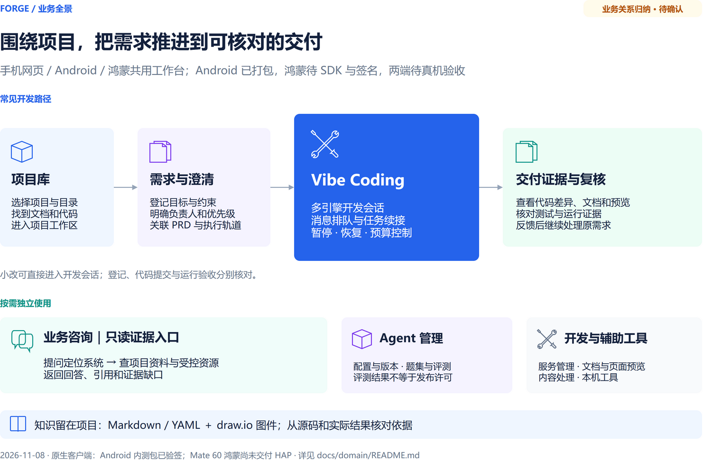

# Forge 业务知识与全景

Forge 把项目、需求、AI 会话和交付证据放在同一个工作台，支持在手机上发起与跟进、在电脑上深入处理。产品定位沿用[项目介绍](../../README.md)，工程分工沿用[AI 编程架构](../ai-coding-architecture.md)；各模块细节继续维护原文。

本页依据 2026-11-07 的项目文档和源码整理。**能力入口已核对；跨模块业务关系为归纳，标为待确认，不代表已部署或已通过业务验收。**迁入条目的原 ID、证据和草稿状态保留，旧 `stable` 不自动视为业务已确认。

[编辑 draw.io 源图](../diagrams/Forge业务全景图.drawio)。图展示一条常见开发路径，咨询与辅助能力可独立使用；小改也可直接进入开发会话。

## 主要能力与原文

| 能力 | 用户可以完成什么 | 继续阅读 |
|---|---|---|
| 项目库 | 找到项目和目录，进入同一项目的 AI 工作区、会话与代码审阅 | [项目库说明](../../frontend/src/features/project-workspace/README.md) |
| AI 交付中心 | 登记需求、澄清目标，按项目跟进执行轨道与交付证据 | [交付中心说明](../../frontend/src/features/reqpool/README.md) |
| Vibe Coding | 在绑定项目的会话中交给编码引擎处理，排队、续接、暂停并查看成果 | [会话说明](../../frontend/src/features/claude-chat/README.md) |
| 手机原生客户端（Android 已打包／鸿蒙待 SDK 与签名，均未真机验收） | Android WebView／鸿蒙 ArkWeb 复用同一工作台，接入系统文件选择、复制及卡片分享；主机继续执行 Agent | [手机客户端工程与状态](../../mobile/README.md) |
| 业务系统咨询 | 根据问题定位业务系统，从授权项目和受控资源读取依据，保存回答与引用 | [咨询说明](../../tools/tool-fore-consult/README.md) |
| Agent 管理与评测 | 管理 Agent 配置、版本、题集及评测结果，查看历史对比 | [Agent 管理](../../frontend/src/features/agent-management/README.md) |
| 项目开发与辅助工具 | 管理开发服务；按需预览文档和页面、处理内容、使用本机工具 | [项目开发](../../frontend/src/features/project-development/README.md)、[文档预览](../../frontend/src/features/doc-viewer/README.md)、[本机工具](../../frontend/src/features/local-tools/README.md) |

## 业务对象与关键边界

- **项目**确定工作目录和证据范围；**需求**记录目标、负责人及进度；**会话**承载与 AI 的持续交流；**交付证据**用于核对实际完成情况。这是业务归纳，待确认；对象定义分别复用[项目库](../../frontend/src/features/project-workspace/README.md)、[需求结构](../../tools/tool-reqpool/src/main/java/com/exceptioncoder/toolbox/reqpool/domain/ReqItem.java)和[会话概念](claude-chat/kai-toolbox-claude-chat-session-concept.md)。
- **需求与 PRD 通过关联字段连接。**已关联的 PRD 不重复显示；多个真实需求关联同一 PRD 时保留各需求；未关联项仍可管理。展示整合不改变业务记录。[文档依据](../../frontend/src/features/reqpool/README.md)、[实现依据](../../frontend/src/features/reqpool/lib/unifiedDeliveryModel.ts)
- **咨询先定位授权项目，再读取证据。**当前源码从 `docs/INDEX.md`、`docs/domain/`、`openspec/specs/` 读取原文；无资料时保留缺口，不恢复公共知识仓。历史文档不当作当前 DDL，实时业务值仍需实际资源查询。[知识入口](../../sidecar/claude-agent/src/knowledgeQuery.ts)、[文件读取实现](../../sidecar/claude-agent/src/projectKnowledge.ts)
- **过程状态不能代替结果。**需求登记、会话完成、代码提交与运行验收分别核对；Agent 的通用评测入口不自动证明某个候选版本可以发布。[交付中心](../../frontend/src/features/reqpool/README.md)、[评测边界](../../frontend/src/features/agent-management/README.md)

## 待确认与验证边界

| 待确认项 | 现有依据与缺口 |
|---|---|
| 哪些条件满足后才能认定需求交付完成 | 代码存在 `READY_FOR_RELEASE`、`DONE` 等需求状态，但状态名称不能证明生产验收已完成；需业务明确最终完成口径 |
| 项目知识查询是否已在当前运行环境加载 | 新源码已使用项目原文；项目库旧说明已按源码纠正，本轮未重启 Forge、未做真实咨询联调 |
| 旧项目定位是否需要统一修订 | 根 Agent 文件仍写“单用户、无认证”，当前[前端登记](../../frontend/src/shell/featureRegistry.ts)已有访问约束、需求对象也关联用户；部署模式与对外定位待项目维护者确认 |

本次覆盖主要工作入口、需求/会话/证据关系和知识来源，不逐模块重新确认全部历史规则，也未连接数据库核对历史 DDL。确认某条业务规则后，只更新对应原文的依据和可信度。

## 后续怎么维护

本页是项目业务概览入口。业务能力或主流程变化时，更新受影响原文、本页及同源 draw.io/预览；正文与图一起随项目提交。代码事实采用定向检索、Git 和按需使用的 Graphify 核实；不维护公共知识正文副本。仅有样式或内部性能变化时不扩写业务知识。

以下资料于 2026-11-07 迁入，迁移不代表重新确认；已有设计或 OpenSpec 定义了同一主题时，以原文为主。

## 按业务查找

- [account-admin/](account-admin/)：该模块术语、规则、状态与流程。
- [ai-chat/](ai-chat/)：该模块术语、规则、状态与流程。
- [ai-secretary/](ai-secretary/)：该模块术语、规则、状态与流程。
- [browser-request/](browser-request/)：该模块术语、规则、状态与流程。
- [claude-chat/](claude-chat/)：该模块术语、规则、状态与流程。
- [config-center/](config-center/)：该模块术语、规则、状态与流程。
- [downloader/](downloader/)：该模块术语、规则、状态与流程。
- [ffmpeg-lab/](ffmpeg-lab/)：该模块术语、规则、状态与流程。
- [lan-share/](lan-share/)：该模块术语、规则、状态与流程。
- [llm-monitor/](llm-monitor/)：该模块术语、规则、状态与流程。
- [magnet/](magnet/)：该模块术语、规则、状态与流程。
- [mail/](mail/)：该模块术语、规则、状态与流程。
- [media-parser/](media-parser/)：该模块术语、规则、状态与流程。
- [new-devmodule/](new-devmodule/)：该模块术语、规则、状态与流程。
- [prd-clarify/](prd-clarify/)：该模块术语、规则、状态与流程。
- [reqpool/](reqpool/)：该模块术语、规则、状态与流程。
- [task-center/](task-center/)：该模块术语、规则、状态与流程。
- [treesize/](treesize/)：该模块术语、规则、状态与流程。
- [video-condense/](video-condense/)：该模块术语、规则、状态与流程。
- [video-library/](video-library/)：该模块术语、规则、状态与流程。
- [visitor-analysis/](visitor-analysis/)：该模块术语、规则、状态与流程。
- [welfare-sign-demo/](welfare-sign-demo/)：该模块术语、规则、状态与流程。
- [workline/](workline/)：该模块术语、规则、状态与流程。

## 实现参考

- [impl/](impl/)：迁入的模块导航、DDL 及候选证据。它们是有来源日期的快照，不创建第二套手工代码索引；后续代码关系用定向源码、Git 和按需采用的 Graphify，表结构用项目迁移和实际 Schema。
- 已有 OpenSpec/设计是同主题的权威正文时，只保留链接，不重复抄写规则。
- 新知识优先更新现有主题；仅出现真实内容才新增文档。
