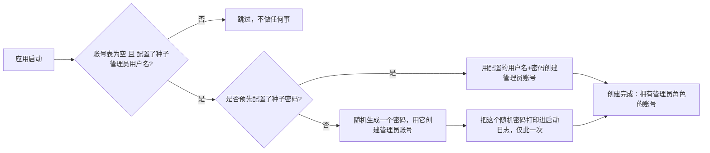

> ⚠️ 草拟骨架：内容为占位，**必须由该模块业务 owner 用真实口径替换后再改 stability: stable**。

## 业务定义

kai-toolbox 是一个需要"至少有一个管理员账号"才能进行账号管理的系统——但系统刚部署好的时候，账号表是空的，没有任何人能登录去创建第一个管理员，这是个先有鸡还是先有蛋的问题。为解决这个"冷启动"问题，系统在启动时会走下面这套流程：

业务规则要点：
1. 只有在"账号表完全为空"的前提下才会触发，一旦系统里已经有任意一个账号（不管是不是管理员），这套流程就永远不会再执行——它只解决"从 0 到 1"的问题，不是一个持续生效的兜底机制。
2. 触发还需要显式配置了"种子管理员用户名"，不配置这个用户名，即使账号表为空也不会自动建号（避免无人知情地被自动建出一个默认账号，成为安全隐患）。
3. 新建出来的种子账号同时拥有管理员角色和普通用户角色，具备完整管理权限。
4. 密码来源二选一：运维/部署方可以预先把密码也配置好（此时日志只提示"密码取自配置"，不打印明文）；如果没预配置，系统会随机生成一个密码并在日志里完整打印一次——这是获取初始密码的唯一途径，此后无法再从日志或界面找回，只能用这个密码登录后自行改密，或者由 owner 走"重置密码"流程。

## 适用范围 / 边界

- 成立范围：全新部署、账号表为空、且部署方主动配置了种子管理员用户名的场景。
- 不适用：已经运行过一段时间、账号表非空的系统——不会重复触发，也不会因为"不小心把所有管理员都删了"而自动补一个回来（那种情况需要运维手动介入）。
- 特例：如果只配置了用户名没配置密码，随机密码只会打印一次，运维/部署方必须在那一次启动日志里拿到它，错过了就只能通过其他手段（如直接操作数据库）恢复访问。

## 备注

口径来源：kai-toolbox 代码调研起草，待 owner 核实。
