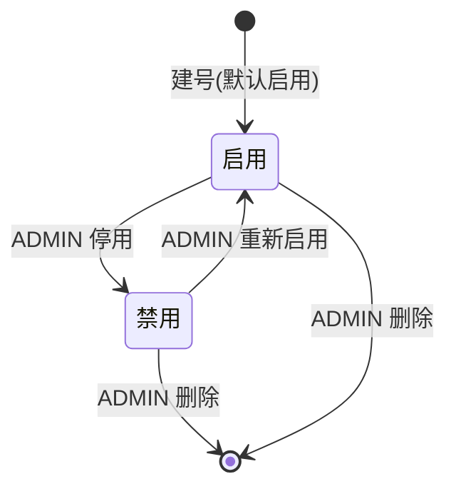

> ⚠️ 草拟骨架：内容为占位，**必须由该模块业务 owner 用真实口径替换后再改 stability: stable**。

## 业务定义

账号有两个状态：**启用**、**禁用**。这是账号自身的"能不能登录"的开关，与"密码对不对""角色是什么"是两件事。

状态语义：
- **启用**：账号可以正常登录、正常使用已签发的会话。
- **禁用**：即使密码正确也拒绝登录；已经登录的会话不会立刻断线，但下一次会话过期刷新时会被拒绝（因为禁用动作会连带吊销该账号所有未过期的登录凭证，见下）。

触发条件与连带效应（这是本条的核心业务规则）：**只要账号发生下面任意一类变更，该账号此前签发的所有登录会话立即作废，必须重新登录**：
1. 该账号被禁用；
2. 该账号的角色被调整；
3. 该账号密码被管理员重置；
4. 用户自己修改了密码。

这条"变更即吊销旧会话"的规则背后的业务含义是：权限/身份相关的改动必须立即生效，不允许旧会话在变更之后还能用旧权限继续操作一段时间。

登录失败时的对外语义：账号不存在、密码错误、账号被禁用，这三种失败原因对外返回的提示会做一定程度的模糊化（不精确区分"账号不存在"和"密码错误"，防止被用来枚举有效用户名），但"账号被禁用"通常会给出更明确的提示，因为此时用户名密码已验证正确，只是账号状态不允许登录。

## 适用范围 / 边界

- 成立范围：所有通过账号管理体系登录的场景（无论是普通用户还是 ADMIN 自己）。
- 不适用：不涉及"临时锁定"（如连续输错密码触发的自动锁定）这种由系统自动触发、自动解锁的状态——当前只有"启用/禁用"这一个由管理员手动扭转的二态开关，没有第三种"临时锁定"状态。
- 特例：ADMIN 不能对自己账号做禁用/删除（见配套的"自我保护"规则条目），因此"禁用导致自己被踢下线"这种情况理论上不会发生在操作者本人身上。

## 备注

口径来源：kai-toolbox 代码调研起草，待 owner 核实。
