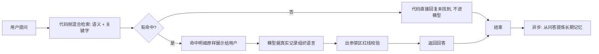

> ⚠️ 草拟骨架：内容为占位，**必须由该模块业务 owner 用真实口径替换后再改 stability: stable**。

## 业务定义

阶段说明：

1. 用户提出问题。
2. 代码侧做混合检索：同时跑"语义相似检索"（问题转向量、在向量库里找最相似的历史记录，只保留达到最低相似度的结果；仅在开启向量能力时使用）与"关键字精确检索"（始终可用，专抓文本中的专有名词/数字类关键词做精确匹配，用于补语义检索容易漏掉的专名，也是向量能力关闭时唯一的检索路径）。两路结果按记录去重合并：语义命中排在前面（按相似度降序），关键字独有的命中追加在后面；两路都命中同一条记录时标注为"双路命中"。
3. 检索到的真实命中记录明细，原样展示给用户，让用户能看到"依据了哪些真实记录"，不经过模型转述。
4. **零命中**：两路检索都没有命中时，代码直接回复"没有找到相关记录"，这句话不经过模型生成，从根源上避免没有依据时让模型胡编答案。
5. **有命中**：把检索到的真实记录连同用户的长期记忆背景一起注入模型，模型此时只负责基于这些真实材料组织一段自然语言回答，不再自行检索、不再调用别的工具。
6. **出参护栏**：模型给出的回答在下发给用户前，要经过一道"是否触碰用户禁区记忆"的红线校验（该校验能力尚在建设中，当前暂时直接放行）。
7. 回答结束后，异步把本次"问题 + 回答"交给长期记忆提炼流程，尝试提炼新的画像候选，不阻塞本次回忆的响应。

## 适用范围 / 边界

仅适用于"回忆态"问答场景；记录本身的写入走"记录态"独立流程（见 capture-flow）。语义检索路径依赖向量能力是否开启，未开启时自动退化为仅关键字检索，不影响"零命中兜底"与"出参护栏"这两条规则的生效。

## 备注

kai-toolbox 代码调研起草，待 owner 核实。
