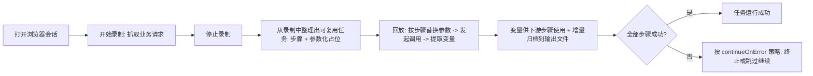

> ⚠️ 草拟骨架：内容为占位，**必须由该模块业务 owner 用真实口径替换后再改 stability: stable**。

## 业务定义

"站点录制编排"把一次业务操作从抓取到复用，划分为三个阶段：

1. **录制阶段**：在一个已打开的浏览器会话上开始录制，实时抓取该会话产生的网络请求。默认只抓业务接口类请求，而不抓页面文档/脚本类请求（体积大且对后续回放没有用处，可按需开启）。
2. **任务整理阶段**：从录制到的请求中挑选/整理出一个可复用的任务，任务由若干"步骤"组成，每个步骤对应一次 HTTP 调用；步骤里的 URL/请求头/请求体中可以标记"参数化占位"，回放时用真实参数替换。
3. **回放阶段**：给定任务的运行参数，按步骤顺序依次替换参数、发起真实调用、从响应中提取变量；提取出的变量可供后续步骤当参数使用，也会被增量归档保存到本地输出文件（每当"最后一步"成功产出一次结果，即立即落一个文件，不必等整个任务跑完）。若某步骤失败，按"是否允许失败继续"的策略决定整体终止还是跳过继续。

## 适用范围 / 边界

该流程针对"通过浏览器会话录制真实网络请求 → 整理为可参数化复用的任务"这一类场景。纯 UI 交互脚本（点击/输入/断言等 AI 用例）走的是另一条独立的"AI 用例生成 - 校验 - 执行"流程（见 flow-script-validation-rule），两者可以共享同一个浏览器会话，但业务模型不同，不要混淆。

## 备注

kai-toolbox 代码调研起草，待 owner 核实。
