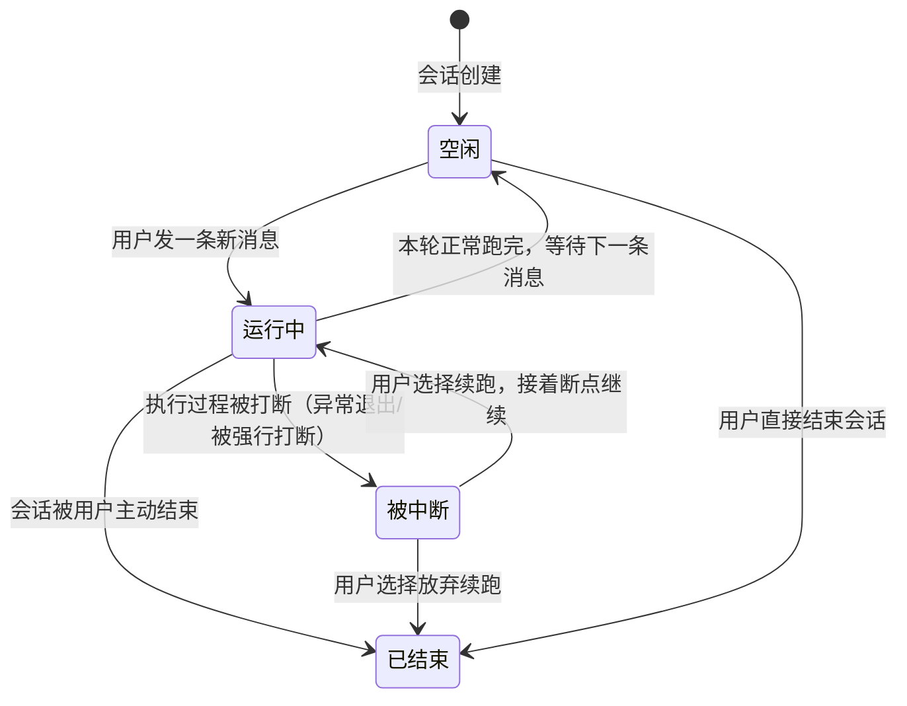

> ⚠️ 草拟骨架：内容为占位，**必须由该模块业务 owner 用真实口径替换后再改 stability: stable**。

## 业务定义

四个状态的业务语义：
- **运行中**：当前这一轮正在被 AI 处理，用户在等结果，此时不应该再发下一条消息打断它。
- **空闲**：AI 已经把这一轮跑完，安静等着用户看结果、决定下一步说什么。这是一个会话大部分时间所处的稳定态。
- **被中断**：这一轮执行没有正常跑完就意外断掉了（比如执行环境崩溃或被强行打断），但**这不等于会话报废**——它是一个可恢复的中间态，之前的对话历史和执行进度仍然保留，用户可以选择"续跑"接着刚才的断点继续，而不必从头重新说一遍需求。
- **已结束**：会话生命周期正常终止，不再接受新消息。

这套状态语义背后的业务取舍是：**AI 结对编程过程中途出问题是常态而非例外**（网络抖动、执行环境异常退出等），产品把"被中断"设计成一个一等公民的可续跑状态，而不是简单粗暴地让用户重新开一个会话、重新交代一遍上下文——这直接影响"用户丢失多少已投入的上下文"这件事，是会话体验的核心业务约束。

## 适用范围 / 边界

- 同样适用于 `claude-chat-stable`（Vibe Coding 稳定版）——复用同一套会话状态语义与后端。
- 这套状态描述的是"一次对话轮次的执行状态"，不要与"门控开发流程里的人工确认关卡"混淆——后者是前门模块（`erp-dev` 等）编排出的业务流程节点，属于另一条知识（门控开发工作台标准流程），不是本会话状态机的一部分。
- 特例：一个刚创建、从未发过消息的会话直接处于"空闲"，不经过"运行中"。

## 备注

- 口径来源：kai-toolbox 代码调研起草（会话状态枚举定义中对"被中断可续跑"的显式标注），待 owner 核实。
- 易混点：不要把"被中断"理解成失败态/错误态——它只是"暂停在半路，可以接着走"，与"已结束"是两回事；只有用户主动放弃续跑，被中断的会话才会走向已结束。
