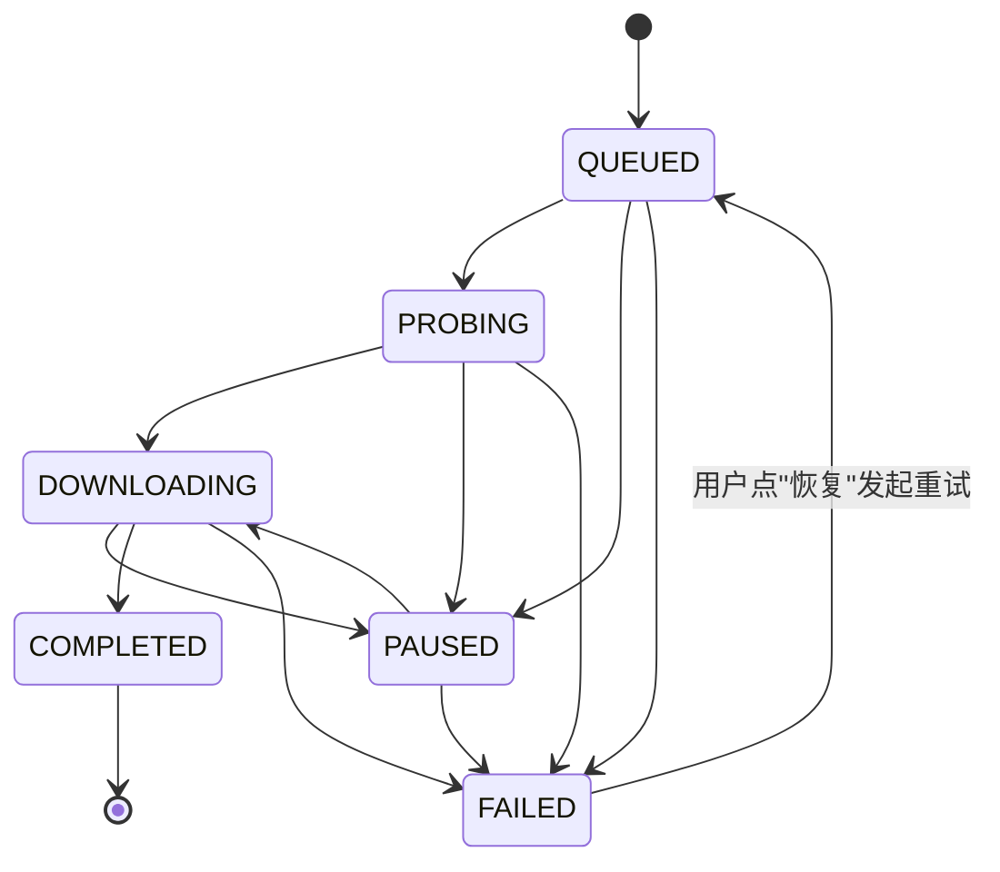

> ⚠️ 草拟骨架：内容为占位，**必须由该模块业务 owner 用真实口径替换后再改 stability: stable**。

## 业务定义

各状态语义：

- **QUEUED（排队）**：任务已创建，尚未开始探测链路。
- **PROBING（探测中）**：正在做"直连 vs 代理"链路 race，决定走哪条链路、任务总大小、是否支持分片下载。
- **DOWNLOADING（下载中）**：链路已决定，分片正在并行下载。
- **PAUSED（已暂停）**：用户主动暂停，或进程重启后系统自动把"探测中/下载中"的任务兜底置为暂停（避免僵死状态）。
- **COMPLETED（已完成）**：全部分片都下载完成，文件已落地，**终态，不可再离开**。
- **FAILED（已失败）**：至少一个分片穷尽重试仍失败、且此时已无分片在途（不会因为个别分片还没跑完就提前判失败）。

特殊转换的业务含义：

- **FAILED → QUEUED**：是本状态机里**唯一允许离开终态区**的转换，代表用户主动发起的"重试"这一业务动作（而非系统自动重试）。语义是"换一条链路重新来过"：所有未完成（非"已完成"）的分片会被重置为待下载、失败次数清零，任务回到排队态，重新走一遍探测→下载流程。
- **PAUSED → DOWNLOADING**：区分两种恢复路径——若暂停前已经决定过路由，直接按原主链路续跑（断点续传，只重新探测一次备用链路是否可用）；若暂停前还没探测出路由，则等价于重新走一次 QUEUED→PROBING→DOWNLOADING。

## 适用范围 / 边界

- **COMPLETED 是唯一真正的终态**：不允许任何转换离开。
- **FAILED 名义上是终态，但业务上留了"重试"出口**（FAILED → QUEUED），不要将其等同于订单类"作废后不可恢复"的终态语义。
- 单个分片的失败不直接把整体任务打成 FAILED：需要等所有分片都到达各自的终态（完成或失败）后，再由整体判定逻辑决定任务是 COMPLETED 还是 FAILED。

## 备注

口径来源：kai-toolbox 代码调研起草，待 owner 核实。
