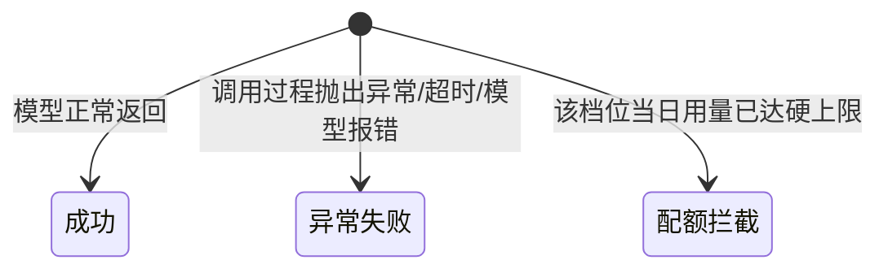

> ⚠️ 草拟骨架：内容为占位，**必须由该模块业务 owner 用真实口径替换后再改 stability: stable**。

## 业务定义

每一次对 LLM 发起的调用尝试，最终都会落成一条记录，记录的状态是以下三者之一（互斥、终态，一条记录一旦落定就不会再变）：

三种状态的业务语义区别：
- **成功**：调用正常完成，拿到了模型的回复，产生了真实的 token 消耗和成本。
- **异常失败**：调用确实发出去了，但因为网络、超时、模型服务报错等原因没有正常拿到结果。这种情况下系统内部通常会尝试换一个候选模型重试（故障转移），如果换过之后成功了，最终对外呈现为"成功"，只是内部经历过失败的尝试；如果换了所有候选都失败，才最终落成一条"异常失败"的记录。
- **配额拦截**：跟前两种有本质区别——这次调用请求**根本没有被发给任何模型**，是在发出去之前就被挡下来的，因为这个调用所在的档位当天已经用超了配额上限。这不是"调用失败"，而是"压根不让调用发生"。被拦截的这次尝试不会去尝试换其他候选模型顶替，因为整个档位（而不是某一个模型）的额度已经用完，换哪个模型都一样超额。

## 适用范围 / 边界

- 成立范围：所有经过监控记录的 LLM 调用尝试。
- 不适用：还在进行中、尚未有结果的调用不在这三态之内（只是还没落成记录，不是第四种状态）。
- 特例：一次"最终成功"的调用，中间可能包含过若干次对不同候选模型的失败尝试，但只要最后有一次成功，落地的记录状态就是"成功"，不会因为中间有失败尝试而记成异常失败——异常失败只属于"所有候选都试完了仍然没成功"的情况。

## 备注

口径来源：kai-toolbox 代码调研起草，待 owner 核实。
