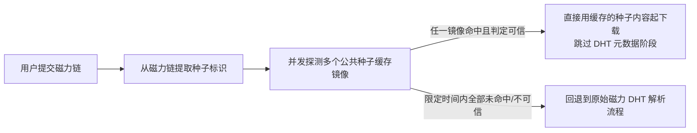

> ⚠️ 草拟骨架：内容为占位，**必须由该模块业务 owner 用真实口径替换后再改 stability: stable**。

## 业务定义

用户提交一个磁力链接（magnet）时，直接走 BT 协议的 DHT 网络去找元数据（metadata）通常要等 30～120 秒才能开始真正下载。为了提速，本工具在真正提交磁力任务之前，先尝试从"公共种子缓存"抄近道：

- **并发竞速**：同时向多个预置的公共种子缓存镜像发起探测，谁先返回可信结果就用谁，其余请求随即放弃，不等全部镜像应答完。
- **可信度判定标准**（决定"命中"是否可以被采信，而不是随便一个 200 响应就信）：响应必须成功返回、返回内容大小在合理范围内、且内容开头具备种子文件（.torrent）应有的格式特征。只要三者都满足才认定为"真种子"，否则视为该镜像未命中（例如镜像返回了错误页面或空内容，会被识别出来并丢弃，不会误当成种子用）。
- **兜底**：给整个竞速过程设置一个总体时间上限；如果在这个时间内所有镜像都没给出可信结果，任务照常退回到原始的磁力 DHT 解析流程，用户体验上等同于没有这道加速。这道加速只做"锦上添花"，不做"唯一路径"，不影响任务最终能否成功提交。

## 适用范围 / 边界

- 仅对磁力链接（`magnet:` 开头）生效；直接的 http(s)/ftp 直链任务不走这套缓存竞速逻辑，没有必要。
- 只影响"拿到种子元数据的速度"，不影响下载来源的真实性/内容安全性——种子缓存镜像返回的是元数据描述（文件名、大小、分片信息等），实际的下载数据仍然来自 BT 网络里的其他节点，缓存命中与否不改变最终下载内容本身。
- 若所有缓存镜像都不可用或全部未命中，功能自动降级为普通磁力任务，用户无感知、无需手动干预。

## 备注

- 口径来源：kai-toolbox 代码调研起草，待 owner 核实（缓存镜像清单、单镜像超时、总体超时等具体数值属于可调参数，非本条业务规则核心，此处不列出）。
- 易混点：这是"提交速度"的优化策略，不是"下载来源可信度"的内容审核策略——命中判定只是为了过滤掉明显不是种子文件的错误响应（如镜像挂了返回的错误页），并不对种子内容做安全/合规审查。
