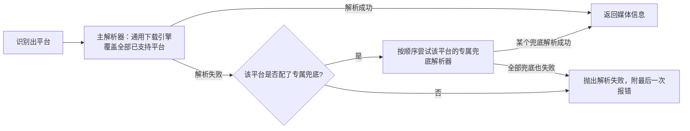

> ⚠️ 草拟骨架：内容为占位，**必须由该模块业务 owner 用真实口径替换后再改 stability: stable**。

## 业务定义

用户贴一条分享链接进来，媒体解析模块要做两件事：识别它属于哪个平台、用哪个（些）解析手段把可下载的媒体信息提取出来。这两件事各有一套业务规则：

**1）平台识别**：按链接中出现的域名关键字判断所属平台，覆盖 TikTok、抖音、Instagram、YouTube、Twitter/X、Reddit、Pinterest、Facebook、B 站、小红书等主流平台；域名不命中任何已知平台则归为"未知平台"，直接拒绝解析并提示当前支持的平台列表。

**2）解析降级链**：每个平台背后不是只有一个解析手段，而是一条"主解析器 → 平台专属兜底解析器"的链路，前者失败才逐个尝试后者：

- **主解析器**是通用的、对所有已支持平台都尝试的第一优先解析手段，优先级最高。
- **专属兜底**只在主解析器对该平台解析失败时才会启用，且因平台而异——不同平台的失败原因不同（例如国外平台的下载防护站点模式、国内短视频平台的前端渲染数据抓取模式各不相同），因此各平台配置的兜底解析器和兜底顺序是平台专属的，不能跨平台复用。
- 兜底链上若有多个候选，按预先设定的先后顺序逐个尝试，前一个失败才轮到下一个；全部试完仍失败才最终报错给用户。

## 适用范围 / 边界

- 仅覆盖"识别平台 + 决定用哪些解析手段、按什么顺序尝试"这一层业务规则，不覆盖具体某个解析手段内部如何抓取页面数据、如何规避反爬等实现细节。
- 平台清单、每个平台具体配了几层兜底、兜底解析器背后依赖的第三方站点，均可能随时间调整（第三方站点失效是常态），本条固化的是"存在降级链、按序尝试、主解析器优先覆盖全平台、兜底按平台专属配置"这套规则本身，不固化具体的平台/站点清单。
- 若某平台完全没有配置任何解析器（既无主解析器覆盖、也无专属兜底），视为不支持该平台，与"域名未识别到任何平台"是两种不同的失败：前者是"认识这个平台但没解析手段"，后者是"根本不认识这个平台"。

## 备注

- 口径来源：kai-toolbox 代码调研起草，待 owner 核实（具体平台清单与各平台兜底解析器数量/顺序会随第三方站点可用性变化，建议由 owner 定期核实是否仍准确）。
- 易混点：解析失败后的"降级到下一个兜底"和"域名识别失败直接拒绝"是两个不同阶段的事——前者发生在已经确定平台之后的解析执行阶段，后者发生在最开始的平台识别阶段。
