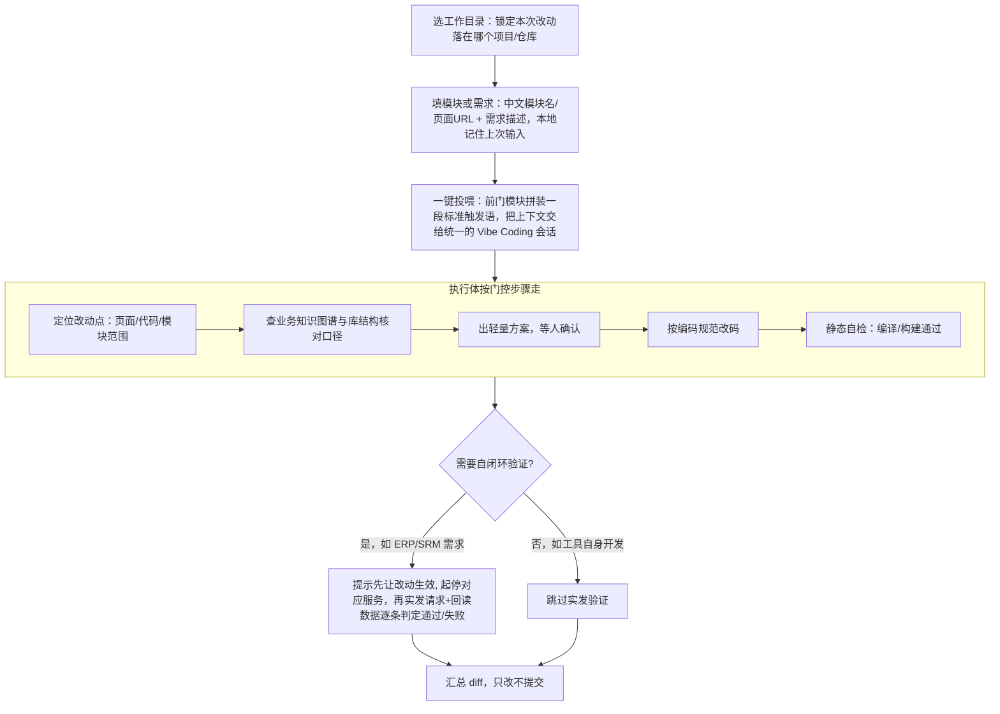

> ⚠️ 草拟骨架：内容为占位，**必须由该模块业务 owner 用真实口径替换后再改 stability: stable**。

## 业务定义

kai-toolbox 里"给某个项目做需求开发"这件事，被固定成一条**人机协作的门控流程**，而不是"AI 自己随便改"。核心思想：**前门模块只负责收集上下文、不跑 AI**；真正的执行与关卡确认统一收敛到同一个会话运行时里，保证不同项目的开发体验一致、且改动始终可被人拦下来。

流程里几个不因技术栈变化而变化的要点：
- **前门与执行分离**：各"XX 需求开发"模块只是入口（收集"在哪改、改什么、需求是什么"），不自己承载 AI 执行逻辑；执行统一发生在同一个会话运行时里，保证多个项目的开发体验一致、且能复用同一套关卡纪律。
- **每一步都有人工关卡**：命中范围、方案、DB/配置改动、"是否生效重启"这些节点必须停下来等人拍板，不允许无人值守地一路跑到底。
- **自闭环验证是"证明改动真的生效"的环节**：对接了业务系统（库/应用接口）的需求开发场景，要求先让改动生效（重启/重新构建），再用真实请求触达接口、用只读方式回读数据核对结果，而不是仅凭静态代码审查就算完成。
- **终态永远是"只改不提交出 diff"**：门控流程的产出是一份可审阅的改动清单，是否提交由人决定，流程本身不做提交动作。

## 适用范围 / 边界

- 同样适用于：`erp-dev`（ERP 需求开发）、`kai-dev`（kai-toolbox 自身开发）、`project-workspace`（项目工作台）、`srm-dev`（SRM 需求开发）——这几个模块都是该流程的"前门"实例，只是目标项目、需求输入形态（中文模块名/URL/路径）、是否具备自闭环验证能力不同。
- `new-devmodule`（新增系统需求开发模块）是这条流程的**生成入口**：它本身触发的是"生成一个新的门控前门模块"这件事，产出物即是又一个套用本流程的模块，因此本知识点挂在 `new-devmodule` 下最具代表性。
- 自闭环验证（"实发请求 + 只读回读判定"）只在对接了外部业务系统（如 ERP/SRM）的场景才有意义；纯工具自身开发（如 `kai-dev`）通常止步于静态自检 + 手动看服务日志，不强制要求实发接口验证。
- 不适用于：与"给项目做需求开发"无关的纯工具类模块（如格式化、下载器等），以及 `claude-chat`/`claude-chat-stable` 本身（它们是被投喂、承载执行与关卡确认的会话运行时，而非前门）。
- 若某次改动完全不涉及外部项目代码（比如纯粹的库连接测试、配置带入），不走本流程，是各前门模块里的独立辅助功能。

## 备注

- 口径来源：kai-toolbox 代码调研起草（`erp-dev`/`kai-dev`/`new-devmodule`/`project-workspace`/`srm-dev` 五个前门模块的页面交互 + 触发语拼装逻辑），待 owner 核实。
- 易混点：不要把"服务启停 + 看日志"本身当成这条流程的核心——那只是自闭环验证阶段"让改动生效"的一个支撑手段（通用的进程管理能力），核心是"前门收集上下文 → 统一执行 → 强制人工关卡 → (可选)验证 → 只改不提交"这条治理逻辑。
