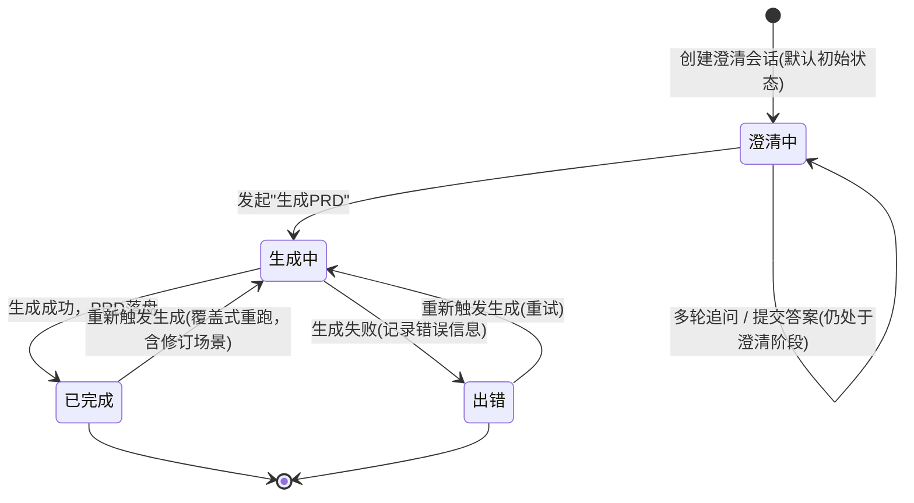

## 业务定义

- **澄清中**：会话刚创建时的默认状态，处于"逐轮向AI提问、用户作答"的阶段。多轮追问与提交答案都发生在这个状态内部，不产生新状态（追问轮次结构见同模块的"多轮渐进式澄清流程"）。
- **生成中**：用户认为澄清已充分、发起"生成PRD"后进入的过渡状态，代表AI正在生成PRD正文。
- **已完成**：PRD正文生成成功并落盘后的终态。
- **出错**：生成过程中失败后的终态，同时记录错误信息，便于定位失败原因。
- **触发条件的关键约束**：提交澄清答案这个动作，只允许在"澄清中"状态下执行——若会话已经进入生成中/已完成/出错，提交答案会被拒绝，防止对已经推进到后续阶段的会话追加答案造成状态混乱。
- **重新生成不受来源状态限制**：与"提交答案"不同，"发起生成PRD"这个动作本身没有来源状态限制——无论会话当前是澄清中、已完成还是出错，都可以再次触发生成（对应"重跑"或"基于修订说明重新生成"等场景），每次触发都会先进入生成中，再流向已完成或出错。

## 适用范围 / 边界

- 该状态机描述的是"一次PRD澄清会话"的整体阶段推进，不涉及多轮追问内部逐题的往返细节（那部分是流程结构，不是状态字段）。
- 不覆盖需求管理池（reqpool）里需求条目自身的状态流转——两者是不同模块的独立状态机，仅通过"关联PRD会话"这一层做单向的状态同步（PRD侧完成会推动需求侧状态前进），但状态语义与生命周期完全独立维护。
- 不覆盖"开发文档"的生成成功/失败（开发文档是PRD完成之后的衍生产出，其新鲜度用另一条规则型知识点判断，不占用本状态机的状态位）。

## 备注

- 口径来源：kai-toolbox 代码调研起草，待 owner 核实。
- 易混点：达到"已完成"或"出错"并不意味着流程彻底关闭——两者都允许再次触发生成回到"生成中"，"终态"只是相对当前一轮流程而言，不是不可逆的锁定状态。
