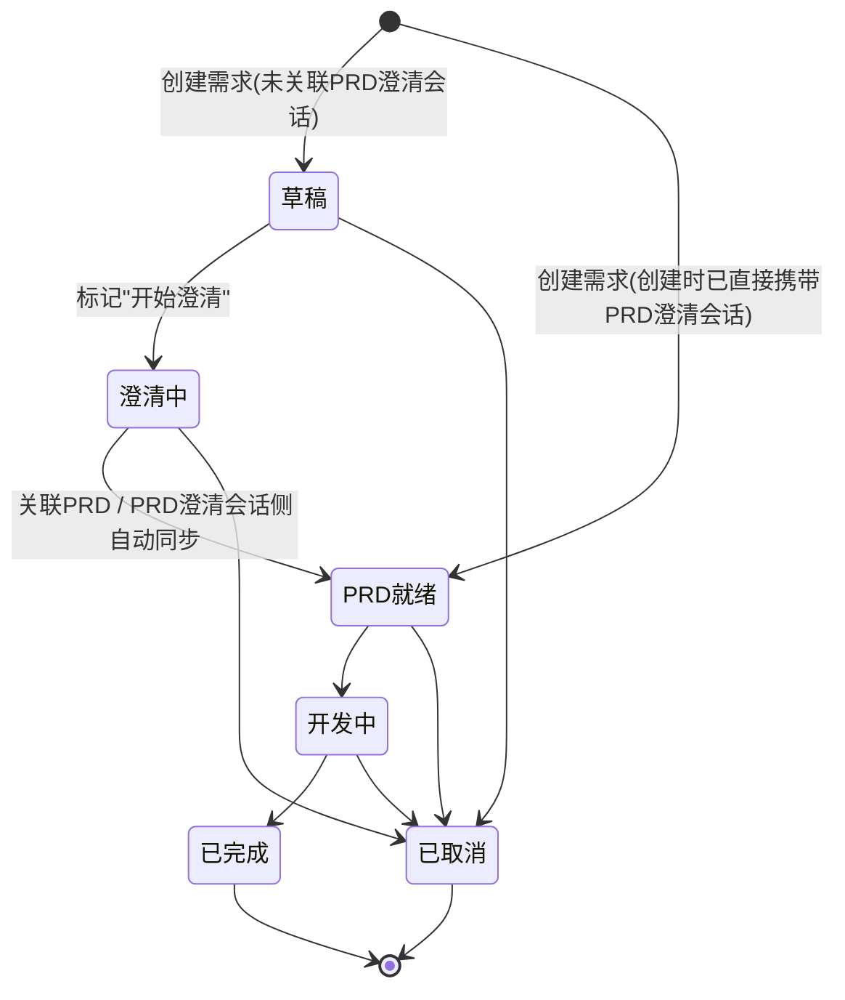

## 业务定义

- **草稿**：需求刚被提出、尚未进入澄清流程的初始状态（默认初始状态）。
- **澄清中**：已明确要对这条需求做PRD澄清，等待澄清完成。
- **PRD就绪**：已经关联上一份PRD澄清会话产出的PRD文档，具备进入开发的前提条件。
- **开发中 / 已完成**：需求进入实际开发、直至开发完成的阶段。
- **已取消**：需求在任意阶段都可以被标记为取消，是一个可以从多个状态直接进入的终态。
- **两条推进到"PRD就绪"的路径**：
  1. 用户在需求详情里手动"关联PRD"，把某个已完成的PRD澄清会话绑定到这条需求上，直接从"澄清中"推进到"PRD就绪"；
  2. 与PRD澄清助手之间存在自动同步：当某个PRD澄清会话完成PRD生成时，会自动把对应的需求条目同步为"PRD就绪"；若该PRD澄清会话仍处于"澄清中"，则对应需求条目同步为"澄清中"。该同步是幂等的——只有状态确实存在差异时才会更新，且若该PRD澄清会话在需求池里还没有对应的需求条目，会自动新建一条（用于"先在PRD澄清助手侧发起、后反向登记进需求池"的场景，此时创建时会跳过"草稿"直接落在"PRD就绪"或"澄清中"）。
- **"开发中"、"已完成"当前无专属的流转校验入口**：这两步流转（以及流转到"已取消"）目前是通过通用的需求编辑入口直接修改状态字段完成的，没有强制校验"只能从哪个状态流转过来"——也就是说，理论上可以直接把任意状态的需求改成"已完成"或"已取消"，不要求先经过前置状态。

## 适用范围 / 边界

- 该状态机描述的是需求管理池里单条需求条目自身的状态，不是PRD澄清会话（prd-clarify模块）自身的状态——两者是不同模块的独立状态机，仅通过"关联的PRD会话"做单向同步（PRD侧完成会推动需求侧状态前进）。
- "开发中/已完成/已取消"目前缺少强制的合法来源状态校验，这是当前口径的真实现状而非推测；后续若产品侧要补齐"批量状态变更+流转合法性校验"，需同步更新本条知识点。

## 备注

- 口径来源：kai-toolbox 代码调研起草，待 owner 核实。
- 易混点：需求创建时若直接携带了PRD澄清会话（说明是从PRD澄清助手侧发起后反向登记），会跳过"草稿"直接进入"PRD就绪"，不要误以为所有需求都必须经过"草稿→澄清中"这两步。
