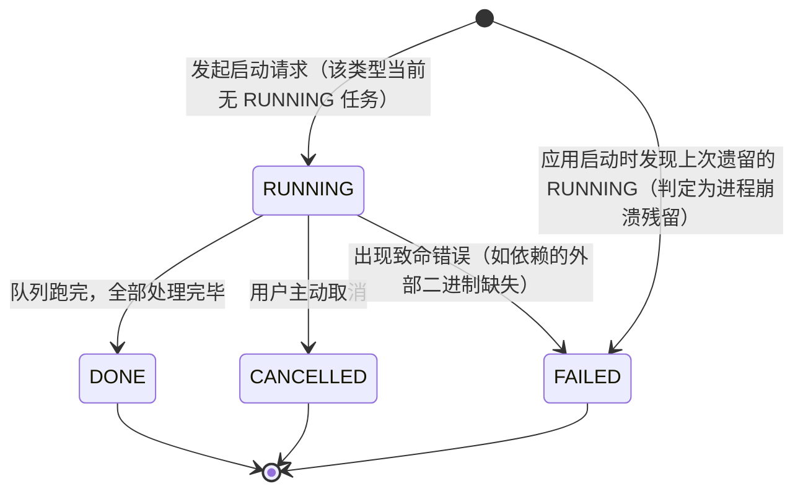

## 业务定义

- **任务类型（type）是互斥的最小单位**：任务中心里的每一类任务（时长探测 / 名称归类 / 语言识别 / 缩略图生成等）各自独立生命周期，但**同一类型同一时刻只允许存在一个 RUNNING 任务**——发起启动请求时，若该类型已有 RUNNING 任务，请求会被拒绝（业务上视为"任务已在跑，不重复起"），而不是排队或并发执行。
- **终态三选一**：一个 RUNNING 任务最终只会落到三种终态之一：
  - `DONE`：本轮待处理项全部处理完成（无论其中有多少条处理失败，只要循环正常跑完就是 DONE，不会因为个别失败退化为 FAILED）；
  - `CANCELLED`：用户在跑的过程中主动请求停止；
  - `FAILED`：处理过程中出现导致整个任务中断的致命错误（例如依赖的外部工具不存在），区别于"个别处理项失败但任务继续"。
- **崩溃恢复规则**：应用每次启动时，会把数据库里"上次遗留、状态仍是 RUNNING 但没有正常结束"的任务行，一次性判定为 FAILED。这是因为 RUNNING 状态只应该在应用存活期间存在——应用重启说明上一个 RUNNING 任务所在的进程已经不在了，不可能再自然流转到 DONE/CANCELLED，只能视为异常终止。这一步是为了避免"幽灵任务"永久占住互斥锁、导致该类型任务再也无法启动。
- **进度是任务的附属信息，不是状态**：任务生命周期内会持续汇报"已处理/总数"，但这只是 RUNNING 期间的进度展示，不改变状态机本身的三个终态判定逻辑。

## 适用范围 / 边界

- 该状态机描述的是"任务中心"承载的批处理型任务（对视频库批量做某种处理），不是任务中心里某一次具体处理项（如某一个视频）的状态——单个处理项的成功/失败只计入进度统计，不影响任务整体终态判断（除非是致命错误）。
- 互斥约束的粒度是"任务类型"，不同类型的任务可以同时并行跑（例如时长探测和名称归类可以同时 RUNNING），只有同类型才互斥。
- 崩溃恢复只在应用启动时执行一次，不是持续巡检；如果应用长期不重启，异常挂起的 RUNNING 任务不会被自动清理。

## 备注

- 口径来源：kai-toolbox 代码调研起草（task-center 复用 treesize 的视频处理任务调度机制），待 owner 核实。
- 易混点：DONE 不代表"全部处理项都成功"，只代表"任务正常跑完了整个队列"；单条失败会计入失败计数，但不会让任务整体状态变成 FAILED。
