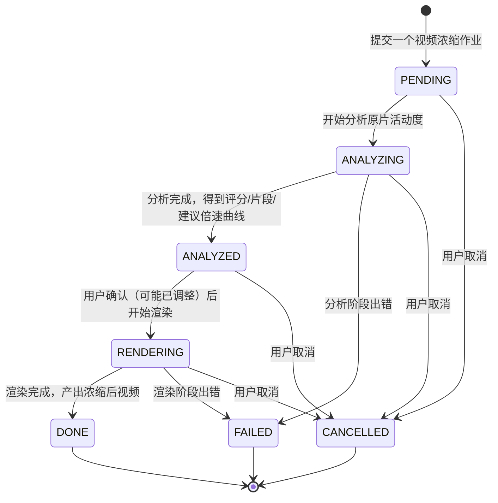

## 业务定义

- **两段式主流程**：一个浓缩作业先经过"分析"（探测原片活动度、切出片段、算出建议倍速曲线），再经过"渲染"（按倍速曲线真正生成浓缩后的视频文件）。`ANALYZED` 是两阶段之间的中间态，代表"分析已完成、可以看到建议方案，但还没有实际生成产物"——用户可以在这个阶段查看/确认变速方案，再决定是否进入渲染。
- **终态三选一**：`DONE`（完整走完分析+渲染，产出成品）、`FAILED`（分析或渲染任一阶段出错中断）、`CANCELLED`（用户在流程中任意阶段主动取消）。三者互斥，一旦进入其一即结束整个作业生命周期。
- **失败/取消可能发生在任一非终态阶段**：`PENDING`/`ANALYZING`/`ANALYZED`/`RENDERING` 都可能被用户取消；只有正在执行子进程的阶段（分析、渲染）会因执行出错而进入 `FAILED`。

## 适用范围 / 边界

- 该状态机描述的是"一次浓缩作业"的整体生命周期，不代表分析/渲染内部具体用了什么工具或算法。
- `ANALYZED` 是本流程特有的"方案确认点"——区别于很多批处理任务"跑完就是终态"的模式，这里用户有机会在拿到分析结果后再决定是否继续（甚至可能调整建议方案）才进入渲染，这一点是该状态机的业务特征，不能等同于普通的"处理中→完成"两态模型。
- 不涉及"一次分析/渲染内部有多少个子步骤"的细节，那属于实现层面。

## 备注

- 口径来源：kai-toolbox 代码调研起草（video-condense 浓缩作业状态机），待 owner 核实。
- 易混点：`ANALYZED` 不是终态，是流程中的一个可交互中间态；不要把它和 `DONE` 混淆——`ANALYZED` 只代表"有方案了"，`DONE` 才代表"成品视频已生成"。
