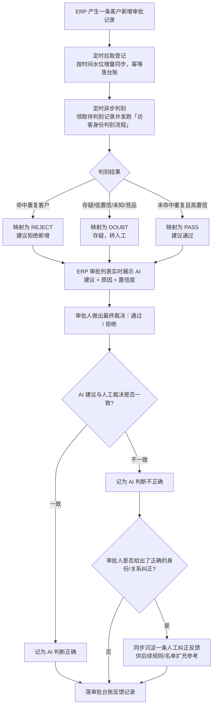

> ⚠️ 草拟骨架：内容为占位，**必须由该模块业务 owner 用真实口径替换后再改 stability: stable**。

## 业务定义

- **两段定时任务解耦**：一是"拉取登记"，按时间水位增量从 ERP 拉审批记录并幂等落库（不重复登记同一条）；二是"异步判别"，独立定时领取尚未判别完成的记录，并发跑访客身份判别核心流程。两者解耦意味着"登记"和"判别"可以有时间差，ERP 侧可能会先看到"暂无 AI 判定"，稍后才刷新出结果。
- **判别结果 → ERP 三态映射**：判别核心逻辑复用「访客身份判别流程」，得到内部的身份/是否重复客户/是否需人工复核等结论后，按以下规则映射成 ERP 好理解的三态：
  - **REJECT（建议拒绝）**：命中重复客户。
  - **DOUBT（存疑，转人工）**：需要人工复核、或身份判定为"未知"、或判定为"竞品"。
  - **PASS（建议通过）**：以上都不满足，即未命中重复客户且是高置信结论。
  - 判别尚未完成（进行中/失败/排队中）时，ERP 侧统一显示"暂无 AI 判定"，不会展示任何一种结论，避免用未完成的中间态误导审批人。
- **审批人是最终拍板者，AI 只是参考**：ERP 侧审批人做出的通过/拒绝决定才是最终业务动作，AI 的 PASS/REJECT/DOUBT 只是辅助参考，不会阻断或代替人工审批。
- **正确率反馈闭环**：审批人裁决后，系统会拿"AI 给出的建议方向"与"人工最终决定"做比对：
  - AI 给出明确的 PASS 或 REJECT 建议时才参与对错评判——AI 建议拒绝且人工也拒绝、或 AI 建议通过且人工也通过，记为"AI 判断正确"；两者相反则记为"AI 判断不正确"。
  - AI 结论是 DOUBT（存疑）或尚无判定时，不计入对错统计（视为"不算错"），因为 AI 本来就没有给出明确建议。
  - 当判定不正确、且审批人（或后续人工复核）给出了正确的身份/关系纠正时，这条纠正会额外沉淀成一条反馈记录，作为后续扩充竞品名单、调整判别规则的参考依据。

## 适用范围 / 边界

- 该闭环只服务于"ERP 客户新增审批"这一个业务入口，AI 判别核心逻辑与「访客身份判别流程」共用同一套判别引擎，本文档只描述"审批场景下的对接与反馈"部分，不重复判别本身的规则。
- ERP 侧只做"客观动作"的推送（通过/拒绝 + 备注 + 操作人），不需要、也不会自行判断 AI 对错——对错的比对逻辑完全在本工具侧完成。
- 正确率反馈只在 AI 给出明确 PASS/REJECT 建议时才有意义；DOUBT 状态下的人工裁决不参与 AI 准确率统计。
- 同一条审批记录可能存在多轮/多节点审批台账，回查时以最新一条为准。

## 备注

- 口径来源：kai-toolbox 代码调研起草（visitor-analysis 与 ERP 客户新增审批的联动逻辑），待 owner 核实 PASS/REJECT/DOUBT 的映射条件、以及"不计入对错统计"的存疑处理策略是否仍是当前生效口径。
- 易混点：REJECT/DOUBT/PASS 是 AI 给 ERP 的"建议"，不是审批结果本身；实际审批通过/拒绝的决定权始终在人工审批人手上，AI 从不代为拍板。
