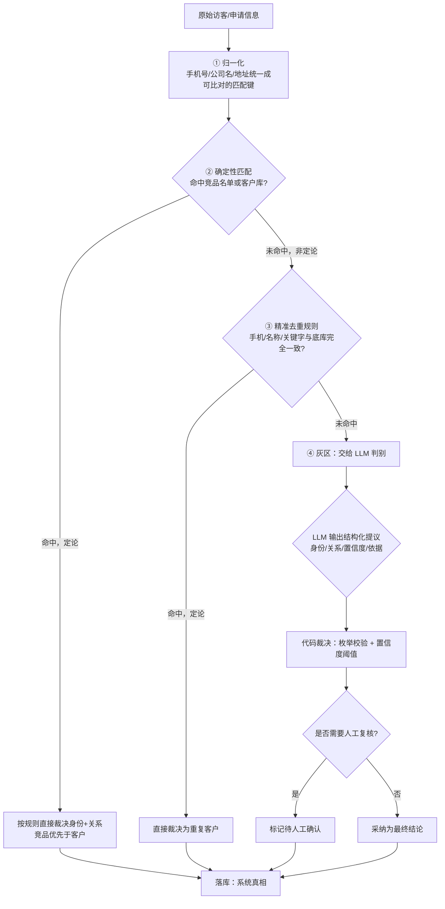

> ⚠️ 草拟骨架：内容为占位，**必须由该模块业务 owner 用真实口径替换后再改 stability: stable**。

## 业务定义

四层依次是：

1. **归一化**：把手机号、公司名、地址原始文本转成统一的匹配键（具体算法见「手机号/公司名/地址归一化算法」）。这一步只做标准化，不做任何身份判断。
2. **确定性匹配（命中即定论，不看 LLM）**：先查是否命中竞品名单，命中则直接裁决为"竞品"；未命中竞品再查是否命中客户库（含别名），命中则直接裁决为"客户"（并进一步区分是熟客还是流失客户）。命中竞品或客户库任一者，本轮判别到此为止，不再往下走。
3. **精准去重规则（命中即定论，不看 LLM）**：若前一层没有定论，再用手机号/公司名/关键字做一次"与底库完全一致"的精确比对，命中则直接裁决为"重复客户"，同样不需要 LLM 介入。
4. **灰区：LLM 判别兜底**：只有前三层都没能定论的申请，才会进入这一层——先做向量召回找历史相似记录辅助判断，再请 LLM 给出身份/关系/置信度/依据的结构化提议。

**贯穿全流程的裁决原则——"LLM 提议，代码裁决"**：无论灰区层 LLM 给出什么结果，都不会直接采纳：
- LLM 的输出会被当作不可信的"提议"，经过枚举合法性校验；
- 结合置信度是否达标（是否高于人工复核阈值）、身份是否为"无法识别"、以及企业数据增强是否处于降级状态，共同决定该结论是直接采纳还是转人工复核；
- LLM 调用失败或解析异常时，一律降级为"身份未知 + 待人工确认"，绝不让灰区判别的不确定性直接污染系统结论。

最终无论走到哪一层拿到结论，都会作为"系统真相"落库，供后续业务（如 ERP 审批联动）读取。

## 适用范围 / 边界

- 该流程适用于所有需要判定"这个访客/申请人到底是谁（竞品/客户/未知）、和公司关系如何（在用客户/流失客户/无关系）"的场景，包括访客登记、ERP 客户新增审批同步等入口，判别核心逻辑是同一套，只是触发来源不同。
- 前三层任一层命中即为"定论"，定论的判断不会再被后续层覆盖或送去给 LLM 复核——即使定论结果后续被证明有误，也是走人工反馈纠正（见 ERP 辅助判定闭环），而不是重跑判别流程。
- 只有走到第④层（灰区）才可能出现"待人工确认"的中间状态；前三层的结论均为高置信度直接结论。
- 判别结论只落"系统真相"表，不会自动写入向量召回底库——召回底库的更新是由人工维护的客户资料库经专门的同步动作灌入，避免不确定/判错的结论反向污染未来的召回参考。

## 备注

- 口径来源：kai-toolbox 代码调研起草（visitor-analysis 访客判别流程），待 owner 核实各层判定条件与降级策略的当前生效口径。
- 易混点：「确定性匹配」与「精准去重规则」都是"命中即定论、不经 LLM"的规则层，容易被误认为是一层；两者的区别是前者查的是竞品名单/客户库（含别名/模糊匹配），后者是与底库做"完全一致"的精确比对，触发条件和目的不同。
