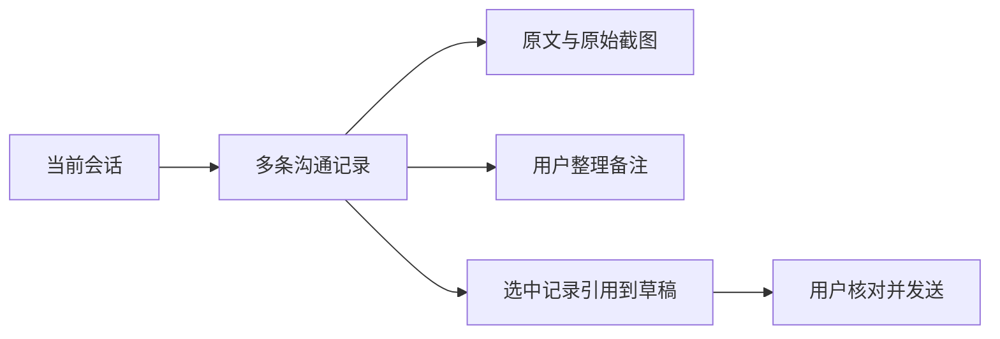

# 会话沟通流水设计

一期闭环：用户在当前开发会话保存多条沟通原文与截图，填写自己的整理备注，按时间回顾并将选中的资料引用到输入草稿。保存资料不启动模型，也不把沟通材料自动转换成已确认规格。

适用 OBJ-01、NAV-01、CTX-01、DENS-01、FEED-01、AI-01、EVID-01、CTRL-01、IDEM-01，无原则例外。唯一主对象为服务器会话 ID，每条流水有稳定 UUID；不新增全局会话列表。现有「更多」承载会话内稳定资料视图，新增和编辑使用单层弹窗，关闭及刷新保留按用户和会话隔离的 sessionStorage 草稿；存储不可用时提示仅在本页保留。窄屏先选记录再阅读，返回保留筛选；键盘操作、Esc 与关闭后焦点恢复沿用现有 Radix 组件。

记录保存主题、沟通时间、来源说明、参与人、来源链接、原文、备注、图片附件 ID、版本及创建/更新时间。会话最多 1000 条（含已移除），一页 20 条；每条原文及备注各最多 20000 字、PNG/JPEG/GIF/WebP 图片最多 10 个且合计 25 MiB，上传校验实际文件头。列表只读取摘要，详细原文按选中记录读取。搜索限定当前会话，以 SQLite 原生筛选和分页完成；不逐条查附件。图片归属批量校验，内容读取再次核对会话权限与记录关联；不接受客户端文件路径。

创建使用客户端稳定 UUID，超时重试同一 ID 和相同内容复用已保存结果。修改及移除/恢复校验版本，冲突提示重新读取，不静默覆盖。移除可恢复，不立即删除原文或图片；删除整个会话时清理记录。已过期会话只读。会话切换不显示旧请求或把迟到保存/上传结果写入新对象。

引用由用户显式选择，单次最多 5 条，保留记录 ID、回看链接、沟通时间、原文和「用户整理备注」的区别，图片使用已有输入附件通道；在草稿中核对后发送，不自动出队、发送或执行。沿用已有手动文本/附件上下文契约，不增加证据层或将沟通内容提升为 OpenSpec 权威，不调整 AI 编程架构契约。

DDL 预检 evidenceId `505b5d5e-772e-4d00-95da-d165dba51c94` 为 PARTIAL：知识库未包含新增表及既有附件表。DDL 未核验；新增结构按本项目 SQLite 设计，附件字段以仓库现有启动 schema 为实现证据，均需在真实 SQLite 临时库验证。启动 schema 使用幂等 CREATE，属于应用正常运行初始化，无人工待执行 SQL。

二期暂无已确认范围；实际出现跨会话复用、飞书自动同步或 OCR 整理需求时再设计。三期暂无已确认需求，不建设通用沟通平台或连接器。

已核对 [WAI 视图导航与键盘语义](https://www.w3.org/WAI/ARIA/apg/patterns/tabs/) 及 [MDN 文件拖放与选择文件替代入口](https://developer.mozilla.org/en-US/docs/Web/API/HTML_Drag_and_Drop_API/File_drag_and_drop)（2026-10-13）；沿用现有导航按钮语义，不将弹出菜单伪装成自动激活页签。
