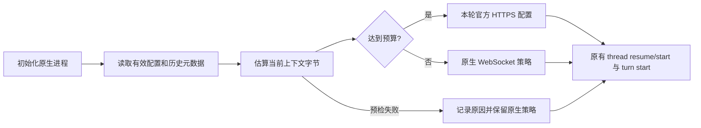

# 大上下文传输预检

## 原因与证据

2026-10-14 对 Forge 会话 `4a7f8d17-be72-4bac-adb4-a25182c26211` 的调查：

- 原生 thread `01a11459-32d7-7311-be97-8fa10cf7221e` 在 00:13:06、00:19:34、00:28:10 回退 HTTP。前两轮未压缩请求分别为 21,599,143 和 22,659,504 字节，回退后真实 HTTPS 响应为 200；不是只有端口探测成功。
- 读取最新 compaction 的 `replacement_history` 和后续 `response_item`，当时约 23.9 MB 的有效记录中约 22.9 MB 为图片 data URL。文件累计大小或 token 数不能代替消息字节数。
- 同一账号、端点与本机网络路径，合成 `generate:false` 请求不执行模型生成或工具：1 KB、4 MiB、8 MiB、10 MiB 请求完成；22 MB 请求返回关闭码 1009。将文本分段以避开单项长度校验后，16,776,369 字节正常 `response.completed`，16,778,401 字节没有任何响应事件即被 1009 关闭；均握手 101、协商 `permessage-deflate`。这支持本次链路约 16 MiB 的解压后消息限制，不能推广为所有提供商的公共规格。
- 上述边界复验的 TLS 均通过验证，证书为 `chatgpt.com`、签发者 Google Trust Services。本机存在 TUN 路由（远端显示为 198.18.0.144），但同一路由稳定承载阈值以下请求；不能把这次有明确 1009 边界的失败归为一般代理阻断。
- [原生 0.162.1 WebSocket 实现](https://github.com/openai/codex/blob/rust-v0.162.1/codex-rs/codex-api/src/endpoint/responses_websocket.rs) 收到 Close 时丢弃关闭码，仅报 `websocket closed by server before response.completed`。[客户端](https://github.com/openai/codex/blob/rust-v0.162.1/codex-rs/core/src/client.rs) 的回退状态属于进程内 ModelClient；Forge 每轮独立进程造成重复重试。

原始日志及脱敏探测结果保存在本机运行目录 `codex-transport-diagnosis-20261013-2338.json` 和本次隔离验证目录中，不提交账号、历史内容或日志数据库。现有证据指向消息体积；不把一般性代理故障作为本次根因。

## 实现

在已有 Sidecar JSON-RPC 适配层添加 `codexTransportPolicy.ts`，主消息与续问预测共用：

1. `config/read` 按 cwd 取得实际配置。仅处理内置官方 OpenAI 通道，第三方 provider/自定义端点保留原策略。
2. `thread/read` 仅取元数据；校验 rollout 的真实路径位于所选授权目录，并匹配 thread ID。倒序读取到最近一次 `replacement_history`，计入后续原生消息、当前输入的 UTF-8/图片 base64 字节及本轮配置。最多缓存 32 个文件的大小、mtime 和计数，不缓存内容；读中发生变更不采用不完整结果。旧式 compaction 没有替换历史时保守保留原计数。
3. 上下文达到 12 MiB 时选 HTTPS，为原生指令、工具 schema 和请求信封预留 4 MiB。该数值是保守预检预算，不是假称精确测量原生最终请求。小上下文保留 WebSocket；压缩后重新计算，不永久锁定账号或网络。
4. 原生 0.162.1 不允许覆盖内置 `openai` provider。按[官方 provider 配置契约](https://developers.openai.com/codex/config-reference) 在单次 RPC 配置中声明 `forge_openai_https`，保持 OpenAI 名称、原生鉴权、官方端点解析、版本和组织/项目头、搜索能力，仅关闭 Responses WebSocket。不写 config/auth，不调整普通流重试及任务时长。
5. 原生元数据会记录该运行时 provider ID，这是 SDK 契约的可见影响。隔离原生 CLI 实验确认 ID 不变、默认列表可见、下次不带覆盖仍可按 `openai` 恢复。显式只筛 `openai` 的外部客户端可能过滤该别名；Forge 的历史读取不使用该过滤。别名冲突时不覆盖用户配置。
6. 选择结果记录传输、原因、字节数；失败记录安全的错误摘要并保留原生处理，不伪称连接恢复，不重放轮次或吞掉后续模型错误。预测保持可选性及既有清理屏障。

## 验证与局限

集中执行 Sidecar 类型编译、策略/连续发送/预测/生命周期定向回归、原生 schema 检查及项目质量门禁；源码隔离快照排除其他任务未提交修改。无需前端构建或全仓 Java 测试，因为未改变这些载荷。合成上游实验不发送业务消息；原生配置实验使用独立空授权目录。

原生 HTTP 路由契约另用真实 0.162.1 CLI 和本机 SSE 测试端点验证：生产选择器生成运行时 provider 配置，仅在测试中把端点替换为 loopback 并使用虚拟凭据。两个全新原生进程连续恢复同一 thread，均完成轮次，累计 2 次 Responses HTTP 请求、0 次 WebSocket Upgrade。此结果证明配置实际生效，不代表生产服务已加载本次代码。

2026-10-14 本地验收：独立待提交源码快照的 TypeScript 编译及 58 项定向回归通过，0 失败、0 跳过；原生 schema 检查通过（11 个服务端请求方法），OpenSpec 严格校验通过。Forge 质量门禁 JSON 为 `PASSED`、退出码 0：`executedCheckers` 为空，不能声称执行了静态检查器；9 个已有 HTTP 场景通过，仅反映旧运行版本可用，不覆盖本次传输修复。尚未重启加载，真实受影响会话及 60 秒稳定验收待授权后执行。

只估算轮次开始时可见内容；执行中新增大工具输出、未知原生附加内容或连接在中途丢失，仍可能触发一次原生回退。不能宣称覆盖所有 WebSocket 错误。重启后须另验真实连续发送及至少 60 秒稳定性，未加载时不得标记运行验收通过。

回滚仅移除预检调用与策略，恢复原生传输；本变更没有改写历史或账号配置。既有临时 provider 记录可由下次默认原生 resume 恢复。进程所有权、终态、队列和工程上下文分层契约保持不变，无整体 AI 编程架构契约变更。
