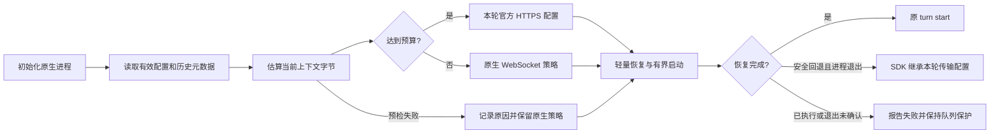

# 大上下文传输预检

## 原因与证据

2026-10-14 对 Forge 会话 `4a7f8d17-be72-4bac-adb4-a25182c26211` 的调查：

- 原生 thread `01a11459-32d7-7311-be97-8fa10cf7221e` 在 00:13:06、00:19:34、00:28:10 回退 HTTP。前两轮未压缩请求分别为 21,599,143 和 22,659,504 字节，回退后真实 HTTPS 响应为 200；不是只有端口探测成功。
- 读取最新 compaction 的 `replacement_history` 和后续 `response_item`，当时约 23.9 MB 的有效记录中约 22.9 MB 为图片 data URL。文件累计大小或 token 数不能代替消息字节数。
- 同一账号、端点与本机网络路径，合成 `generate:false` 请求不执行模型生成或工具：1 KB、4 MiB、8 MiB、10 MiB 请求完成；22 MB 请求返回关闭码 1009。将文本分段以避开单项长度校验后，16,776,369 字节正常 `response.completed`，16,778,401 字节没有任何响应事件即被 1009 关闭；均握手 101、协商 `permessage-deflate`。这支持本次链路约 16 MiB 的解压后消息限制，不能推广为所有提供商的公共规格。
- 上述边界复验的 TLS 均通过验证，证书为 `chatgpt.com`、签发者 Google Trust Services。本机存在 TUN 路由（远端显示为 198.18.0.144），但同一路由稳定承载阈值以下请求；不能把这次有明确 1009 边界的失败归为一般代理阻断。
- [原生 0.162.1 WebSocket 实现](https://github.com/openai/codex/blob/rust-v0.162.1/codex-rs/codex-api/src/endpoint/responses_websocket.rs) 收到 Close 时丢弃关闭码，仅报 `websocket closed by server before response.completed`。[客户端](https://github.com/openai/codex/blob/rust-v0.162.1/codex-rs/core/src/client.rs) 的回退状态属于进程内 ModelClient；Forge 每轮独立进程造成重复重试。

原始日志及脱敏探测结果保存在本机运行目录 `codex-transport-diagnosis-20261013-2338.json` 和本次隔离验证目录中，不提交账号、历史内容或日志数据库。现有证据指向消息体积；不把一般性代理故障作为本次根因。

## 实现

在已有 Sidecar JSON-RPC 适配层添加 `codexTransportPolicy.ts`，主消息、续问预测与 SDK 回退共用：

1. `config/read` 按 cwd 取得实际配置。仅处理内置官方 OpenAI 通道，第三方 provider/自定义端点保留原策略。
2. `thread/read` 仅取元数据；校验 rollout 的真实路径位于所选授权目录，并匹配 thread ID。倒序读取到最近一次 `replacement_history`，计入后续原生消息、当前输入的 UTF-8/图片 base64 字节及本轮配置。最多缓存 32 个文件的大小、mtime 和计数，不缓存内容；读中发生变更不采用不完整结果。旧式 compaction 没有替换历史时保守保留原计数。
3. 上下文达到 12 MiB 时选 HTTPS，为原生指令、工具 schema 和请求信封预留 4 MiB。该数值是保守预检预算，不是假称精确测量原生最终请求。小上下文保留 WebSocket；压缩后重新计算，不永久锁定账号或网络。
4. 原生 0.162.1 不允许覆盖内置 `openai` provider。按[官方 provider 配置契约](https://developers.openai.com/codex/config-reference) 声明 `forge_openai_https`，保持 OpenAI 名称、原生鉴权、官方端点解析、版本和组织/项目头、搜索能力，仅关闭 Responses WebSocket。不改默认 provider、账号凭据、普通流重试或任务时长。
5. 原生会把 provider ID 持久化到线程索引，ChatGPT 独立恢复时不会继承 Forge 单次 RPC 中的 provider 定义；这会形成 `Model provider forge_openai_https not found` 的悬空引用。Forge 因此在首次实际选择 HTTPS 时，通过官方 `config/batchWrite` 幂等登记完整定义，再执行线程。名称被用户占用或写入失败时不覆盖、不选择该别名，保留原生策略并记录预检失败。
6. 选择结果记录传输、原因、字节数；失败记录安全的错误摘要并保留原生处理，不伪称连接恢复，不重放轮次或吞掉后续模型错误。预测保持可选性及既有清理屏障。

### 会话恢复与 SDK 回退

2026-10-20 的日志核实了第二个断点：02:59:56 为原生 thread `01a0dde4-f122-7e50-b6a7-7fbf579d98e5` 选择 HTTPS，上下文估算 18,688,371 字节；约 03:00:17 转入 SDK。原生 App Server 的配置已是 `supports_websockets:false`，仍先在本地 stdio `thread/resume` 的 20 秒预算内未完成恢复。累计 rollout 约 987 MB 不等于单次网络请求；本次 SDK 断流没有记录关闭码，不能直接认定再次发生 1009。

- 主轮次、预测恢复和只需身份的分叉均传 `excludeTurns:true`，不向 Forge 返回完整轮次历史，也不删除模型的上下文。依据[官方恢复契约](https://learn.chatgpt.com/docs/app-server#start-or-resume-a-thread)及已安装 0.162.1 生成的 schema。
- `thread/start/resume/fork` 使用独立 120 秒上限；普通 RPC 保留 20 秒，预测保留其更短的整体可选任务上限。中断仍立即进入原清理流程，不等待恢复预算耗尽。
- 主执行器在恢复前交接本轮传输选择。符合原有 `retrySafe` 条件且原进程已退出时，SDK 使用独立客户端继承该配置；重新生成的当前安全约束优先，不把本轮选择放入共享客户端缓存。初始化阶段提前失败、还没有选择结果时，SDK 在执行前通过只读配置/历史元数据调用重新预检。自定义 provider、第三方网关和预检失败继续保留原策略，不强行覆盖。
- SDK 完成后获取分叉锚点，以及终态通知丢失时的对账，只调用 `thread/turns/list`，倒序取一轮且 `itemsView:notLoaded`，避免再次读取全部历史；对账必须匹配当前 turn ID，其他轮次完成不释放当前队列，不以空历史触发旧全量接口回退。
- 恢复 RPC 记录耗时、预算及 completed/failed/timeout。SDK 记录是否继承策略、配置选择和上下文估算；上游错误只记类别与明确出现的关闭码，没有关闭码时记录 `null`，不猜测 1009。日志不记录消息、图片、配置正文、密码或 Token；`native_policy` 不被当成实际 WSS 握手成功的证据。

适用产品原则：OBJ-01、CTX-01、FEED-01、AI-01、EVID-01、CTRL-01、IDEM-01。主对象仍为 Forge session 与所属 native thread；没有新增页面或权限入口，加载失败和结果未知保留原身份及草稿。已经接受、产生输出或副作用的轮次不因断流自动重放；取消和清理屏障优先。键盘、焦点和窄屏交互未变，本次验证协议与进程边界，不能替代真实手机网络验收。

## 验证与局限

集中执行 Sidecar 类型编译、策略/连续发送/预测/生命周期定向回归、原生 schema 检查及项目质量门禁；源码隔离快照排除其他任务未提交修改。无需前端构建或全仓 Java 测试，因为未改变这些载荷。合成上游实验不发送业务消息；原生配置实验使用独立空授权目录。

原生 HTTP 路由契约另用真实 0.162.1 CLI 和本机 SSE 测试端点验证：生产选择器生成运行时 provider 配置，仅在测试中把端点替换为 loopback 并使用虚拟凭据。两个全新原生进程连续恢复同一 thread，均完成轮次，累计 2 次 Responses HTTP 请求、0 次 WebSocket Upgrade。此结果证明配置实际生效，不代表生产服务已加载本次代码。

2026-10-14 本地验收：独立待提交源码快照的 TypeScript 编译及 58 项定向回归通过，0 失败、0 跳过；原生 schema 检查通过（11 个服务端请求方法），OpenSpec 严格校验通过。Forge 质量门禁 JSON 为 `PASSED`、退出码 0：`executedCheckers` 为空，不能声称执行了静态检查器；9 个已有 HTTP 场景通过，仅反映旧运行版本可用，不覆盖本次传输修复。尚未重启加载，真实受影响会话及 60 秒稳定验收待授权后执行。

只估算轮次开始时可见内容；执行中新增大工具输出、未知原生附加内容或连接在中途丢失，仍可能触发一次原生回退。不能宣称覆盖所有 WebSocket 错误。重启后须另验真实连续发送及至少 60 秒稳定性，未加载时不得标记运行验收通过。

2026-10-20 本次扩展验收：Sidecar 全源 TypeScript 编译通过；86 项定向测试通过，0 失败、0 跳过。真实 SDK 配合本地 exec 协议进程验证连续两个 HTTPS 回退客户端、小会话隔离、压缩后显式恢复 openai，以及新安全约束覆盖旧约束；本地 JSON-RPC 子进程验证轻量恢复、超过原 20 秒预算、恢复中取消、恢复失败后交接，以及终态通知丢失时有界对账和退出屏障。原生 0.162.1 schema 校验通过（11 个服务端请求方法，包含恢复/分叉/分页字段契约）；OpenSpec 严格校验及两份受影响文档的 25 个 Mermaid 代码块解析通过。Mermaid 首次在纯 Node 环境缺少 DOMPurify DOM，补用项目已有 jsdom 后解析成功，未改渲染依赖。

Forge 质量门禁 JSON 为 `PASSED`、退出码 0；`executedCheckers` 为空，不能将其当成额外静态扫描通过，静态证据来自上述类型、协议和规格检查。`executedVerifiers` 仅执行 9 个已有只读 HTTP 场景，均通过，属于当前旧运行版本的可用性证据；不证明本次源码已加载、当前真实 WSS 关闭码或公网大上下文已恢复。编译写入独立目录，未替换运行产物、调用模型或重启服务，任务 7 保持待确认和待运行验收。

2026-10-27 跨客户端恢复修复：确认用户三个 `config.toml` 均未定义 `forge_openai_https`，而 Codex 线程索引会保留自定义 provider ID；这与 ChatGPT 报 `Model provider forge_openai_https not found` 一致。通过 Codex 官方 `config/batchWrite` 补齐三个授权目录并用 `config/read` 回读确认。Sidecar 全源 TypeScript 编译及传输/生命周期 22 项定向测试通过，覆盖首次登记、重复使用、名称冲突和写入失败不返回悬空 provider；OpenSpec 严格校验通过。Forge 质量门禁为 `PASSED`，静态 `executedCheckers` 为空，运行部分仍是当前旧版本的 9 个只读 HTTP 场景。运行中的 Sidecar 仍是旧产物，未获重启授权，未执行目标版本运行验收。

回滚移除预检、轻量恢复/SDK 配置交接及 Forge 管理的兼容 provider 定义，恢复原适配器行为；本变更不改写原生历史或账号凭据。进程所有权、终态、队列和工程上下文分层契约保持不变；SDK 回退传输和恢复边界已同步整体 AI 编程架构说明。本次源码尚未加载，真实受影响会话、当前上游关闭码与稳定观察仍待运行验收。
