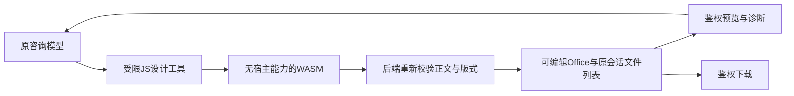

# 设计

## 当前闭环

模型通过 `design_consult_document` 提交纯JavaScript函数体和本次选择的数据。Sidecar在独立Worker内的QuickJS WASM解释器执行，不注入宿主函数、文件、网络、模块、环境变量或凭据。代码只返回正文与受限版式数据。解释器内存16MB、栈256KB、计算1.5秒，Worker硬超时5秒、同时最多2项；不启用Node vm，不放开原咨询终端或文件写权限。禁止时间和随机源，避免相同输入重试产生随机副本。

依据[QuickJS WASM官方嵌入与资源限制](https://github.com/justjake/quickjs-emscripten)（2026-10-15查阅）。这是语言能力隔离，不是可运行任意Python/Node代码的操作系统虚拟机；解释器/依赖漏洞仍属供应链边界。原生Windows下不假定Claude命令沙箱可用，见[官方限制](https://code.claude.com/docs/en/sandboxing)。

后端仍是唯一Office写入口，拒绝路径、外部资源和宏。新增有界layout：PPT 960×540画布内的文字、矩形、椭圆、直线，全部可编辑；Word的字号、层级色彩和横向纸张；Excel的列宽、数值格式、受限同表公式和原生柱/线/饼图。普通字符串永远不转成公式；公式不接受跨表、外链或任意函数，并在保存前实际计算拒绝错误。

生成工具自动读取首批预览，模型应检查后修改代码重生成。`preview_consult_document`只接受当前会话的文件ID和页码，PPT每次最多4页，可分批检查全部页面；Word/Excel是有明确说明的结构预览，不能当作Office最终分页或原生图表渲染。预览从已保存Office生成，不新增持久化图片，也不扩大文件写入范围。预览失败保留文件和恢复入口，不谎报已通过视觉检查。

下载和浏览器预览复用owner/admin校验；MCP预览复用绑定运行时的HMAC。生成修订按内容哈希新增，不覆盖旧版本；旧快速导出内容哈希序列化保持兼容。没有服务端新表或人工SQL。依赖、代码完成、运行加载和真实模型验收分开记录。

## 交互与产品原则

适用OBJ-01、CTX-01、DENS-01、FEED-01、AI-01、EVID-01、CTRL-01、IDEM-01，无例外。主对象仍是原咨询及内容哈希文档，不新建导航、Agent会话或数据事实库。原会话保存位置和下载行为不变，预览放在文件行按需展开，加载与失败可恢复，关闭不删除产物或清除输入草稿。键盘可展开、重试和翻页，窄屏图片不溢出；错误图片提供重新加载入口。

本期不引入任意脚本执行、网络素材下载、模板上传、外部分享或Office应用自动化。更自由的图片/模板/Python工具只有真实需求和隔离执行条件成立后再设计，不作为当前实现的隐含权限。
