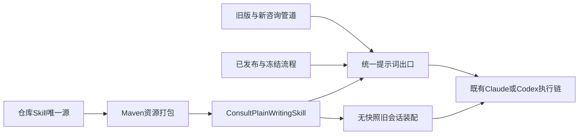

# 设计

## 边界与单一来源
适用AI-01、EVID-01、DENS-01、FEED-01：对象仍是原咨询会话，没有新导航或额外选项。默认业务表达、技术问题按需详细，由模型理解本轮意图，不新增关键词分类器；角色只提供上下文，不强制技术报告。

`.agents/skills/consult-plain-writing/SKILL.md`是唯一维护源，补充团队人话原则但不修改个人插件缓存。tool-fore-consult的Maven resources只复制这个明确列出的Skill到`fore-consult-skills`；运行时ClassPathResource读取随应用打包的内容，不读取用户目录、被咨询业务仓库或外部URL。该文件既可供仓库Agent发现，也作为受控运行指令。加载失败明确报装配错误，不静默遗漏。

## 装配与兼容
ConsultOrchestrationContext.renderPrompt在已有证据规则之后追加一次Skill，覆盖v1-v4与ConsultWorkflowService默认、已发布及冻结快照的渲染。内置v2/v4只引用Skill，不复制写作细则。旧流程保留原快照，末尾规则明确仅覆盖固定正文结构，不覆盖安全、证据、环境与机器识别协议。ConsultToolAssemblyProvider对无快照的旧会话追加相同Skill；有快照则沿用统一渲染，不重复装配。引擎中途直接沿用旧上下文且未重新装配的在途回答不承诺立即改变。

## 输出契约
默认一小段业务结论，答完就结束，不自动追加下一步/协助。用户明确要求、必须由用户动作才能继续或影响办理判断时再提供必要信息。通用规则、可能原因与实际单据事实分开，根因未确认在结论就地说明一次。没有查询数据库时，不因已配置DEV资源补充环境尾注；实际使用查询结果时仍保留真实资源/环境范围。技术追问保留实施精度，用户要求转交时协助写清角色、对象和事项；关键条件、风险、数值及用户修正保留，不硬截断或虚构完成。

统一规则及发送前自检只维护在Skill中。SDK FORGE候选沿用既有装配，逐条执行宪法且保留JSON字段、证据ID和三条数量。正文精简不改变既有证据留存/投影合同、只读权限或机器识别块；结构化建议整理仍保留原字段和任务。不新增后处理关键词替换、第二个模型评审调用或字数裁剪，也不回写旧问答。

## 验证范围
验证资源能从classpath读取，所有管道首次及追问装配一次，冻结节点及工具集不变，内部识别块保留，无快照旧会话也获得规则；宿主编译覆盖新增模块资源打包。模型写作效果具有不确定性，提示词断言不能冒充模型质量验收。部署后分别以截图日期异常、简单菜单操作、显式表字段问题和“给业务人员一句回复”的跨轮追问检查真实回答；不在本轮自行重启或伪称效果已验收。无新增交互，无焦点或键盘恢复变化。

2026-11-03 宪法强化按L2扩展原任务，不改变上述装配架构。基于用户提供的BOM、派料日期、打印及测试库咨询整理[验收案例](acceptance.md)，真实案例与边界变体分开，按结论准确性、行动可执行性、协助必要性/具体性及条件保留判定，不仅看字数。未运行的模型案例保留待验收状态。

同日截图反馈显示仍有重复来源/DEV尾注。源码定位发现默认节点输出合同强制列来源、环境和未验证项，v2/v4要求这些信息不得精简，v1还强制提供测试复现方法；运行装配末尾的数据库提示要求说明资源环境。原Skill只明确覆盖六段/双口径，未解决上述冲突。本次同时收敛这些默认表达要求，冻结旧节点不改库，由末尾当前Skill明确接管业务正文；数据库提示限定实际使用结果时说明真实范围，权限、可查环境及工具集保持不变。不做UI字符串截断或隐藏证据，不新增模型调用；实际服务加载版本及语义效果不能由截图或源码推定。

## 2026-11-12 反馈修正（L2）

本次只收敛既有表达Skill和v1优先反问提示，不改变组件职责、证据流、权限、机器合同或架构。Skill继续通过现有打包资源在默认与冻结流程末尾注入，覆盖后续首问/追问，不改写历史答案。加强：方向明确时在授权范围内继续有界核查；过程不进入业务正文；已确认结论不追加无证据的故障猜测；筛选生效不能推导筛选错误。具体ERP类型含义仅登记为有来源的验收输入，不写入通用Skill作为系统事实。效果必须真实模型回归，提示词装配测试不能证明语义达标。
