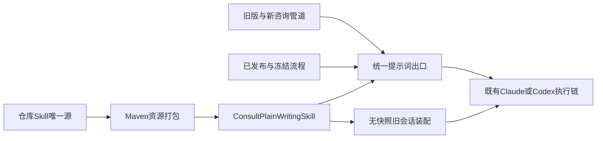

# 设计

## 边界与单一来源
适用AI-01、EVID-01、DENS-01、FEED-01：对象仍是原咨询会话，没有新导航或额外选项。默认业务表达、技术问题按需详细，由模型理解本轮意图，不新增关键词分类器；角色只提供上下文，不强制技术报告。

`.agents/skills/consult-plain-writing/SKILL.md`是唯一维护源，补充团队人话原则但不修改个人插件缓存。tool-fore-consult的Maven resources只复制这个明确列出的Skill到`fore-consult-skills`；运行时ClassPathResource读取随应用打包的内容，不读取用户目录、被咨询业务仓库或外部URL。该文件既可供仓库Agent发现，也作为受控运行指令。加载失败明确报装配错误，不静默遗漏。

## 装配与兼容
ConsultOrchestrationContext.renderPrompt在已有证据规则之后追加一次Skill，覆盖v1-v4与ConsultWorkflowService默认、已发布及冻结快照的渲染。内置v2/v4只引用Skill，不复制写作细则。旧流程保留原快照，末尾规则明确仅覆盖固定正文结构，不覆盖安全、证据、环境与机器识别协议。ConsultToolAssemblyProvider对无快照的旧会话追加相同Skill；有快照则沿用统一渲染，不重复装配。引擎中途直接沿用旧上下文且未重新装配的在途回答不承诺立即改变。

## 输出契约
默认先回答结论、原因、下一步；少量清楚段落即可。不因检索源码就暴露表名、内部证据标签和调用过程；明确请求技术取数、SQL或实施时保留必要精度，不额外询问是否展开。追问只补新增内容。环境、单号、数值、单位、风险和不确定性不得省略，识别块仍按原协议输出。Skill只影响表达，不重写事实、不做输出关键词替换，不扩大能力。

## 验证范围
验证资源能从classpath读取，所有管道首次及追问装配一次，冻结节点及工具集不变，内部识别块保留，无快照旧会话也获得规则；宿主编译覆盖新增模块资源打包。模型写作效果具有不确定性，提示词断言不能冒充模型质量验收。部署后分别以截图日期异常、简单菜单操作、显式表字段问题和“给业务人员一句回复”的跨轮追问检查真实回答；不在本轮自行重启或伪称效果已验收。无新增交互，无焦点或键盘恢复变化。
