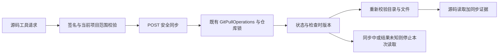

# 按授权项目同步，保留本地现场

适用原则：OBJ-01、AI-01、CTRL-01、IDEM-01、EVID-01、FEED-01。对象为既有咨询运行ID和ProjectCatalog项目ID；复用GitPullOperations及提供方共享仓库互斥，不新增项目或凭据配置。图谱约713MB超过查询工具512MB上限，当前实现事实由定向源码和测试核对。

1. MCP在source_context/source_read/source_search/source_git_history前，先核验项目身份，再POST签名的source-sync；GET路由保持只读。服务端重新核对当前目录、排除策略、会话候选与PENDING状态，禁止任意目录和已归档会话写入。
2. 同步只沿当前分支已配置的上游fetch，再按固定版本token调用既有ff-only能力。暂存区、工作树、未跟踪文件、分叉、detached HEAD、未完成整合或无上游由已有Git服务拒绝，不自动stash/reset/rebase。不是Git根目录不向父仓库更新。没有真实运行项目拉取或服务重启作为开发验证。
3. 同一规范目录五分钟复用检查结果；并发请求返回SYNCING，不进行重复fetch。完成后返回状态、分支、检查时提交和时间。Git原异常可能含凭据，不向模型透传；失败明确本地证据局限，允许继续已核验目录内的本地读取。传输超时/非成功状态或SYNCING属于结果未知，本次不读源码，避免与后台更新竞速；可重试查询既有结果。旧后端404明确降级为未部署同步能力，不宣称已更新。
4. 同步后再次核对路径与授权，包括新拉取内容中的符号链接；若项目路径变化，拒绝读取。模型看到同步检查证据，但不获得原始Git命令、远端URL、凭据或目录选择权。工具声明不再冒称完全无写副作用。
5. 更新源码不更新Graphify、System Profile或领域快照；这些仍按现有新鲜度规则判断，关键结论回到source_read。本地检查提交不证明生产版本。缓存检查也不证明检查后文件未变。

用户无需额外弹框；原会话、附件、草稿和资源绑定不变。验证使用真实本地Git仓库、HTTP签名、并发与MCP多根目录测试，不需要新增前端交互或浏览器验收。实际业务仓库网络/凭据及目标进程验收在授权部署后进行。

依据：2026-10-20核对Git官方[merge](https://git-scm.com/docs/git-merge)与[fetch](https://git-scm.com/docs/git-fetch)，实现复用项目现有固定版本安全快进，不改变其防覆盖规则。
