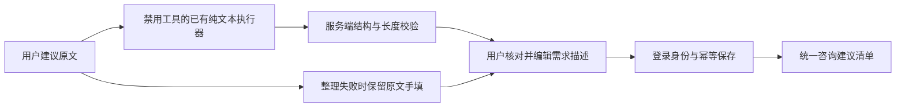

# 设计

## 对象与范围
适用OBJ-01、NAV-01、CTX-01、DENS-01、FEED-01、AI-01、EVID-01、CTRL-01、IDEM-01，无例外。对象是业务咨询平台的待评审建议，不是咨询问答评分、缺陷记录或已批准的开发任务。沿用咨询入口，不另开全局工作台；需求池的RequirementRegistrationPort仅登记待执行任务，当前不合适，不建立跨工具表查询或复制任务。

## 页面与状态
桌面画布右下显示232px轻量卡片，最新三条标题和总数；不与右上升级纸签重叠。普通用户与管理员都能进入，手机不悬浮卡片，从更多功能进入全宽抽屉。复用Sheet、主题token、焦点管理；单一内容区滚动，触控按钮至少44px，安全区padding保留。点击标题直接定位建议，关闭返回原触发器，手机菜单已消失时返回更多入口；咨询草稿与图谱位置不变。

反馈原文 -> 整理成需求描述 -> 可编辑标题/问题/期望/可选完成标准 -> 提交建议 -> 同一清单展示。明确说明清单对平台用户可见，不代表排期。首期所有记录均待评审，不实现排期、审批、投票、通知和自动开发。清单每页20条并可加载更多，不只截断固定数量。

加载、无记录、失败重试、整理失败手填、提交结果未知分别反馈；整理不写库，用户可检查AI表达是否准确。原文变化清除旧整理结果；运行中防重复并暂阻关闭。关闭及刷新保留当前用户草稿，浏览器存储失败时仅页面内保留；成功清空草稿。原文未保存到服务器前不宣称服务器已接收。

## 后端与数据
`GET /api/fore-consult/suggestions?offset=0`返回分页项目和总数；`POST /normalize`仅返回草稿，`POST /suggestions`保存。全部RequireAuth；作者从AuthContext获取，不信任客户端账号。consult_suggestion由本模块持有，保存user_id、request_id、原文、整理字段和创建时间；列表不暴露账号标识。启动时CREATE IF NOT EXISTS及索引幂等创建，无人工数据库步骤。

提交键为(user_id, request_id)，UUID由界面创建并随用户草稿保存。相同键及相同规范化内容返回原记录；同键不同内容返回409；不同用户相同键相互独立。输入编辑生成新键，断线重试原键。事务内INSERT ON CONFLICT与读取保证不会重复，所有SQL参数化，原文按纯文本显示。每项字段有长度限制，列表有上限及稳定次序。

## AI边界
复用AgentOneShotRunner.ExecutionRequest.text，固定TOOL_POLICY_DISABLED、cwd为空、codex引擎默认账号配置；无源码、数据库或外部操作能力。虚拟线程中调用，60秒有界等待，不自动反复重试。提示词要求仅依据原文，不编造优先级、负责人、日期或实现方案；复用consult-plain-writing受控Skill。输出必须是有界JSON对象，字段必须是字符串并经过服务端长度/必填校验。失败不保存虚构的整理结果，允许用户按保留原文手填并提交。提示词与接线测试不证明模型实际质量；真实模型整理待运行验收。

## 依据与验证
抽屉使用既有Radix Sheet，键盘及焦点恢复参考[WAI-ARIA Dialog](https://www.w3.org/WAI/ARIA/apg/patterns/dialog-modal/)（2026-10-22核对）。验证重点为登录拦截、服务端作者、原文保留、分页、相同提交重试与冲突、模型禁用工具及畸形输出、失败手填、草稿恢复、关闭保护。桌面和手机需实际浏览器检查，旧服务缺少新接口时只记录界面/失败态，不声称保存或模型整理运行成功；服务更新必须当次用户授权。
