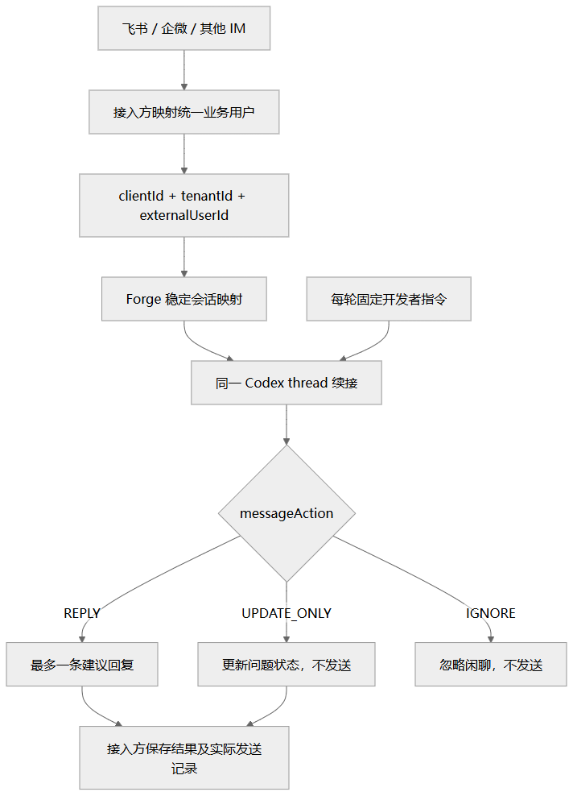
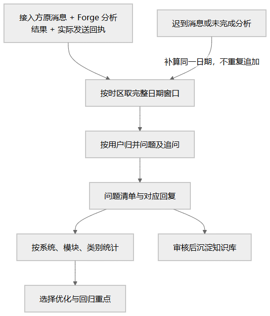

# 业务咨询 SDK：一个用户，一条持续答疑会话

ITCS 把同一业务用户的消息交给 Forge，业务追问沿用历史，闲聊不打扰。适用于后端 SDK 0.6.1 的 FORGE_FLEX 模式。

## 01 · 身份固定，问题接着聊



- 每条消息只必填 `tenantId`、`externalUserId`、`requestId`、`description`；`clientId` 来自应用凭据，无需重复传入。
- 规则由 Forge 每轮通过独立指令通道带入，用户原文不再追加模板。固定规则可以统一更新，不代表只发送或计费一次。
- 不传新参数，继续使用原来的无状态分析；开启后会持久保留任务与原生会话上下文。

## 02 · 接入时，先跑通一次追问

使用 `ForgeConsultBackendClient` 按用户串行提交；无需预先填写问题编号、来源会话编号或标题：

```ts
const task = await client.submit({
  tenantId: 'company-a',               // 必须匹配当前应用授权
  externalUserId: 'employee-123',      // 同一用户始终使用相同 ID
  requestId: 'feishu-message-002',      // 每条新消息使用独立、已保存的 ID
  description: '刚才那个手机入口叫什么？',
});
const saved = await client.get(task.taskId); // 查询到终态后处理 result
```

**成功标志：** 前后两轮的 `result.session.id` 相同，标题以 `-实施答疑` 结尾。仅 `REPLY` 进入现有回复流程，`UPDATE_ONLY / IGNORE` 不外发。

群聊来源、引用消息和时间可放入可选 `businessContext`；附件按原协议补充。`requestId` 用于防重复，不能省略。Forge 保存会话和分析结果；不传 `problemId` 不代表已经生成结构化问题台账。

**异常处理：** 超时先用 `find(requestId)` 查原任务；忙碌时等上一轮，不确定时核对原任务，不能换 ID 重发。完整初始化、字段与恢复规则见 [接口参考](EXTERNAL-USER-REFERENCE.md) 和 [后端协议](BACKEND.md)。

## 03 · 每天看问题清单，不数聊天条数



- 日终归并由 ITCS 后续实现；Forge 本次未新增定时任务。
- 按明确时区取 `[当天00:00,次日00:00)`，23:59:59 先整理，零点后补齐；同一问题的追问不重复算新增。
- 保存实际发送记录，区分建议回复与已发送回复；系统、模块不明时保留待确认，知识审核后再入库。

## 按需查阅

[身份、恢复与归并字段](EXTERNAL-USER-REFERENCE.md) · [完整后端协议](BACKEND.md) · [员工 WSS 通道](README.md) · [可编辑 draw.io 源图](diagrams/实施答疑与每日归并.drawio)

两张预览均由同一 draw.io 源图导出：第 1 页“持续答疑”、第 2 页“每日归并”。节点、文字和连线可编辑。

**交付状态：** 源码专项测试及原生三轮续接已验证；目标实例升级和完整 SDK 联调仍需单独验收。运行库 DDL 未核验，隔离 SQLite 已验证。详见 [实施记录](../../openspec/changes/consult-external-user-session/tasks.md)。
